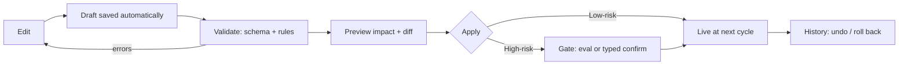

# BharatQuant Agents: UI/UX Development Guide

## Companion to Implementation Plan v3.11: Settings, Agent Lab, and In-App Testing and Refinement

| Field | Value |
|---|---|
| Owner | Abhishek Pathak |
| Version | 1.1 (companion document; applies to plan v3.11 and later) |
| Date | 26 Nov 2026 |
| Relationship to the plan | **Extends and partly replaces plan Section 7.4 (Pages).** The stack (7.1), performance techniques (7.2), dark theme tokens (7.3), Mac touches (7.5) and auth (7.6) stay as written in the plan. Where this guide and Section 7.4 disagree, this guide wins |
| Audience | Whoever builds the React frontend (you, or a coding agent working from this document) |

### Change log

| Version | Date | Change | Where it lands |
|---|---|---|---|
| 1.0 | 21 Nov 2026 | Target-state UI/UX guide: 7 groups, page anatomy, change workflow, settings, Agent Lab, testing workspace | Whole document |
| 1.1 | 26 Nov 2026 | Data and Schedules promoted to top-level tabs; Settings narrowed to four sub-tabs; Today reduced to a command center of linked summaries; sidebar regrouped into Daily / Analyze / Build / Operate / System; Opportunities and Schedules editors wired in | §3.1, §3.2, §6.2, §9, Implementation Status |

The earlier decisions in §2 (principles), §4 (page anatomy), §5 (change workflow), §7 (Agent Lab) and §8 (testing workspace) are unchanged. Where this log and an older paragraph disagree, the log wins.

---

## Table of Contents

1. [Purpose and Outcomes](#1-purpose-and-outcomes)
2. [UX Principles (Non-Negotiable)](#2-ux-principles-non-negotiable)
3. [Information Architecture and Navigation](#3-information-architecture-and-navigation)
4. [Page Anatomy and Shared Patterns](#4-page-anatomy-and-shared-patterns)
5. [The Change Workflow: Draft → Validate → Preview → Apply → Roll Back](#5-the-change-workflow-draft--validate--preview--apply--roll-back)
6. [Settings](#6-settings)
7. [Agent Lab: One Tab per Agent](#7-agent-lab-one-tab-per-agent)
8. [Testing and Refinement Workspace](#8-testing-and-refinement-workspace)
9. [Daily-Use Pages (Summary)](#9-daily-use-pages-summary)
10. [Component Library](#10-component-library)
11. [States: Loading, Empty, Error, Stale, Degraded](#11-states-loading-empty-error-stale-degraded)
12. [Writing Style for the UI](#12-writing-style-for-the-ui)
13. [Accessibility and Keyboard](#13-accessibility-and-keyboard)
14. [Frontend Architecture Rules](#14-frontend-architecture-rules)
15. [Backend API Needed by the UI](#15-backend-api-needed-by-the-ui)
16. [Testing the UI Itself](#16-testing-the-ui-itself)
17. [Build Order (Mapped to Plan Milestones)](#17-build-order-mapped-to-plan-milestones)
18. [Acceptance Checklist](#18-acceptance-checklist)
19. [Appendix: Screen Wireframes](#19-appendix-screen-wireframes)

---

## 1. Purpose and Outcomes

The UI has two jobs:

1. **Run the system day to day** with as little effort as possible: read the morning report, check suggestions, watch positions, read the evening accuracy report.
2. **Improve the system over time**: change any setting, pick a model for any task, set budgets, add API keys, and **tune, test and refine each sub-agent** without touching code or YAML files.

**Outcomes this guide must deliver:**

| # | Outcome | How it is measured |
|---|---|---|
| U1 | Every configurable value in the plan can be changed from the UI | Settings coverage test: every key in `config/` maps to a UI control or the Advanced editor |
| U2 | You can change the model for any LLM task in ≤ 3 clicks from anywhere | Playwright task timing; command palette action "Change model for…" |
| U3 | Every agent has its own tab where you can run it, inspect its input and output, edit its prompt, context and parameters, evaluate changes and promote them | Agent Lab exists for 100% of agents in plan Section 9.1 plus the v3.10 analysts |
| U4 | No change reaches the live system without validation, a preview of its effect and a way to undo it | Every write goes through the change workflow ([Section 5](#5-the-change-workflow-draft--validate--preview--apply--roll-back)) |
| U5 | Experiments never affect live trading, live memory or headline accuracy | Lab runs are tagged `purpose=playground` or `purpose=eval`; tests assert no orders, no memory writes |
| U6 | A first-time setup takes under 15 minutes | Setup wizard; timed walkthrough |
| U7 | The UI stays fast | Plan budgets: first load < 0.5 s, live update < 100 ms, 10k-row tables at 60 fps |

---

## 2. UX Principles (Non-Negotiable)

These rules apply to every screen. Each has a concrete "do this" so it can be checked in review.

| # | Principle | What it means in practice |
|---|---|---|
| P1 | **Today first** | The landing page answers "what do I need to know or do right now?" in one screen, without scrolling on a 1440 px display |
| P2 | **Progressive disclosure** | Show the 20% of controls used 80% of the time. Everything else sits behind **Advanced** toggles, drawers or the raw YAML editor. Never hide something that blocks a decision |
| P3 | **Safe by default** | Dangerous actions (kill switch, flatten, reset account, delete key, promote to live) need hold-to-confirm or typed confirmation. Experiments are sandboxed. Defaults match the plan's safe defaults |
| P4 | **Preview before apply** | Every change shows its effect before you save: token estimate, symbols added or removed, next run times, effective policy, a diff |
| P5 | **Everything is undoable** | Config is versioned (plan Section 3). Every saved change shows "Undo" for 30 s and stays in History with one-click rollback |
| P6 | **Explain every number** | Any confidence %, score, token count or P&L figure opens a drawer explaining where it came from: evidence, context manifest, ledger rows. Nothing is a black box |
| P7 | **One way to do a thing** | Each setting lives in exactly one place. Other pages link to it ("Change in Settings → Models") rather than duplicating the control |
| P8 | **Consistent page anatomy** | Every page uses the same header, tabs, action bar and drawer layout ([Section 4](#4-page-anatomy-and-shared-patterns)) |
| P9 | **Live but calm** | Data streams in without layout shift. Values flash briefly on change; nothing blinks continuously. Alerts are ranked so only critical ones interrupt |
| P10 | **Honest states** | Stale, delayed, provisional, degraded and estimated values are always labelled, never shown as if they were final |
| P11 | **Keyboard first, mouse friendly** | ⌘K reaches any page, setting, agent, symbol or action. Common actions have shortcuts |
| P12 | **Plain language** | Labels describe outcomes ("Use local model first"), not internals (`LOCAL_FIRST`). Internal names appear as secondary text for searching and debugging |

---

## 3. Information Architecture and Navigation

### 3.1 Top-Level Groups

The 21 pages in plan Section 7.4 are grouped into a left sidebar. The sidebar can be collapsed to icons. **Version 1.1 note:** the implemented sidebar uses five groups (Daily, Analyze, Build, Operate, System). Data and Schedules are now first-class tabs under Operate, and Today is a linked command center rather than a diagnostics dump. The broader target-state grouping below is preserved for the pages that are not built yet.

| Group | Pages | Purpose |
|---|---|---|
| **Daily** | Today (Command Center), Opportunities, Trade | Status, suggestions, act on ideas, manage paper positions |
| **Analyze** | Research, Technical, Reports | Read reports, news, dossiers and technical runs |
| **Build** | Strategies, Backtests, Agent Lab | Create and test strategies; run, tune and promote agents |
| **Operate** *(v1.1)* | Data, Schedules | Data readiness, snapshot freshness, calendar coverage, job catalogue and history |
| **System** | Settings, How to use | Change behaviour; read the in-app guide |
| **Observe** *(future)* | Agents timeline, LLM Usage, Analytics, Audit | See what happened and why; health and costs |
| **Settings** *(target-state)* | All configuration ([Section 6](#6-settings)) | Change how the system behaves; implemented as four sub-tabs |

In the implemented app, Settings has four sub-tabs: **Overview**, **Models & keys**, **Risk & execution**, and **Runtime & network**. Data (Section 6.2 #9) and Schedules (#10) left Settings for their own tabs; the Settings entries now describe what those tabs contain.

### 3.2 Route Map

```
/                              Today (Command Center)
/opportunities                 Opportunities (+ /:oppId drawer) — implemented as a top-level tab
/trade/desk                    Orders, positions, holdings, funds
/trade/approvals               Approval inbox
/trade/chart/:symbol           Chart workspace
/data                          Data readiness, snapshot freshness, calendar coverage (v1.1)
/schedules                     Job catalogue, schedule editor, wake decisions, job runs (v1.1)
/research/reports              Reports archive (+ /:date, /:reportId)
/research/feed                 News, YouTube, scanners
/research/value                Screener, dossiers (+ /:symbol)
/build/strategies              Library (+ /:id with tabs, Review with AI)
/build/backtests               Runs, sweeps, compare (+ /:runId)
/lab                           Agent Lab home (all agents, health, open experiments)
/lab/:agentId                  Agent tab (sub-tabs in Section 7.3)
/lab/:agentId/:subtab
/lab/evals                     Eval Center (all golden sets, runs, comparisons)
/lab/replay                    Replay and what-if
/lab/experiments               All experiments (shadow, A/B)
/observe/agents                Decision-cycle timeline (Gantt)
/observe/llm-usage             Token dashboard
/observe/analytics             Attribution, calibration, scorecards
/observe/audit/:id             Trade Explainer
/observe/system                Resources, logs, jobs, health
/settings                      Settings home (search + categories)
/settings/:section             Settings sections (Section 6.2)
/settings/history              All config changes, diff, rollback
/setup                         First-run wizard
```

Old routes from plan Section 7.4 (`/llm/routing`, `/llm/prompts`, `/risk`, `/accounts`) redirect to their new Settings or Agent Lab homes. `/data` and `/schedules` are no longer redirects: v1.1 promotes them to their own top-level tabs, while Settings keeps only a link to each.

### 3.3 Global Elements (Always Visible)

| Element | Location | Content |
|---|---|---|
| **Status strip** | Top bar | Market session (PRE-OPEN, OPEN, CAS, CLOSED) with countdown · data badge (LIVE, DELAYED ~Xm, EOD) · LLM health (DeepSeek, Gemini, Local) · free Gemini quota gauge · Auto-trading ON/OFF · **Kill switch** (hold to confirm) |
| **Mode banner** | Below the top bar, only when relevant | "Lab mode: this page runs experiments; nothing trades", "Degraded: DeepSeek unavailable, routing to Gemini", "Unsaved draft in Settings → Models" |
| **Command palette** | ⌘K | Pages, settings (searchable by label and internal key), agents, symbols, actions ("Run morning report now", "Change model for confidence.review", "Pause strategy…") |
| **Alerts tray** | Bell icon | Ranked: Critical (interrupts with a toast) · Warning · Info. Each alert links to the place to fix it |
| **Draft indicator** | Top bar | Count of unsaved drafts across Settings and Agent Lab; click to review all |

### 3.4 Navigation Rules

- Every entity (symbol, agent, task, strategy, report, order, LLM call, context manifest) has a **canonical link**. Clicking its name anywhere opens it.
- Drawers are used for detail views, so you never lose your place. Drawers have their own URL (`?drawer=opp:123`) and can be opened full-page.
- Back and forward always work; filters, sorting and tab choices are stored in the URL.
- **⌘1–⌘7** switch between the seven groups.

---

## 4. Page Anatomy and Shared Patterns

### 4.1 Standard Page Layout

```
┌──────────────────────────────────────────────────────────────────────────┐
│ Status strip (global)                                                     │
├────────┬─────────────────────────────────────────────────────────────────┤
│        │ Breadcrumb · Page title · status badges          [Primary action]│
│ Side-  │ Sub-tabs: Overview | … | History                  [⋯ more]       │
│ bar    ├─────────────────────────────────────────────┬───────────────────┤
│        │ Main content (cards, tables, charts)         │ Context panel     │
│        │                                              │ (optional, help,  │
│        │                                              │ preview, diff)    │
│        ├─────────────────────────────────────────────┴───────────────────┤
│        │ Sticky action bar (only when editing): Discard · Validate · Save │
└────────┴─────────────────────────────────────────────────────────────────┘
```

- **One primary action** per page, top right (for example "Run now", "New strategy", "Save changes").
- **Context panel** (right, resizable, collapsible) shows help, live preview, diff or the "explain" drawer.
- **Sticky action bar** appears only when a form has unsaved edits.

### 4.2 Shared Patterns

| Pattern | Use it for | Rules |
|---|---|---|
| **Explain drawer** | Any number or decision | Tabs: *Why* (plain-language reasons) · *Evidence* (families, sources) · *What the model saw* (context manifest) · *Tokens* (ledger rows) · *Raw* (JSON) |
| **Diff view** | Any edit to config, prompts, context specs, parameters | Side-by-side, word-level for text, key-level for YAML; Monaco diff for prompts |
| **Impact preview** | Before saving | Shows counts and estimates: "Adds 214 symbols · ~+1,900 requests/day · next run 15:50 IST" |
| **Version timeline** | Config, prompts, agents, strategies | Each version: who, when, why (required note), diff, "Restore" |
| **Status badge** | Health and lifecycle | Fixed set and colours from plan Section 7.3; never invent new badge colours |
| **Estimate chip** | Token and time estimates | Always labelled "est."; replaced by actual values after a run |
| **Run button** | Any action that calls an LLM or starts a job | Shows the estimate before you click; shows progress, tokens and cancel while running |

---

## 5. The Change Workflow: Draft → Validate → Preview → Apply → Roll Back

This workflow applies to **every** write in Settings and Agent Lab. It makes changes safe without making them slow.



### 5.1 Risk Classes

| Class | Examples | What Apply requires |
|---|---|---|
| **Low** | Theme, notification channels, table layouts, report sections, tooltip settings | Click Save. Undo available for 30 s |
| **Medium** | Schedule times, universe floor, data provider routing, model choice for a SMALL task, context budgets | Validation passes + impact preview shown + a short change note |
| **High** | Model choice for a REASONING task, confidence thresholds, risk limits, approval policy, prompt changes, promoting an agent version | Validation + preview + **eval gate passed** (for prompts, models and context specs) **or** typed confirmation (for risk and approval) |
| **Critical** | Kill switch, flatten all, reset account, delete API key, switch licence mode | Hold-to-confirm or type the account name; logged with reason |

### 5.2 Rules

- **Drafts autosave** locally and on the server (`config_drafts`), so a page reload never loses work.
- **Validation runs as you type** (zod from OpenAPI), plus server rules on Validate (for example "REASONING task cannot be set to local", "morning report cannot start after market open").
- **Changes take effect at the next cycle** (plan SLO: hot reload, no restart). The UI shows "Live from 10:31 IST" after apply.
- **During market hours**, High-risk changes show a warning and offer "Apply after close (15:45)".
- **Every applied change** writes a `config_versions` row with a required note, and appears in Settings → History with Restore.

---

## 6. Settings

### 6.1 Settings Home

- **Search box first** (searches labels, help text and internal keys, e.g. typing `min_rr` finds "Minimum reward-to-risk").
- **Category cards** with a one-line summary of the current state, e.g. "Models: 18 tasks · 9 local · 7 DeepSeek · 2 Gemini".
- **Health row**: problems that need attention ("Gemini key expires soon", "Calendar not loaded for 2027", "3 unsaved drafts").
- **"Recently changed"** list with Undo.

### 6.2 Settings Sections

| # | Section | What you can do | Plan reference |
|---|---|---|---|
| 1 | **General** | Name, time zone (IST fixed, shown), number format (lakh/crore), language, default landing page | 7.3 |
| 2 | **API Keys and Providers** | Add, test and remove keys; provider health ([Section 6.3](#63-api-keys-and-providers)) | 10.7, 22 |
| 3 | **Models and Routing** | Choose the model for every task; fallbacks; cost policy; task class ([Section 6.4](#64-models-and-routing)) | 10.2, 10.7.3, 10.8 |
| 4 | **Local Models** | Installed models, Slot A/B, start/stop, benchmark, eval-gate status per task | 10.5 |
| 5 | **Budgets** | LLM token and spend budgets, context budgets, capital budgets, risk budgets ([Section 6.5](#65-budgets)) | 10.4, 10.9.9, 18 |
| 6 | **Accounts and Capital** | Create, clone, pause, reset accounts; deposit/withdraw; bucket split | 18.1 |
| 7 | **Risk and Approval** | Limits, loss limits, kill-switch levels, approval policy matrix with effective-policy preview | 18.3, 18.4 |
| 8 | **Confidence Policy** | Levels, gates, minimum R:R, families, caps, provisional rules | 12.3.4 |
| 9 | **Data and Universe** *(now the top-level Data tab, v1.1)* | Provider routing per domain, presets, delayed-data policy, universe floor, tiers, request-rate meter; the implemented Data tab currently covers imports, snapshot freshness and calendar coverage | 11 |
| 10 | **Schedules** *(now the top-level Schedules tab, v1.1)* | Every job and runtime window, triggers, dependencies, Run now / Dry run; the implemented tab also shows wake decisions and job runs | 16.1 |
| 11 | **Reports** | Morning-report scope profiles, evening settings, delivery | 16.2.1 |
| 12 | **Context and Memory** | Global defaults for context specs, memory on/off, retention, hygiene jobs | 10.9 |
| 13 | **Horizons and Market Rules** | Horizons, sessions (effective-dated), holidays, MIS cut-offs, charges, tax | 11.4, 12.1, 17 |
| 14 | **Notifications** | macOS, Telegram, email; per-alert routing and quiet hours | 22 |
| 15 | **Appearance** | Theme, density, colour-blind mode, reduced motion, chart defaults | 7.3 |
| 16 | **System and Backup** | Resources, memory budget, worker caps, backup and restore, logs | 20 |
| 17 | **Advanced** | Raw YAML editor for any config file (Monaco + schema), import/export, licence mode, feature flags | 4.1 |
| 18 | **History** | Every config change across sections, diff, restore | 3 |

### 6.3 API Keys and Providers

**Layout:** one card per provider (Gemini, DeepSeek, Local, YouTube Data API, Telegram, paid data vendors later).

| Control | Behaviour |
|---|---|
| **Add key** | Fields: alias, provider, project/account label, **tier** (Gemini: FREE, PAID, STANDBY_FREE), priority. The secret field is **write-only**: it is sent once to the backend, stored in the macOS Keychain, and **never shown again** (plan 10.7.7, 22) |
| **Test** | Makes a minimal call (ledgered as `purpose=test`), shows latency, model list and any error in plain language |
| **Status** | AVAILABLE, COOLING (countdown), EXHAUSTED (reset time in IST), DISABLED, STANDBY |
| **Usage** | Today's requests and tokens for this key; link to LLM Usage filtered by key |
| **Replace / Remove** | Replace keeps the alias and history. Remove is Critical (typed confirmation) and warns if any task would lose its only route |
| **Guardrail notices** | The UI explains the standby-only rule for extra free Gemini keys, and blocks setting two keys as active FREE (plan 10.7.2) |
| **Refresh models** | Pulls the provider's model list, marks free-tier eligibility and context limits, and asks you to set each new model's knowledge cutoff |

### 6.4 Models and Routing

This is the most-used settings screen. It must make "which model does what" obvious and changeable in seconds.

**Main view: Task × Model matrix**

| Column | Content |
|---|---|
| Task | Plain-language name + internal ID (e.g. "Review confidence · `confidence.review`") |
| Class | SMALL / REASONING / MULTIMODAL badge |
| Agent | Which agent uses it (links to Agent Lab) |
| Primary model | Dropdown filtered to allowed models for the class |
| Fallback chain | Draggable chips; the resolved order (after cost tier) is shown greyed underneath |
| Cost policy | Use local first / Free first / Free only / Paid OK / Paid or private |
| Quality gate | For SMALL tasks: PROMOTED / CANDIDATE / DEMOTED with agreement % |
| Today | Calls, input/output tokens, failure rate, p95 latency |
| Actions | Test · Compare models · History |

**Filters:** by agent, class, provider, "uses free Gemini", "changed in last 7 days", "failing".

**Rules enforced in the UI** (from the plan):
- A REASONING task cannot select a local model; the option is shown disabled with the reason.
- MULTIMODAL tasks only list Gemini models.
- Tasks with `PAID_OR_PRIVATE` never list free-tier keys.
- Changing a REASONING task's model is **High risk**: requires an eval run comparing old vs new on the task's golden set ([Section 8.2](#82-eval-center)), unless you choose "Apply without eval" with typed confirmation (recorded).

**Scope overrides:** a second tab shows overrides by strategy, agent and job (plan 10.2: strategy > agent > global). Each override shows what it overrides.

**"Compare models" action:** opens the Playground ([Section 8.1](#81-playground)) with the task pre-loaded and two or more models side by side on the same inputs.

### 6.5 Budgets

"Budget" means four different things in the plan. Settings keeps them in **one section with four tabs** so they are never confused.

| Tab | What it controls | Controls | Defaults (from plan) |
|---|---|---|---|
| **LLM spend and tokens** | Daily/monthly token and spend limits per provider, task, agent | Optional caps (off by default), anomaly alert multiplier (N × 7-day average), free-quota reserve for 08:00 and 17:00 reports, monthly paid-Gemini budget | Caps off; anomaly alerts on |
| **Context budgets** | How many tokens each task may send | Per task: max input tokens and per-section budgets (facts, notes, documents, memory, task input), shown as a stacked bar; overflow order (drag to reorder) | Plan 10.9.9 table |
| **Capital** | Money per account, horizon and strategy | Bucket split editor with a donut and table; reserve %; strategy sub-buckets | ₹10,00,000 split per plan 18.1 |
| **Risk** | Loss limits and exposure | Daily/weekly/monthly loss limits, per-symbol cap, max open positions, sector and correlation caps, cool-off rules | Plan 18.3 |

**Budget UX rules:**
- Every budget shows **current usage vs limit** as a bar, with the trend over the last 30 days.
- Every budget change shows a preview: for token caps, which tasks would have been blocked last week; for capital, which open positions would exceed new bucket limits (never force-sold, per plan 18.1); for context budgets, how many items would have been dropped in the last 50 calls.
- When a cap is hit, the alert links straight to this tab.

### 6.6 Settings Form Rules

- Labels in plain language; internal key shown in small monospace text below.
- Each field has: help text (one sentence), the default value ("Default: 70%"), and "Reset to default".
- Units always shown (₹, %, tokens, minutes, IST).
- Numeric inputs accept Indian formats (10,00,000 and 10L).
- Related fields are grouped in cards of no more than 7 fields.
- Advanced fields are collapsed under "Advanced" in each card.
- Any field changed from its default shows a small dot; a filter "Show only changed settings" exists on every section.

### 6.7 First-Run Setup Wizard (`/setup`)

Runs on first launch and can be re-opened from Settings.

| Step | Content | Can skip? |
|---|---|---|
| 1. Welcome | What the system does; paper-only reminder; disclaimer | No |
| 2. Machine check | Results of `bq doctor` (cores, RAM, display, power) | No |
| 3. API keys | DeepSeek key, Gemini key(s) with tier, optional YouTube and Telegram; Test each | Gemini/DeepSeek: at least one required |
| 4. Local model | Download and benchmark Slot A model, or skip (SMALL tasks then use cloud) | Yes |
| 5. Capital | Account name, starting capital, bucket split (pre-filled) | No |
| 6. Universe | Market-cap floor with live symbol count | No |
| 7. Strictness | Suggest at HIGH or VERY HIGH; auto paper-trading on/off | No |
| 8. Schedule | Confirm 08:00 and 17:00 reports and keep-awake window | No |
| 9. Notifications | macOS, Telegram, email | Yes |
| 10. Review | Summary of everything; "Finish" applies all as version 1 | — |

---

## 7. Agent Lab: One Tab per Agent

### 7.1 Purpose

The Agent Lab is where you **play with, tune and refine** each sub-agent. Every agent gets its own tab with the same sub-tabs, so learning one teaches all.

**Ground rules:**
- **Lab runs are sandboxed.** They are recorded in the token ledger with `purpose=playground` or `purpose=eval`, **never place orders, never write memory, never register predictions**, and never count toward headline accuracy.
- **Changes are drafts until promoted.** An agent's live version only changes through the Promote flow ([Section 7.5](#75-promote-flow-champion-and-challenger)).
- **Deterministic agents** (Budget Manager, Risk Manager, Execution) have parameter and simulation tabs, **not** prompt tabs. The Risk Manager can never be given an LLM (plan ADR-009).

### 7.2 Agent List (Lab Home `/lab`)

Lab Home shows one card per agent with: status (healthy, degraded, failing), live version, model(s), today's runs, tokens, quality score trend, open experiments, and a "Open" button.

**Agents with a tab** (from plan Sections 9.1, 4.3.10, 10.9, 16):

| Group | Agent | Type | Main tasks |
|---|---|---|---|
| Orchestration | Orchestrator / Portfolio Manager | DAG + LLM | `orchestrator.conflict_resolution` |
| Orchestration | Debate (Bull, Bear, Judge) | LLM | `strategy.debate.*`, `context.round_summary` |
| Ideas | Opportunity Scout | Rules + LLM | scanners, `opportunity.blurb`, `opportunity.thesis_writer` |
| Ideas | Recommender (win-rate pre-ranker, v3.10) | Rules | pre-ranking weights |
| Confidence | Confidence Engine | Rules + model | evidence families, base rates, calibration |
| Confidence | Confidence Reviewer | LLM | `confidence.review` |
| Research | Market Research | LLM + tools | `market_research.synthesis`, Market Stance |
| Research | News Research | Local + LLM | `news.relevance_filter`, `news.classify_sentiment`, `news.summarise`, `news.impact_reasoning`, `news.digest` |
| Research | YouTube Research | Gemini | `youtube.video_extraction`, `youtube.translation` |
| Research | Technical Analysis | Rules + LLM | indicators, patterns, `technical.interpretation`, `technical.chart_vision` |
| Research | Sector Rotation Analyst (v3.10) | LLM | sector rotation view |
| Research | Sentiment Analyst (v3.10) | LLM | sentiment view |
| Value | Fundamental and Value Analyst | Rules + LLM | `value.*` |
| Value | Persona Lenses | LLM | `persona.*` |
| Strategy | Strategy Agents 1..N | Rule / LLM / hybrid | per strategy (links to Build → Strategies) |
| Strategy | Strategy Reviewer | LLM | `strategy.review`, `strategy.review.critic` |
| Reports | Morning Report | LLM pipeline | `report.morning_synthesis`, `report.morning_suggestion_rationale` |
| Reports | Evening Report | LLM pipeline | `report.evening_narrative` |
| Reports | Reporting / Journal | Local | `reporting.daily_journal` |
| Utilities | Pre-compressor | Local | `prompt.precompress` |
| Utilities | Memory Manager | Rules + LLM | memory writers, hygiene, `analyst_reflections` |
| Controls | Budget Manager | **Deterministic** | sizing, allocation |
| Controls | Risk Manager | **Deterministic only** | pre-trade checks |
| Controls | Execution | **Deterministic** | order routing to paper engine |

New agents appear automatically: the Lab reads the agent registry from the backend (`GET /api/v1/agents`), so no frontend change is needed to add one.

### 7.3 Standard Agent Tab: Sub-Tabs

Every agent page (`/lab/:agentId`) has the same sub-tabs. Tabs that don't apply to an agent are hidden (for example, Prompt for the Risk Manager).

| Sub-tab | Purpose | Key contents |
|---|---|---|
| **1. Overview** | Is it healthy and is it good? | Live version, model(s), last 20 runs, success/failure rate, p50/p95 latency, tokens per run, **quality metrics** (agreement with cloud, Brier, hit rate or eval score as relevant), open alerts, recent changes |
| **2. Playground** | Try it now | Run the agent on any input you choose ([Section 7.4](#74-playground-sub-tab-in-detail)) |
| **3. Prompt** | Edit what it is told | Monaco editor with Jinja2 highlighting; variables panel; version list; diff vs live; **source provenance** (e.g. "Adapted from TradingAgents v0.7.1, Apache-2.0"); output schema viewer; token count of the static prefix |
| **4. Model** | Choose how it runs | Per-agent model and fallback overrides (writes to Settings → Models scope overrides), temperature and other parameters, cost policy, class (read-only for REASONING) |
| **5. Context** | Control what it sees | Context spec editor (plan 10.9.4) as a form **and** YAML; budget stacked bar; providers, filters, ranking weights, overflow order; **"Build context now"** preview for a chosen symbol and `as_of`, showing items included and dropped with reasons |
| **6. Memory** | Control what it remembers | Browse memories used by this agent (lessons, symbol decisions, reflections); search; see where each was used; mark as wrong, disable or expire; memory on/off for this agent; hit rate |
| **7. Parameters** | Tune its rules | For rule-based agents: thresholds, weights, lookbacks, gates, with defaults and help (e.g. evidence-family thresholds, pre-ranker weights, scanner settings, Risk Manager limits) |
| **8. Evals** | Prove a change is better | Golden sets for this agent's tasks, eval runs, scores over time, compare candidates ([Section 8.2](#82-eval-center)) |
| **9. Experiments** | Test in real conditions | Shadow runs and A/B splits for this agent ([Section 8.4](#84-experiments-shadow-and-ab)) |
| **10. History** | See every run | Run list with filters; each run opens the Run Inspector ([Section 8.5](#85-run-inspector)); replay any run |
| **11. Versions** | Manage releases | Version timeline (prompt + model + context spec + parameters bundled as one **agent version**), diff any two, promote, roll back |

### 7.4 Playground Sub-Tab in Detail

```
┌ Inputs ───────────────────────┐┌ Output ──────────────────────────────┐
│ Version: [Draft v12 ▾] vs [Live v11 ▾]  (compare mode)                │
│ Symbol: [TCS ▾]  Date/time (as_of): [21 Nov 2026 09:20 IST]           │
│ Scope: [Swing ▾]  Inputs: ( ) Live data  (•) Saved fixture  ( ) Paste │
│ Model: [Use route ▾ / pick model]   Memory: [On ▾]                     │
│ [Build context] [Run ▶]  est. 3.1k in / 0.4k out tokens                │
├───────────────────────────────┤├──────────────────────────────────────┤
│ Context preview (sections,     ││ Structured output (validated)        │
│ tokens per section, dropped    ││ Rendered view │ JSON │ Diff vs live  │
│ items with reasons)            ││ Guardrail results ✓/✗               │
│                                ││ Tokens, latency, model, cache hit   │
└───────────────────────────────┘└──────────────────────────────────────┘
 [Save as test case] [Add to golden set] [Open in Run Inspector]
```

**Capabilities:**
- **Point-in-time runs:** pick any past `as_of`; the backend builds the context exactly as it would have been then (plan 10.9). LLM look-ahead warning appears if the date is before the model's knowledge cutoff (plan 13.3).
- **Compare mode:** run two versions or two models on identical inputs; output diff highlighted; token and latency difference shown.
- **Batch mode:** run on a list of symbols or dates (up to a configured limit) with a summary table.
- **Edit and rerun:** change the draft prompt, context spec or parameters in the other tabs; the Playground reruns with one click (⌘↵).
- **Save as test case:** stores inputs + expected output (or a label) into the agent's golden set.
- **Cost control:** estimate shown before running; batch runs above a threshold need confirmation; all runs ledgered with `purpose=playground`.

### 7.5 Promote Flow (Champion and Challenger)

An **agent version** bundles prompt version + model route + context spec version + parameters. The live version is the **champion**; a draft being tested is a **challenger**.

| Step | What happens | UI |
|---|---|---|
| 1. Draft | You edit any of the bundled parts | Draft badge; diff vs champion |
| 2. Eval | Run the agent's golden sets on challenger vs champion | Eval report with pass/fail against thresholds |
| 3. Shadow (optional, recommended for REASONING agents) | Challenger runs alongside champion on live inputs for N days, outputs stored but not used | Experiment card with daily comparison |
| 4. Review | Summary: quality delta, token delta, latency delta, failures, sample disagreements | Side-by-side review page |
| 5. Promote | Champion replaced at the next cycle; old champion kept for instant rollback | High-risk confirmation with required note |
| 6. Watch | 5 trading days of post-promotion monitoring; automatic alert if quality drops below the previous champion | Banner on Overview |

**Gate thresholds** are set per agent in its Evals tab (defaults: no regression on the primary metric beyond its confidence interval; JSON validity ≥ 99%; guardrail pass rate not lower; token change shown but not blocking).

### 7.6 Deterministic Agents (Budget, Risk, Execution)

These tabs replace Prompt/Model/Context/Memory with:

| Sub-tab | Contents |
|---|---|
| Parameters | Limits and methods (e.g. sizing method, loss limits, caps) |
| **Simulate** | Run the agent against past decision cycles or a hand-built intent list and see what it would have approved, resized or rejected, and why |
| **Impact** | "If this setting had been live over the last N days": orders blocked, P&L effect, drawdown effect |
| Tests | Read-only view of the property and golden tests that cover the agent, with last result |

Changes to the Risk Manager are always **High risk** and need typed confirmation.

---

## 8. Testing and Refinement Workspace

These tools live under Agent Lab (`/lab/evals`, `/lab/replay`, `/lab/experiments`) and are also embedded inside each agent tab, filtered to that agent.

### 8.1 Playground

Described in [Section 7.4](#74-playground-sub-tab-in-detail). There is also a **task-level playground** (from Settings → Models → Compare models) for testing any LLM task outside an agent.

### 8.2 Eval Center

The UI front end for promptfoo evals run through the ledger-recording eval proxy (plan 4.3.2, 10.5.4).

| Feature | Description |
|---|---|
| **Golden sets** | List per task and agent: size, last updated, label source (manual, cloud reference, resolved outcome). Create, import (CSV/JSONL), edit items, add from Playground or from History runs |
| **Labelling UI** | Fast keyboard labelling for SMALL tasks (relevance yes/no, sentiment labels): one item per screen, number keys to label, ⌘Z undo |
| **Run eval** | Choose task/agent, candidates (versions or models), golden set, assertions; see estimate; run in the background with progress |
| **Results** | Score per candidate with confidence intervals; per-item table with filters (only disagreements, only failures); JSON validity; guardrail pass rate; tokens and latency |
| **Context ablations** | One-click variants: memory off, budget −25%, different ranking weights (plan 10.9.10) |
| **Quality gate status** | For SMALL tasks: local vs cloud agreement and PROMOTED/CANDIDATE/DEMOTED status (plan 10.5.4) |
| **Trends** | Eval score over versions, so you can see whether refinement is actually improving the agent |

### 8.3 Replay and What-If

| Feature | Description |
|---|---|
| **Replay a cycle** | Pick any past decision cycle; rebuild it from context manifests and cached LLM responses; confirm the same outputs (plan replay determinism) |
| **What-if** | Re-run a past cycle with a challenger agent version, different parameters or a different model; outputs compared node by node; nothing is written to live tables |
| **Replay a day** | Run a whole past trading day for rule-based strategies through the paper engine with changed settings; P&L and order differences shown |
| **Scenario tests** | Pre-built stress scenarios: "news storm" (10× items), "DeepSeek down", "both clouds down", "free Gemini exhausted at 10:00", "Mac slept 11:00–11:40". Each shows how the system behaved and whether budgets and rules held |
| **Look-ahead guard** | LLM-dependent what-ifs before a model's knowledge cutoff are labelled CONTAMINATED (plan 13.3) |

### 8.4 Experiments: Shadow and A/B

| Type | How it works | Safe because |
|---|---|---|
| **Shadow** | Challenger runs on the same live inputs as the champion; outputs stored only | Never acts; costs tokens (estimate shown, daily token cap per experiment) |
| **A/B (SMALL tasks only)** | A share of live calls (e.g. 20%) uses the challenger; outputs are used | Only for SMALL tasks that cannot directly change a trade decision (plan 10.8); automatic stop if escalation rate or failures exceed thresholds |
| **Shadow strategy** | A strategy version runs in PAPER_SHADOW (plan 13.4) | Uses the strategy lifecycle; no orders |

**Experiment card** shows: hypothesis (required text), start/end, sample size so far, primary metric with confidence interval, token cost, "Stop", "Promote challenger", "Discard". Results are kept permanently.

### 8.5 Run Inspector

Opens for any agent run, LLM call, decision cycle node or report.

| Panel | Content |
|---|---|
| Summary | Agent, version, task, model, status, duration, tokens in/out/cached, cost (display only) |
| **What the model saw** | Context manifest by section: included items (with links to sources), dropped items and reasons, tokens per section, PIT check result (plan 10.9.8) |
| Prompt | Rendered prompt (with secrets scrubbed) |
| Output | Raw output, repair steps (json-repair, re-asks), validated output, guardrail results |
| Downstream | What used this output (opportunity, confidence card, order, report) |
| Actions | Replay · Open in Playground with these inputs · Add to golden set · Mark as bad output (feeds eval sets) |

### 8.6 Feedback Capture Everywhere

Refinement needs examples. Every LLM-generated item in the UI (summary, tag, thesis, rationale, review comment, report paragraph) has a small **👍 / 👎 / ✎ correct** control. Feedback is stored with the run ID and appears in the agent's Evals tab as candidate golden-set items for review. It never changes live behaviour by itself.

---

## 9. Daily-Use Pages (Summary)

These pages keep the scope in plan Section 7.4; this guide adds UX rules.

| Page | UX rules added by this guide |
|---|---|
| **Today** | *v1.1:* four linked summary cards (paper account, data, schedules, runtime) plus four "Start here" shortcuts; no forms and no duplicated controls. Target-state adds session, Market Stance, auto-trading state, day P&L, alerts, "Today's suggestions", open positions, report links and a 3×3 sector heatmap. Nothing on this page requires scrolling at 1440 × 900 for the top section |
| **Opportunities** | Default filter HIGH and above; Watch list collapsed; every row opens the Explain drawer; one-click actions keyboard-accessible (P = paper trade, W = watch, D = dismiss with reason) |
| **Chart** | Levels (SL, targets, fair value) and evidence pins (news, filings, YouTube) on the chart; crosshair shows bar source quality |
| **Desk** | Positions grouped by horizon; tax-lot details in drawers; manual ticket validates against risk before submit and shows the risk result inline |
| **Approvals** | Only shown in the sidebar when a non-AUTO policy is active; keyboard approve/reject; each item shows the exact order that would execute (idea from ai-hedge-fund) |
| **Reports** | Calendar heat-map coloured by accuracy; morning-vs-evening side by side; every prediction links to its resolution |
| **Strategies** | Review with AI button; versions timeline; Monaco DSL editor with live validation |
| **Backtests** | Run progress over WebSocket; compare runs; QuantStats tear sheet embedded; CONTAMINATED watermark where applicable |
| **LLM Usage** | Tier mix, tokens by section (context), cloud tokens avoided, escalation rate; every chart drills down to ledger rows |
| **Audit** | Trade Explainer chain from fill back to sources, context manifests and tokens |

---

## 10. Component Library

Build these once in `web/src/components/` (shadcn/ui base) and use them everywhere.

| Component | Purpose | Notes |
|---|---|---|
| `AppShell`, `Sidebar`, `StatusStrip`, `ModeBanner` | Global layout | StatusStrip subscribes to `system:health` |
| `PageHeader`, `SubTabs`, `ActionBar`, `ContextPanel` | Page anatomy | Sub-tab state in URL |
| `SettingField` | One setting | Label, help, default, reset, changed-dot, internal key, unit, validation |
| `SettingsSection` | Section wrapper | Autosaved draft, validation, sticky action bar |
| `ImpactPreview` | Show effect before apply | Takes a preview API response; renders counts, lists, estimates |
| `DiffView` | YAML/text/JSON diff | Monaco diff for text; key-level for config |
| `VersionTimeline` | Versions with restore | Used by config, prompts, agents, strategies |
| `ConfirmDialog` | Risk-class confirmations | Variants: simple, typed, hold-to-confirm |
| `ModelPicker` | Choose a model | Filters by class, capability, tier; shows context limit, free eligibility, knowledge cutoff |
| `FallbackChainEditor` | Order fallbacks | Drag to reorder; shows resolved order |
| `BudgetBar`, `StackedBudgetBar` | Usage vs limit; context sections | Colour shifts at 80% and 100% |
| `KeyCard` | API key status | Never renders the secret |
| `PromptEditor` | Prompt editing | Monaco, Jinja2, variable autocomplete, token counter, schema panel |
| `ContextSpecEditor` | Context spec | Form ↔ YAML toggle, budget bar, overflow order drag list |
| `ContextManifestView` | What the model saw | Sections, included/dropped items, reasons, tokens |
| `PlaygroundRunner` | Run an agent or task | Inputs, estimate, run, compare mode |
| `EvalResultTable` | Eval results | Virtualised; filters for disagreements |
| `ExperimentCard` | Experiment status | Metric with CI, cost, actions |
| `RunInspector` | Run details | Panels from Section 8.5 |
| `ExplainDrawer` | Explain any number | Why / Evidence / What the model saw / Tokens / Raw |
| `ConfidenceCard` | Suggestion card | Matches plan 12.3.1 example |
| `StatusBadge`, `EstimateChip`, `FreshnessBadge` | Small status items | Fixed vocabulary |
| `FeedbackControl` | 👍/👎/✎ on LLM output | Posts to `/feedback` |
| `EmptyState`, `ErrorState`, `StaleState` | States | See Section 11 |
| `CommandPalette` | ⌘K | Index of pages, settings, agents, symbols, actions |

**Storybook** (or Ladle) documents every component with all states; visual regression runs in CI.

---

## 11. States: Loading, Empty, Error, Stale, Degraded

| State | Rule | Example copy |
|---|---|---|
| **Loading** | Skeletons shaped like the final content; no spinners over 300 ms without a label | — |
| **Empty (normal)** | Explain why it is empty and whether that is expected | "No suggestions today. 0 of 37 candidates met the HIGH bar. This is normal." + link to near misses |
| **Empty (setup needed)** | Say what to do, with a button | "No golden set for this task yet. Add items from the Playground or import a file." |
| **Error** | Plain-language cause, what still works, and a fix action; technical detail collapsed | "DeepSeek is not responding. Reasoning tasks are using Gemini. [Test key] [View details]" |
| **Stale** | Badge with age; greyed values if older than the threshold | "Prices delayed ~15 min" |
| **Provisional** | Label until confirmed | "Provisional · confirmed tomorrow ~08:00" |
| **Degraded** | Mode banner + affected areas marked | "Rules-only mode: no LLM views until a provider recovers" |
| **Lab** | Distinct border colour and banner on any sandboxed view | "Lab run · no orders · not counted in accuracy" |

---

## 12. Writing Style for the UI

- Short, direct sentences; sentence case for labels and buttons.
- Buttons say what happens: "Run eval", "Promote to live", "Apply after close", not "OK" or "Submit".
- Avoid jargon in labels; put the technical term second: "Use local model first (LOCAL_FIRST)".
- Numbers: Indian grouping, ₹ symbol, IST times, % with one decimal where useful, tokens with k/M.
- Warnings say the consequence: "This blocks all intraday suggestions on delayed data."
- Never blame the user; never use exclamation marks in errors.
- Every disclaimer is short and consistent: "Paper trading and research only. Not investment advice."

---

## 13. Accessibility and Keyboard

- WCAG 2.2 AA contrast on the dark theme; colour-blind mode (plan 7.3); never rely on colour alone (add icons or text: ✓ ✗ ▲ ▼).
- Full keyboard support, visible focus rings, logical tab order, Radix primitives for dialogs and menus.
- `prefers-reduced-motion` respected; value flashes become a static highlight.
- Screen-reader labels on all icon buttons and charts (summary text for each chart).
- Minimum hit target 32 × 32 px in dense mode, 40 × 40 px in comfortable mode.

**Keyboard shortcuts:**

| Keys | Action |
|---|---|
| ⌘K | Command palette |
| ⌘1–⌘7 | Switch group |
| ⌘S | Save draft / apply (when valid) |
| ⌘↵ | Run (Playground, eval, job) |
| ⌘Z | Undo last applied change (within 30 s) |
| G then S / L / T | Go to Settings / Lab / Today |
| / | Focus search on the current page |
| J / K | Next / previous row in tables and lists |
| Esc | Close drawer or dialog |
| ? | Show shortcuts |

---

## 14. Frontend Architecture Rules

These extend plan Sections 7.1–7.2.

| Area | Rule |
|---|---|
| **API types** | Only generated types and zod schemas from OpenAPI (plan 8.1). No hand-written API types |
| **Server state** | TanStack Query; WebSocket deltas patch the cache. Query keys follow `[domain, entity, id, params]` |
| **Drafts** | Settings and Lab drafts live in a Zustand store persisted to IndexedDB, mirrored to `/config/drafts` on the server |
| **Forms** | react-hook-form + generated zod; one form per settings card; server validation errors mapped to fields |
| **Schema-driven settings** | Settings forms are rendered from a **UI schema** served by the backend (`GET /settings/schema`): field type, label, help, unit, default, risk class, section, advanced flag. Adding a backend setting adds it to the UI without new frontend code. Hand-built screens are used only for the matrix, budget and key views |
| **Agent registry** | Agent Lab tabs are generated from `GET /agents` (type, tasks, sub-tabs available). New agents appear automatically |
| **Feature folders** | `web/src/features/{today,trade,research,build,lab,observe,settings}/` each with `pages/`, `components/`, `api/`, `hooks/` |
| **Long operations** | Evals, batch playground runs, replays and backtests are jobs: start returns `job_id`; progress over `jobs:<id>` topic; can be cancelled |
| **Permissions** | Single user, but the UI still reads a `capabilities` object (e.g. `can_trade`, `licence_mode`) so features can be locked by mode |
| **Performance** | Lazy-load Lab, Monaco, ECharts; virtualise all lists over 100 rows; keep initial bundle ≤ 250 KB gzip (plan 7.2) |
| **Error boundaries** | One per route and one per heavy widget, with the ErrorState component and a "Report issue" that copies diagnostics |

---

## 15. Backend API Needed by the UI

New or extended endpoints under `/api/v1` (in addition to plan Section 8.1). All follow the plan's conventions (keyset pagination, Problem+JSON, command/query split, Idempotency-Key on commands).

| Area | Endpoints |
|---|---|
| Settings schema and drafts | `GET /settings/schema` · `GET/PUT /config/drafts/:section` · `POST /config/validate` · `POST /config/preview` (impact) · `POST /config/apply` · `GET /config/history` · `POST /config/rollback/:version` |
| Keys | `GET /providers` · `POST /providers/:p/keys` (write-only secret) · `POST /providers/:p/keys/:alias/test` · `DELETE /providers/:p/keys/:alias` · `POST /providers/:p/models/refresh` |
| Routing | `GET/PUT /llm/routes` · `GET/PUT /llm/routes/overrides` · `GET /llm/models` |
| Budgets | `GET/PUT /budgets/{llm,context,capital,risk}` · `POST /budgets/preview` |
| Agents | `GET /agents` · `GET /agents/:id` · `GET /agents/:id/versions` · `POST /agents/:id/versions` (create draft bundle) · `POST /agents/:id/promote` · `POST /agents/:id/rollback` |
| Prompts and context | `GET/PUT /prompts/:task/draft` · `GET /prompts/:task/versions` · `GET/PUT /context/specs/:task/draft` · `POST /context/build` (preview for scope + as_of) |
| Playground | `POST /lab/run` (agent or task, version or model, inputs, as_of) → `job_id` · `POST /lab/compare` |
| Evals | `GET/POST /evals/sets` · `POST /evals/sets/:id/items` · `POST /evals/run` → `job_id` · `GET /evals/runs/:id` |
| Replay and scenarios | `POST /lab/replay/cycle/:id` · `POST /lab/whatif` · `POST /lab/replay/day` · `GET /lab/scenarios` · `POST /lab/scenarios/:id/run` |
| Experiments | `GET/POST /experiments` · `POST /experiments/:id/{stop,promote,discard}` |
| Memory | `GET /memories?agent=&kind=` · `PATCH /memories/:id` (disable, mark wrong, expire) |
| Runs and feedback | `GET /runs/:id` (Run Inspector) · `GET /context/manifests/:id` · `POST /feedback` |

**Sandbox enforcement (backend, not UI):** any request under `/lab/*` and `/evals/*` runs with a `SandboxContext` that blocks order commands, memory writes, prediction registration and live config writes. Tests in [Section 16](#16-testing-the-ui-itself) assert this.

**Data model additions** (extend plan Section 19):

| Table | Purpose |
|---|---|
| `config_drafts` | Unsaved drafts per section |
| `agent_versions` | Bundles: prompt version, route, context spec version, parameters, status (DRAFT, CHALLENGER, CHAMPION, RETIRED), eval refs, note |
| `playground_runs` | Lab runs with inputs, outputs, manifest, ledger call IDs |
| `eval_sets`, `eval_items`, `eval_runs`, `eval_results` | Golden sets and results (promptfoo output imported) |
| `experiments`, `experiment_samples` | Shadow and A/B runs |
| `feedback` | 👍/👎/corrections linked to run IDs |
| `ui_preferences` | Layouts, saved filters, density |

---

## 16. Testing the UI Itself

| Layer | What is tested |
|---|---|
| **Component tests** (Vitest + Testing Library) | Every component in Section 10, including all states and keyboard behaviour |
| **Visual regression** | Storybook snapshots in dark and colour-blind modes |
| **Contract** | Generated client matches OpenAPI (plan 23); settings schema renders every field type |
| **Settings coverage** | Script compares every key in `config/` with the settings schema; CI fails on any key not reachable from the UI |
| **End-to-end** (Playwright) | Flows listed below |
| **Accessibility** | axe-core in Playwright on every route; keyboard-only run of key flows |
| **Performance** | Lighthouse CI and bundle budget (plan 7.2); 10k-row table scroll at 60 fps |
| **Sandbox safety** | E2E: run Playground, eval, what-if and scenario on a test account; assert zero orders, zero memory rows, zero predictions, ledger rows tagged `playground`/`eval` |

**Required Playwright flows:**

1. First-run wizard end to end.
2. Add a Gemini key, test it, see it in LLM Usage; confirm the secret is never returned by any API.
3. Change the model for a SMALL task (≤ 3 clicks), see the preview, apply, undo.
4. Try to set a REASONING task to a local model: blocked with a reason.
5. Change a REASONING task's model: eval required; run eval; apply; roll back from History.
6. Edit an agent prompt in Agent Lab, run Playground in compare mode, add the case to the golden set, run eval, promote, then roll back.
7. Edit a context spec, preview the built context, see dropped items, apply.
8. Change the universe floor: preview shows symbols added and removed and request-rate change.
9. Change capital split below deployed capital: warning, no forced sells.
10. Start a shadow experiment, stop it, view results.
11. Replay a past decision cycle: identical outputs.
12. Kill switch hold-to-confirm, then resume.

---

## 17. Build Order (Mapped to Plan Milestones)

| Plan milestone | UI work from this guide |
|---|---|
| **Phase 0** | App shell, sidebar, status strip, command palette skeleton, theme, component library basics (`SettingField`, `ConfirmDialog`, `DiffView`, states), settings schema endpoint and renderer, change workflow (drafts → apply → history), **API Keys and Providers**, setup wizard steps 1–3 |
| **Milestone A** (daily intelligence loop) | Today page, Reports, **Settings: Models and Routing, Local Models, Budgets (LLM, context), Schedules, Reports scope, Context and Memory, Confidence Policy**, LLM Usage, **Agent Lab v1**: Lab Home + Overview, Playground, Prompt, Model, Context, History, Versions for News, Market Research, Morning Report, Evening Report, Confidence Reviewer, Pre-compressor; Run Inspector; Eval Center v1 (golden sets, labelling, run, results) |
| **Milestone B** (paper trading core) | Desk, Accounts, **Settings: Accounts and Capital, Risk and Approval, Budgets (capital, risk), Data and Universe, Market rules**; Approvals; deterministic agent tabs (Budget, Risk, Execution) with Simulate and Impact |
| **Milestone C** (improve loop) | Strategies with Review with AI, Backtests, Opportunities with Explain drawer; **Agent Lab v2**: Parameters, Memory, Evals tabs for all agents; Experiments (shadow, A/B); Replay and what-if; promote flow with champion/challenger |
| **Phase 4–5** | Research and Value pages; Agent Lab tabs for YouTube, Sector Rotation, Sentiment, Value, Personas; scenario tests |
| **Phase 6** | Accessibility pass, visual regression, performance tuning, feedback capture everywhere, documentation inside the app (help panels) |

---

## 18. Acceptance Checklist

Use this list to sign off the UI.

**Settings**
- [ ] Every config key is reachable from the UI (coverage test green).
- [ ] Settings search finds any field by label or internal key.
- [ ] Every change shows validation, an impact preview and a diff before apply.
- [ ] Every applied change appears in History and can be restored.
- [ ] API keys are write-only; no endpoint or page ever shows a secret.
- [ ] The model for any task can be changed in ≤ 3 clicks; rules for task classes and private data are enforced.
- [ ] The four budget types are separate, each with usage vs limit and a preview.

**Agent Lab**
- [ ] Every agent in the registry has a tab with the standard sub-tabs that apply to it.
- [ ] Playground runs at any `as_of`, shows the built context, compares versions or models, and saves test cases.
- [ ] Prompt, model, context spec and parameters can be edited as drafts and bundled into an agent version.
- [ ] Promotion requires an eval (or typed override for non-LLM settings) and can be rolled back in one click.
- [ ] Memory can be browsed, disabled and switched off per agent.
- [ ] Deterministic agents have Simulate and Impact tabs; the Risk Manager has no LLM options.

**Testing and refinement**
- [ ] Eval Center supports golden-set creation, labelling, runs, comparisons and ablations.
- [ ] Replay reproduces past cycles; what-if and scenario tests run without touching live data.
- [ ] Experiments (shadow, A/B for SMALL tasks only) have caps, stop rules and results.
- [ ] Lab and eval activity never creates orders, memory, predictions or headline-accuracy entries (E2E test green).
- [ ] Every LLM output in the UI has feedback controls feeding eval candidates.

**Quality**
- [ ] UX principles P1–P12 checked on every page.
- [ ] Performance budgets from plan 2.4 and 7.2 met.
- [ ] WCAG 2.2 AA; keyboard-only flows pass.

---

## Implementation Status

The guide is a target-state design, not an implementation claim. Current
foundation status (**v1.1, 26 Nov 2026**):

- The React app uses the dark app-shell layout: grouped sidebar, top status
  strip, owner setup/sign-in states, paper-only mode banner and responsive
  cards.
- Sidebar groups are **Daily** (Today, Opportunities, Trade), **Analyze**
  (Research, Technical, Reports), **Build** (Strategy, Agent Lab), **Operate**
  (Data, Schedules) and **System** (Settings, How to use). Each item is a
  working page; there are no placeholder links.
- **Today** is a read-only command center: four linked summary cards (paper
  account, data, schedules, runtime) and four "Start here" shortcuts. It
  contains no forms, so diagnostics no longer double as settings.
- **Data** owns imports, snapshot freshness and calendar coverage.
  **Schedules** owns the job catalogue, schedule editor, enable/disable, dry
  run, run now, run history and the live scheduler/wake/job-run status.
  **Settings** owns models and keys, model usage, risk limits, runtime and the
  optional Cloudflare tunnel, split into four sub-tabs.
- **Opportunities** is now mounted and can stage a validated plan into Trade.
  Agent Lab now includes memory calibration in addition to prompts, semantic
  memory and playbooks.
- The old welcome-page-only presentation is not the current UI.
- A browser check of owner access found no horizontal overflow and a working
  off-canvas drawer at 320px, 390px, 430px, 768px, 1024px, 1280px and 1440px
  (v1.2, 26 Nov 2026); tablet and laptop checks were run with a signed-in
  session across every mounted page. Below 1024px the grouped sidebar is a
  labelled drawer with 44px targets, wide tables scroll inside a labelled
  region with the first column pinned, and form fields are 16px so iOS Safari
  does not zoom on focus. This does not certify WCAG AA or the full
  acceptance checklist.
- Settings draft/preview/history, command palette, per-agent Lab sub-tabs,
  replay/evals, experiments and feedback remain future work. The guide's
  target-state IA for those surfaces is unchanged.
- Any implementation update must preserve honest stale/error/degraded states
  and must not connect to live providers or broker behavior before the
  documented external and data gates are complete.

---

## 19. Appendix: Screen Wireframes

### 19.1 Settings → Models and Routing

```
Settings › Models and Routing                                  [Save changes]
[Matrix] [Overrides] [Cost policies] [History]
Filter: [All agents ▾] [All classes ▾] [Provider ▾] [ ] Changed in 7 days  🔍 task…
┌──────────────────────────┬──────────┬───────────────┬───────────────────────┬────────────┬────────┐
│ Task                     │ Class    │ Primary       │ Fallbacks (resolved)  │ Policy     │ Today  │
├──────────────────────────┼──────────┼───────────────┼───────────────────────┼────────────┼────────┤
│ Filter news relevance    │ SMALL    │ Local Slot A ▾│ Gemini Flash-Lite ›   │ Local first│ 412 ·  │
│ news.relevance_filter    │ ✓ gated  │               │ DeepSeek chat         │            │ 96k/8k │
│ Review confidence        │ REASONING│ DeepSeek R ▾  │ Gemini (paid)         │ Paid/priv. │ 6 ·    │
│ confidence.review        │          │ (local ✗)     │                       │            │ 31k/4k │
└──────────────────────────┴──────────┴───────────────┴───────────────────────┴────────────┴────────┘
Context panel: Impact preview → "confidence.review: eval required (High risk). [Run eval]"
```

### 19.2 Agent Lab → News Research → Playground

```
Agent Lab › News Research                     Live v11 · Draft v12      [Promote…]
[Overview] [Playground] [Prompt] [Model] [Context] [Memory] [Parameters] [Evals] [Experiments] [History] [Versions]
┌ Inputs ─────────────────────────────┐ ┌ Output: Draft v12 vs Live v11 ─────────────┐
│ Task: news.classify_sentiment ▾      │ │ Item 1  TCS  Positive (0.82) │ Positive    │
│ Input: (•) Fixture "Nov results" 20  │ │ Item 7  INFY Neutral  (0.55) │ Negative ⚠ │
│ as_of: 21 Nov 2026 09:20 IST         │ │ … 18 agree · 2 differ                      │
│ Model: route ▾   Memory: off         │ │ JSON valid ✓  Guardrails ✓                 │
│ est. 2.4k in / 0.3k out              │ │ Tokens 2,391 / 288 · 1.4 s · Local Slot A  │
│ [Build context] [Run ▶ ⌘↵]           │ │ [Diff] [Add disagreements to golden set]   │
└──────────────────────────────────────┘ └────────────────────────────────────────────┘
```

### 19.3 Settings → Budgets → Context Budgets

```
Settings › Budgets › Context
Task: [confidence.review ▾]  Max input tokens: [6000]  (model limit 64k · 70% rule ✓)
facts      ████████████ 1500   required
notes      ██████████████████ 2200
memory     ██████████ 1200
task_input ██████ 800          required
Overflow order: [compress notes] → [drop memory] → [drop notes tail]   (drag to reorder)
Preview (last 50 calls): 7 calls would drop notes · 0 required-section failures
```

### 19.4 Agent Lab → Risk Manager → Simulate

```
Agent Lab › Risk Manager (deterministic)            Live v4
[Overview] [Parameters] [Simulate] [Impact] [Tests] [History] [Versions]
Simulate on: (•) Last 20 decision cycles  ( ) Custom intents
Changed: max sector exposure 30% → 25%
Result: 3 intents would be resized, 1 rejected (sector cap) · est. P&L effect −₹4,200 · max DD −0.3 pp
[Apply after close] (High risk: type "RISK" to confirm)
```

---

_This guide is a living document. Update it when the plan changes, and record UI decisions as ADRs (suggested: ADR-034 Settings change workflow and schema-driven forms; ADR-035 Agent Lab with sandboxed runs and champion/challenger promotion)._
