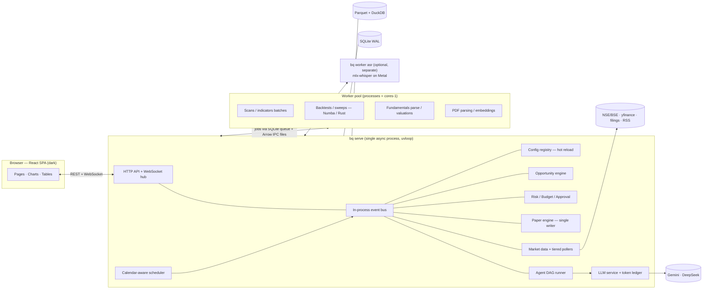
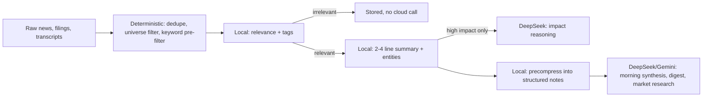
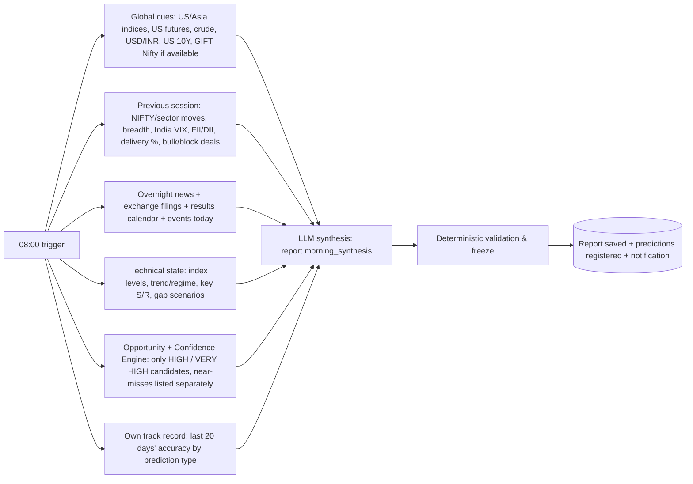
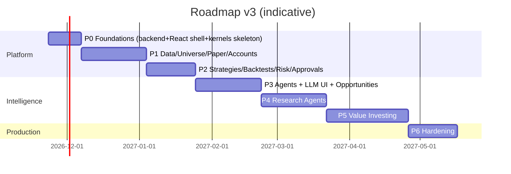

# BharatQuant Agents: Multi-Agent AI Trading & Investing System (Indian Equities)

## Implementation Plan v3.12: Expanded Reuse (gs-quant, awesome-agentic-trading), Shadow Trades & Regime Weights, the /learn Docs Module, ContextBuilder Memory Decay, Personal-Use Licence Mode, React + TypeScript, MacBook Pro M5 Pro, Task-Class LLM Routing, High-Conviction Suggestions

| Field | Value |
|---|---|
| Owner | Abhishek Pathak |
| Version | 3.12 (plan only; supersedes v3.11 and earlier) |
| Date | 25 Nov 2026 |
| Scope | Paper trading of Indian equities (all NSE stocks above a minimum market cap that you set in the UI) |
| LLMs | **Reasoning → DeepSeek and Gemini. Small tasks → local models (MLX on the M5 Pro)** to cut token use. Every call's input and output tokens are tracked; there is no spending cap |
| UI | **React 19 + TypeScript single-page app (dark theme)**, confirmed |
| Hardware | **MacBook Pro with M5 Pro, 24 GB unified memory, 307 GB/s memory bandwidth, GPU Neural Accelerators, Apple Silicon (arm64): the only required machine.** It is **plugged in from 08:00 to 17:00 IST on trading days, lid closed, driving an external monitor (clamshell mode)**. Wake/sleep schedules are set up by you in macOS, not by the app. Runs natively; Docker is optional |
| Reuse | **Reuse-first:** generic parts come from maintained open-source libraries under a licence policy (no AGPL imports, no copied GPL code); we build only India-specific, point-in-time, confidence and LLM-routing logic ([Section 4](#4-open-source-research-build-vs-reuse)) |
| Core languages | Python for orchestration; Polars/DuckDB (Rust/C++ engines) for data; **Numba** and **Rust (PyO3)** for heavy compute; C++ only through existing libraries |

---

## 0. What Changed

### v3.12 (this version): Expanded Reuse, Shadow Trades, and the /learn Module

| # | Change | Where |
|---|---|---|
| N1 | **`gs-quant` (Goldman Sachs, Apache-2.0) added** as **R2 selective port + R3 architecture reference, never a runtime dependency**. Offline econometric/statistical formulas (rolling beta, volatility estimators, z-scores, drawdown/Sharpe conventions) are ported into `bq/compute/stats.py`; the `Strategy → Trigger → Action` backtest grammar informs our YAML DSL; `.price()`/`.calc()`/Marquee/GS calendars are explicitly out of scope | [Section 4.3.5](#435-backtesting-portfolio-and-statistics), [Section 4.3.11](#4311-cross-cutting-architecture-and-quant-references-v312), [Section 13.1](#131-strategy-types), [ADR-034](#b-adrs-to-write-in-phase-0) |
| N2 | **`awesome-agentic-trading` adopted as an R3 taxonomy reference.** Its **Data → Agent → Execution → Harness → Application** five-layer model makes **Harness** (evals, PIT enforcement, shadow tracking, Brier calibration, replay parity, ContextBuilder manifests) a **first-class architectural pillar** | [Section 4.3.11](#4311-cross-cutting-architecture-and-quant-references-v312), [Section 5.4](#54-architectural-layers-data--agent--execution--harness--application), [Section 21](#21-repository-structure) |
| N3 | **Shadow Trades (counterfactual learning)** auto-record **every** HIGH / VERY HIGH (and STRONG BUY) candidate as a virtual trade whether executed or not, backfill 1/3/5/10-day P&L, and compute a **Filter Verdict** (`HELPS` / `NEUTRAL` / `HURTS`) comparing skipped vs. tracked win rates | [Section 12.3.6](#1236-proving-that-strictness-works), [Section 16.5](#165-accuracy-metrics) |
| N4 | **Conditional Regime Weights (3-layer merge)** for the LLM-free pre-ranker: `DEFAULT → base_tuned → regime_override[BULL|BEAR|SIDEWAYS|HIGH_VOL]`, gated by a minimum sample count per regime and a Wilson lower-bound threshold so regime-dependent signals switch weights only when the evidence supports it | [Section 12.2](#122-opportunity-engine), [Section 12.3.4](#1234-confidence-policy-configurable-from-the-ui) |
| N5 | **BM25 memory pruning + age-based decay + frecency** in ContextBuilder Agent Memory: per-entry `created_at` / `last_accessed` / `hit_count`, decay (1.0× ≤ 30 d, linear to 0.20× at 365 d) plus a 1.25× frecency bonus for items accessed in the last 7 d, with a `/memory-admin` **dry-run and manual prune** UI | [Section 10.9.6](#1096-agent-memory) |
| N6 | **Verdict calibration and Brier gap verdicts.** Daily **Market Stance** (`GREEN` / `YELLOW` / `RED`) is backfilled against 1/3/5-day forward NIFTY returns with a neutral dead-band; the reliability diagram gains explicit **overconfident / underconfident / well-calibrated** gap verdicts at a ±5% threshold | [Section 12.3.6](#1236-proving-that-strictness-works), [Section 16.5](#165-accuracy-metrics) |
| N7 | **VIX-adjusted position-sizing curve** adopted as a configurable default: 100% normal → **85%** at India VIX 15–20 → **65%** at 20–25 → **50%** above 25 | [Section 18.2](#182-budget-manager), [Section 18.3](#183-risk-manager) |
| N8 | **SEBI static-IPv4 enforcement (from April 2026).** Broker HTTP clients force **IPv4** to avoid IPv6-mismatch rejections against the static-IP API rule | [Section 25](#25-regulatory-notes), [Section 26](#26-delivery-roadmap) |
| N9 | **Free dual-broker Phase 7 pattern:** **Fyers** (free live quotes/WebSocket) for data plus **Zerodha Personal** (free order execution) behind one `BrokerAdapter` | [Section 26](#26-delivery-roadmap), [Section 25](#25-regulatory-notes) |
| N10 | **TradingAgents updated to v1.0.x deltas:** TypeScript research terminal (still **R3 design/prompt reference only**); **Markdown-defined specialist skills** (`Companies`, `Valuation`, `Markets`, `Risk`) under `config/llm/skills/`; a **Plan-Before-Execute** toggle for expensive runs; and **inline source attribution** (`src_id` + numbered sources) in Markdown/PDF exports | [Section 4.3.1](#431-agent-frameworks-r3-design-and-prompts), [Section 16.8](#168-manual-ai-strategy-review-review-my-strategy) |
| N11 | **AI-trader sequential entry-quality gates** (composite-score threshold, previous-bar continuation, micro-momentum confirmation, short-window re-pricing) and **score-tiered sizing fallback** over raw Kelly when samples are small | [Section 12.3.2](#1232-evidence-families-chart-volume-and-more), [Section 12.3.3](#1233-from-evidence-to-confidence), [Section 12.3.4](#1234-confidence-policy-configurable-from-the-ui) |
| N12 | **Vibe Trading UX/interop patterns:** contextual action chips on dashboard cards and an optional HTTP skill endpoint (`/.well-known/openclaw.json`, `POST /skills/<name>`) for local agent integration | [Section 7.4](#74-pages), [Section 8.1](#81-rest-fastapi-apiv1) |
| N13 | **In-app `/learn` module** (page #22): versioned Markdown docs+academy with FTS5 search, KaTeX/Mermaid rendering, contextual "Learn why" deep-links, an optional "Explain with my data" button, and a **docs-as-code CI guardrail** so every feature/metric has a doc | [Section 7.7](#77-the-learn-module-feature-docs--trading--quant-academy), [Section 19](#19-storage-and-data-model), [Section 23](#23-testing-and-benchmarking), [ADR-035](#b-adrs-to-write-in-phase-0) |
| N14 | New tables (`shadow_trades`, `regime_weight_versions`, `learn_docs_fts`, `learn_docs`, `learn_progress`), module `bq/learn/`, `docs/learn/`, and tests | [Section 19](#19-storage-and-data-model), [Section 21](#21-repository-structure), [Section 23](#23-testing-and-benchmarking) |

### v3.11: Agent Context Management

| # | Change | Where |
|---|---|---|
| X1 | **ContextBuilder**: one component builds the input for every LLM call, with a mandatory `as_of` timestamp | [Section 10.9](#109-context-management-contextbuilder-v311) |
| X2 | **Per-task context specs** (YAML): section budgets, providers, filters, ranking, overflow order; required sections never truncated silently | [Section 10.9.4](#1094-context-spec-per-task) |
| X3 | **Fixed prompt layout** (system → reference → facts → notes → documents → memory → task input) for prefix-cache hits and `src_id` citations | [Section 10.9.3](#1093-prompt-layout-fixed-section-order) |
| X4 | **Point-in-time enforced in one place**, with a second check on every item and alerts on violations | [Section 10.9.5](#1095-context-providers) |
| X5 | **Agent memory** that is read back: setup lessons, past symbol decisions, track record, thesis history, analyst reflections. Written only after outcomes resolve; may only lower confidence | [Section 10.9.6](#1096-agent-memory) |
| X6 | **Debate state compression** per round, and map-reduce retrieval for long documents (sqlite-vec + FTS5) | [Section 10.9.7](#1097-multi-step-tasks-debates-and-long-documents) |
| X7 | **Context manifest** per call, linked to the token ledger; "What the model saw" in the UI; replay rebuilds the same context hash | [Section 10.9.8](#1098-context-manifest-and-observability) |
| X8 | New tables, module `bq/llm/context/`, tests, ADR-033 | [Section 19](#19-storage-and-data-model), [Section 23](#23-testing-and-benchmarking) |

### v3.10: India Agent Repos and Personal-Use Licence Mode

| # | Change | Where |
|---|---|---|
| P1 | **Personal-use licence mode.** BharatQuant runs only on your Mac for you, so any open-source code may be imported, copied or ported, including GPL and AGPL. Provenance is still recorded, so the code can be cleaned up if the app is ever shared | [Section 4.1](#41-reuse-levels-and-licence-policy) |
| P2 | **PyMuPDF reinstated** as the primary PDF engine (fastest, best layout); pypdfium2/pdfplumber stay as fallbacks. NseIndiaApi, OpenAlgo and vectorbt code may now be ported directly | [Section 4.3.8](#438-documents-and-pdfs) |
| P3 | **pradeepsiddappa/indian-trading-agent** reused: India-adapted TradingAgents prompts, scanner, signal recommender weighted by win rate, **Daily Verdict (TRADE / SELECTIVE / STAND DOWN) with calibration tracking**, FII/DII tracker, earnings + economic calendar filter, seasonality, "Today" page UX | [Section 4.3.10](#4310-india-specific-agent-projects-v310) |
| P4 | **hopit-ai/india-trade-cli (Vibe Trading)** reused: 7-analyst parallel layout incl. **sector-rotation and sentiment analysts**, **weighted scorecard with conflict detection**, multi-round debate, fundamentals scorer, DCF, data-source fallback chains, Telegram bot, Zerodha/Fyers adapters | [Section 4.3.10](#4310-india-specific-agent-projects-v310) |
| P5 | **Bhala-Srinivash/nse-trading-skills** reused as **rule specifications** (coded deterministically) and as LLM context: stop-loss and trailing-stop methods incl. **chandelier exit**, **RSI divergence (regular + hidden)**, **Fibonacci confluence**, **3-screen multi-timeframe scoring**, Kelly/ATR sizing, R:R/EV filtering | [Section 4.3.10](#4310-india-specific-agent-projects-v310), [Section 12.3.2](#1232-evidence-families-chart-volume-and-more) |
| P6 | **aaryansinha16/AI-trader** reused: feature-engineering catalogue (80 bar features), **"rule signal filtered by ML probability"** pattern, Kelly sizing and regime gating code; adds an optional **gradient-boosted challenger** to the confidence model | [Section 4.3.10](#4310-india-specific-agent-projects-v310), [Section 12.3.3](#1233-from-evidence-to-confidence) |
| P7 | **Morning report gains a "Market Stance" line** (TRADE / SELECTIVE / STAND DOWN), scored every evening like any other prediction | [Section 16.2](#162-morning-report-0800-ist-market-research-predictions-and-trade-suggestions) |
| P8 | **Phase 7:** Vibe Trading's Zerodha/Fyers adapters are a direct-code alternative to running OpenAlgo | [Section 26](#26-delivery-roadmap) |

### v3.9: Open-Source Reuse Review

| # | Change | Where |
|---|---|---|
| O1 | **Reuse levels and licence policy**: dependency, port, prompt/design reference, external process. CI licence gate with an allow-list | [Section 4.1](#41-reuse-levels-and-licence-policy) |
| O2 | **PyMuPDF removed** (AGPL-3.0 or commercial). PDFs now use **pypdfium2 + pdfplumber**, with Docling optional | [Section 4.3.8](#438-documents-and-pdfs) |
| O3 | **Agent prompts seeded from TradingAgents (Apache-2.0) and ai-hedge-fund (MIT)**, dossier structure from FinRobot; each adapted prompt records its source | [Section 4.3.1](#431-agent-frameworks-r3-design-and-prompts) |
| O4 | **json-repair** becomes the first step of the LLM repair loop; **Outlines + MLX-LM** evaluated for guaranteed-schema local output | [Section 4.3.2](#432-llm-layer-helpers), [Section 10.1](#101-design) |
| O5 | **promptfoo** replaces a custom eval runner; it calls a ledger-recording eval proxy so evals stay token-tracked | [Section 4.3.2](#432-llm-layer-helpers), [Section 10.5.4](#1054-quality-gate-and-escalation) |
| O6 | **Data:** NseIndiaApi (`nse`, GPL-3.0) added as an optional filings adapter; jugaad-data (public domain) for NIFTY TRI benchmarks; pandas_market_calendars to cross-check holidays | [Section 4.3.3](#433-indian-market-data), [Section 11.1](#111-provider-routing-configurable-from-the-ui) |
| O7 | **Indicators:** polars-ta-lib downgraded to a candidate (very new). **polars_ta** is primary; **TA-Lib 0.8.3 wheels** (C library bundled, no compiler) are the golden reference and candlestick source | [Section 4.3.4](#434-indicators-and-chart-analysis) |
| O8 | **Chart structure and volume profile ported** from smart-money-concepts (MIT) and py-market-profile (BSD) into Numba | [Section 4.3.4](#434-indicators-and-chart-analysis) |
| O9 | **QuantStats, skfolio and scikit-learn** adopted for tear sheets, allocation and calibration | [Section 4.3.5](#435-backtesting-portfolio-and-statistics) |
| O10 | **News:** trafilatura, datasketch and pyahocorasick replace hand-written extraction, MinHash and the planned Rust MinHash kernel | [Section 4.3.6](#436-news-and-text-processing), [Section 15](#15-research-pipelines) |
| O11 | **nse-xbrl reclassified to reference only** (needs Python 3.14, no licence or releases); own lxml parser | [Section 4.3.3](#433-indian-market-data) |
| O12 | **Licence corrections:** vectorbt is Apache-2.0 + Commons Clause; NautilusTrader is LGPL-3.0; nselib is Apache-2.0 | [Section 4.3](#43-findings-by-component) |
| O13 | **Python baseline 3.13** (TA-Lib, polars_ta and Polars plugins all support it); roadmap estimates updated | [Section 6.2](#62-concurrency-model), [Section 26](#26-delivery-roadmap) |

### v3.8

| # | Change | Where |
|---|---|---|
| T1 | **Every LLM task belongs to one of three classes:**<br>• **SMALL**: local model first<br>• **REASONING**: DeepSeek and Gemini only, **never local**<br>• **MULTIMODAL**: Gemini only<br>The class decides routing. Cost tiers only choose *which* cloud model within a class | [Section 10.8](#108-task-classes-small-local-vs-reasoning-cloud) |
| T2 | **Strategy reviews stay on DeepSeek** (critic on paid Gemini). The local option for strategy review is removed | [Section 10.8.2](#1082-reasoning-tasks-cloud-only) |
| T3 | **Some writing tasks move back to the cloud** because they need real reasoning: evening "what went wrong and why", the opportunity thesis with "what would make it wrong", and news-digest synthesis. Local keeps only bounded, small tasks | [Section 10.8.1](#1081-small-tasks-local-first) |
| T4 | **Local becomes a token filter in front of the cloud.** It filters, deduplicates, tags and compresses inputs so reasoning models receive small, structured notes instead of raw text | [Section 10.8.3](#1083-local-as-a-token-filter-in-front-of-the-cloud) |
| T5 | **Simpler local setup:** one resident small model. The larger "Slot B" model becomes optional and is off by default. Memory use drops | [Section 10.5](#105-local-models-on-the-m5-pro-small-tasks-only) |
| T6 | **Reasoning tasks never fall back to a local model.** If both DeepSeek and Gemini are unavailable, the task is deferred, or the system runs rules-only. A weaker local answer is never used | [Section 10.8.2](#1082-reasoning-tasks-cloud-only) |

### v3.7

| # | Change | Where |
|---|---|---|
| L1 | **Target hardware is now a MacBook Pro with M5 Pro and 24 GB.** It has 15 or 18 CPU cores (5–6 "super" cores plus 10–12 performance cores, **no efficiency cores**), 307 GB/s memory bandwidth, and Neural Accelerators in every GPU core. Pool sizing, budgets and benchmarks are updated | [Section 6.2](#62-concurrency-model), [Section 20.5](#205-memory-and-cpu-budget-on-a-shared-24-gb-mac) |
| L2 | **Local LLMs are used wherever feasible** (narrowed to SMALL tasks in v3.8): news summarisation, relevance, sentiment and event tagging, entity linking, translation, transcript and filing summaries, journal drafts, evening narratives and more. These tasks run **local first**: local → free Gemini → DeepSeek → paid Gemini | [Section 10.5](#105-local-models-on-the-m5-pro-small-tasks-only) |
| L3 | **Quality gate.** A task moves to local-first only after it passes its evaluation set against a cloud reference. Low-confidence or invalid local outputs are automatically escalated to the next tier | [Section 10.5.4](#1054-quality-gate-and-escalation) |
| L4 | **Local model manager**: a two-slot model plan (a resident fast model plus an on-demand quality model), memory-pressure guard, thermal watch in clamshell mode, scheduling around market hours | [Section 10.5.3](#1053-model-manager-memory-and-scheduling) |
| L5 | **Private tasks may prefer local models.** Strategy reviews and anything containing your positions can run locally, so no data leaves the Mac | [Section 10.5.2](#1052-which-tasks-run-locally) |

### v3.6

| # | Change | Where |
|---|---|---|
| H1 | **LLM cost order: free Gemini → DeepSeek → paid Gemini → local model.** This applies to every task, except where a task needs a capability only Gemini has (video, audio, images) | [Section 10.7.3](#1073-cost-tiers-and-routing) |
| H2 | **Confidence Engine: the system suggests trades only when it is highly confident.** Every suggestion shows a **confidence %, a confidence level, an error range and expected value**. Days with no suggestions are normal | [Section 12.3](#123-confidence-engine-fewer-high-conviction-suggestions) |
| H3 | **Chart (price-graph) analysis, volume analysis and peer-graph analysis** feed confidence as separate evidence families. Chart structure and volume must **both** confirm before anything is suggested | [Section 12.3.2](#1232-evidence-families-chart-volume-and-more) |
| H4 | **Checking that strictness works:** every candidate is shadow-tracked, including rejected ones. Reports show accuracy by confidence level and coverage vs accuracy | [Section 12.3.6](#1236-proving-that-strictness-works) |

### v3.5

| # | Change | Where |
|---|---|---|
| F1 | **Free-first cost tiering for Gemini.** Free quota is used first, then paid; each task has a cost tier; a planner fits the daily workload into free limits; the tier mix is shown in the token dashboard | [Section 10.7](#107-gemini-keys-free-first-cost-tiering-and-failover) |
| F2 | **Multiple accounts are for resilience, not for stacking free quota.** The system does **not** rotate through several free-tier accounts to multiply free limits. Extra free-tier keys are held on **standby** and used only if the primary free key fails for a reason other than quota (revoked, restricted, invalid). This avoids Google treating several accounts as quota circumvention and restricting them, including your main one | [Section 10.7.2](#1072-what-the-system-will-and-wont-do) |
| F3 | **Free-tier privacy routing.** Tasks that carry your strategy definitions, portfolio or review content are marked `paid_or_private` and never go to free-tier Gemini | [Section 10.7.6](#1076-free-tier-data-handling) |

### v3.4

| # | Change | Where |
|---|---|---|
| K1 | **Every scheduled job can be configured from the UI.** There is a complete job catalogue, nothing is hard-coded, jobs can depend on each other, and changes are checked before they're saved | [Section 16.1](#161-scheduler-every-job-configurable-from-the-ui) |
| K2 | **The morning report's scope can be configured from the UI:** indices and sectors, prediction types, how many suggestions and what kind, filters, report sections, and which models to use. Each scope is versioned | [Section 16.2.1](#1621-morning-report-scope-configurable-from-the-ui) |
| K3 | **Multiple Gemini API keys** in a key pool, with automatic failover (revised in v3.5 to free-first tiering; see F1–F3). Keys are grouped by Google Cloud project, because Gemini limits apply per project, and a compliance guard is included | [Section 10.7](#107-gemini-keys-free-first-cost-tiering-and-failover) |
| K4 | **Clamshell mode** (lid closed, external monitor, power) is now the documented operating mode, with display-loss detection | [Section 20.4](#204-sleep-wake-and-power) |

### v3.3: Deep Review Fixes

A full review found 24 issues: contradictions, wrong assumptions and gaps. Each is fixed below, and the change log is in [Appendix C](#c-deep-review-log-v33).

| # | Fix | Severity |
|---|---|---|
| R1 | **The Mac's operating window (08:00–17:00) is now the hard constraint.** All jobs fit inside it, and overnight jobs are removed. Morning ingestion catches up on everything since the previous evening | Critical |
| R2 | **LLM look-ahead bias:** backtests of LLM-driven strategies and reports on periods before a model's training cutoff are invalid. These can now only be validated forward (paper trading or shadow mode) | Critical |
| R3 | **The 17:00 evening report may run before official end-of-day files are published.** Scores are now *provisional* at 17:00 and *confirmed* the next morning against the official files | High |
| R4 | **Intraday bars built from 15–30 s price polling miss highs and lows**, which would inflate accuracy and paper P&L. The resolvers and fill engine now rank bar sources by quality and record which source they used | High |
| R5 | **YouTube:** the official API cannot download captions for other people's videos. The pipeline now uses Gemini's direct YouTube-URL video understanding as its primary method | High |
| R6 | **Free per-symbol polling of 100+ stocks every 15–30 s would be blocked.** It is replaced by bulk index snapshots plus per-symbol polling only for open positions | High |
| R7 | **Rust kernels were scheduled before any profiling,** which broke our own rule. They are deferred; Polars and Numba come first | Medium |
| R8 | **Contradictions removed:** SDK vs native HTTP adapters; Alembic vs plain SQL; MessagePack vs simplicity; default approval for report suggestions; DuckDB memory cap larger than the total budget | Medium |
| R9 | **Security gap:** a service on localhost needs **DNS-rebinding and Origin protection**, not just a password | Medium |
| R10 | **Benchmarks:** speed targets are checked on your Mac with `bq bench`. CI only catches relative slowdowns, because CI runners are noisy and are not your machine | Medium |
| R11 | **Scope vs capacity:** the roadmap was too optimistic for one person. A **minimum viable path** now delivers your core daily loop first | Medium |
| R12 | **Market-cap data source is now explicit:** shares outstanding come from shareholding filings, so a free source exists | Medium |

### v3.2

| # | Change | Where |
|---|---|---|
| S1 | **Scheduler with UI control.** Every recurring job (time in IST, trading-day rules, catch-up policy, run now, history) is managed on a Schedules page | [Section 16.1](#161-scheduler-every-job-configurable-from-the-ui) |
| S2 | **08:00 IST morning report.** Market research, structured market predictions, and intraday and short-term trade suggestions | [Section 16.2](#162-morning-report-0800-ist-market-research-predictions-and-trade-suggestions) |
| S3 | **17:00 IST evening accuracy report.** Every prediction and suggestion is resolved by code and scored (hit rate, Brier score, calibration, skill vs baselines, trade R) | [Sections 16.3–16.5](#163-prediction-format-machine-checkable-and-frozen) |
| S4 | **Permanent report archive.** Daily reports are append-only and hash-chained, full-text searchable, and shown on a calendar view | [Section 16.7](#167-report-archive-saved-continuously-every-day) |
| S5 | **Manual AI strategy review.** Deterministic diagnostics, then LLM suggestions (with an optional second-model critique), then automatic out-of-sample validation of each suggestion. Nothing changes until you accept a suggestion | [Section 16.8](#168-manual-ai-strategy-review-review-my-strategy) |
| S6 | **Session rules updated to the revised NSE Closing Auction Session (CAS).** SEBI revised the CAS so that from 7 Dec 2026 it runs 15:30–15:40 on all trading days. Session profiles are now **effective-dated** | [Section 11.4](#114-session-model-effective-dated-including-the-closing-auction-session) |
| S7 | **Plan only.** Coding is paused until the plan is finalised | [Section 26](#26-delivery-roadmap) |

### v3.1

| # | Change | Why |
|---|---|---|
| M1 | **React + TypeScript confirmed.** Routing uses **React Router v7** (simpler than TanStack Router); TanStack Query, Table and Virtual are kept | Fewer concepts, same speed |
| M2 | **MacBook-first.** Everything runs on one Apple Silicon laptop. The design is tuned for macOS arm64: Metal, unified memory, Apple Silicon core types (P/E on M1–M4; super/performance on M5 Pro), and the Keychain | You asked to focus on running locally on the M4 |
| M3 | **Local LLMs become a first-class provider** (made local-first for high-volume text in v3.7) (MLX `mlx_lm.server` or Ollama, both OpenAI-compatible) alongside Gemini and DeepSeek. Tokens are tracked the same way | The M4's Metal GPU makes 7–14B models practical for cheap, high-volume tasks |
| M4 | **Sleep-aware runtime.** The app detects when the Mac slept, reconciles missed bars and orders on wake, uses `caffeinate` during market hours, and supports scheduled wake | A laptop can sleep; a server can't. This must be designed in, not patched later |
| M5 | **launchd** replaces systemd. The browser UI can be installed as a **Safari/Chrome web app (Add to Dock)**, and alerts use native macOS notifications | Native Mac experience with no extra frameworks |
| M6 | **Pools aware of core types.** Heavy compute runs on performance cores; efficiency cores are left for macOS, the browser and I/O | Keeps the laptop responsive while scans run |
| M7 | **Memory budget for a shared 24 GB laptop.** BharatQuant uses ≤ 3 GB steady state (excluding an optional local model) | You'll use the Mac for other work too |
| M8 | **NSE Closing Auction Session (CAS) modelled** for stocks with derivatives (introduced 3 Aug 2026, revised from 7 Dec 2026; see S6) | Correct closing prices, sessions and MIS cut-offs in paper trading |
| M9 | **Plain-SQL migrations on stdlib `sqlite3`** (no SQLAlchemy or Alembic). **Native HTTP adapters** for Gemini, DeepSeek and local models (no provider SDKs) | Fewer dependencies, faster start-up, exact token fields |

### v3.0 Changes (Carried Forward)

| # | Change | Why |
|---|---|---|
| C1 | **Streamlit → React + TypeScript + Vite single-page app**, served as static files by the backend | Full control over layout, real-time updates and keyboard workflows; much faster rendering of large tables and charts; no full-page reruns |
| C2 | **Modular monolith**: one async backend process plus a pool of worker processes. Replaces the eight separate services | Simpler to run, debug and deploy. Lower memory use on a shared laptop. No network hops inside the app |
| C3 | **No Redis or Postgres required.** Uses SQLite (WAL mode) for state and Parquet + DuckDB for market data. Postgres stays an optional adapter | Fewer moving parts. Native and Docker setups behave the same. Fast enough for one user |
| C4 | **Agents run on a lightweight asyncio DAG runner** (parallel fan-out with `TaskGroup`) instead of LangGraph. Typed LLM outputs come from Pydantic | A decision cycle is a short DAG, so a full graph framework is overhead. Durability comes from the decision record saved after each step |
| C5 | **Thin native LLM adapters** (plain HTTPS via httpx to the Gemini REST API and the OpenAI-compatible DeepSeek API; no vendor SDKs) instead of LiteLLM as the core. LiteLLM stays an optional third adapter | Only two providers are needed. This gives exact token-usage fields, fewer dependencies and lower latency. Other providers remain one adapter away |
| C6 | **Tiered compute: Polars/DuckDB → Numba → Rust**, with a profiling rule for when to step down a tier | Speed where it matters, simplicity everywhere else |
| C7 | **Parallelism designed in**: an async I/O fan-out map, multi-threaded data engines, a process pool for CPU-heavy work, and Numba `prange` for parameter sweeps | Explicit requirement in this revision |
| C8 | **A build-vs-reuse decision for each component**, based on the open-source survey in [Section 4](#4-open-source-research-build-vs-reuse) | Avoids reinventing proven parts. Licences are checked |
| C9 | For the future live phase, **OpenAlgo can be used as a separate broker gateway**, called over its API | Covers many Indian brokers without writing broker adapters, and keeps AGPL code out of our codebase |

All features from v2.1 carry over unchanged:

- Five trading horizons, the Opportunity Engine and the value investing module
- Research agents for market, news, YouTube and technical analysis
- Budget, risk and approval rules (AUTO by default)
- Paper capital that you configure from the UI
- Free or paid data, configurable per data domain
- Point-in-time data handling and the token ledger

---

## Table of Contents

1. [Executive Summary](#1-executive-summary)
2. [Goals, Non-Goals, SLOs and Performance Budgets](#2-goals-non-goals-slos-and-performance-budgets)
3. [Design Principles: Simple, Fast, Safe](#3-design-principles-simple-fast-safe)
4. [Open-Source Research: Build vs Reuse](#4-open-source-research-build-vs-reuse)
5. [Architecture: Modular Monolith](#5-architecture-modular-monolith)
6. [Performance Engineering and Parallelism](#6-performance-engineering-and-parallelism)
7. [Frontend: React + TypeScript (Dark Theme)](#7-frontend-react--typescript-dark-theme)
8. [API and Real-Time Contract](#8-api-and-real-time-contract)
9. [Agents and Coordination](#9-agents-and-coordination)
10. [LLM Layer: Gemini + DeepSeek, Routing, Token Ledger](#10-llm-layer-gemini--deepseek-routing-token-ledger)
11. [Market Data Layer and Universe](#11-market-data-layer-and-universe)
12. [Trading Horizons and Opportunity Engine](#12-trading-horizons-and-opportunity-engine)
13. [Strategies and Backtesting](#13-strategies-and-backtesting)
14. [Value Investing Module](#14-value-investing-module)
15. [Research Pipelines](#15-research-pipelines)
16. [Scheduled Reports, Prediction Tracking and AI Strategy Review](#16-scheduled-reports-prediction-tracking-and-ai-strategy-review)
17. [Paper Trading Engine](#17-paper-trading-engine)
18. [Budget, Risk, Approval Policy and Paper Accounts](#18-budget-risk-approval-policy-and-paper-accounts)
19. [Storage and Data Model](#19-storage-and-data-model)
20. [Runtime and Deployment (MacBook-First)](#20-runtime-and-deployment-macbook-first)
21. [Repository Structure](#21-repository-structure)
22. [Security and Observability](#22-security-and-observability)
23. [Testing and Benchmarking](#23-testing-and-benchmarking)
24. [Daily Operations Schedule (IST)](#24-daily-operations-schedule-ist)
25. [Regulatory Notes](#25-regulatory-notes)
26. [Delivery Roadmap](#26-delivery-roadmap)
27. [Risks and Mitigations](#27-risks-and-mitigations)
28. [Open Questions](#28-open-questions)
29. [Appendix](#29-appendix)

---

## 1. Executive Summary

BharatQuant Agents is a personal, production-grade, multi-agent platform for Indian equities. It does three things:

1. **Finds opportunities** across five horizons (intraday to long-term value) for every NSE stock above your market-cap floor.
2. **Explains** each opportunity with cited evidence from technicals, news, YouTube, macro data and fundamentals.
3. **Executes** them on a realistic paper trading engine that follows NSE cash-market rules.

v3 is built on two ideas.

**Simplicity.** The whole system is:

- one backend process (`bq serve`) plus a worker pool,
- one SQLite file and a folder of Parquet files,
- one static React build.

It needs no Redis, Postgres, Node at runtime, or message broker. It runs natively on your MacBook with one command (`bq serve`). Docker is optional.

**Performance.** Data work goes to engines that already run multi-threaded native code (Polars in Rust, DuckDB in C++). Custom path-dependent loops (backtests, trailing stops, parameter sweeps) are compiled with Numba. A small Rust crate is added only for kernels that profiling shows are hot. Everything I/O-bound (data fetches, LLM calls, research fan-out) runs concurrently on asyncio, with a rate limit per provider. The UI uses canvas charts, virtualised tables and WebSocket deltas, so it stays smooth at thousands of rows.

The core safety rule is unchanged: **LLMs propose; deterministic code sizes and approves trades.** Auto-approve skips the human, never the Risk Manager.

---

## 2. Goals, Non-Goals, SLOs and Performance Budgets

### 2.1 Goals

| # | Goal |
|---|---|
| G1 | Multi-agent system: research, strategy, opportunity, value, budget, risk, execution and reporting agents |
| G2 | Gemini + DeepSeek with per-task routing set from the UI; more providers can be added as adapters |
| G3 | Token tracking (input, output, cached, reasoning) for every LLM attempt, broken down by task, model, agent, strategy and day |
| G4 | Run any strategy: Python, YAML DSL, LLM-discretionary, hybrid, or natural language converted to DSL |
| G5 | Five horizons, a value investing module, and an Opportunity Engine that ranks and tracks every opportunity |
| G6 | Universe = all NSE stocks above a configurable minimum market cap, with tiered data coverage |
| G7 | Free data by default; data provider routing per domain, configurable from the UI |
| G8 | Realistic paper trading; capital, accounts and approval policy configurable from the UI (AUTO by default) |
| G9 | **React + TypeScript dark-theme UI** |
| G10 | **Simple and fast**: parallel by design, native kernels where justified |
| G12 | **Scheduled morning and evening reports** with predictions, trade suggestions and accuracy tracking, saved daily; **manual AI strategy review** |
| G11 | Native on macOS, MacBook Pro M5 Pro (primary target); Docker optional; Linux portability kept but not targeted |

### 2.2 Non-Goals

- Live order placement in this version.
- F&O, commodities and currency segments.
- High-frequency trading.
- Multi-tenant SaaS.
- LLM spending caps (available, but off by default).

### 2.3 SLOs

| SLO | Target |
|---|---|
| Runtime availability during market hours (Mac awake and on power) | ≥ 99.5%; any sleep gap is detected, recorded and reconciled on wake |
| Paper accounting accuracy | Exact match on the golden contract-note set |
| Token tracking completeness | 100% of LLM attempts recorded |
| Config hot-reload (models, data routes, policy, capital) | Applied at the next cycle, with no restart |
| BharatQuant memory, steady state | ≤ 3 GB RSS (excluding an optional local LLM), with ≥ 8 GB left free for macOS and your other apps |

### 2.4 Performance Budgets

These budgets are **checked on your M5 Pro with `bq bench`** (plugged in, nothing heavy running). CI only checks *relative* slowdowns of more than 15% against a stored baseline, because shared CI runners are noisy and are not M4s (see [Section 23](#23-testing-and-benchmarking)). The targets are initial estimates, to be confirmed in Phase 0–1.

| Operation | Budget (MacBook Pro M5 Pro, on AC power) |
|---|---|
| Rule-based path: bar close → paper order | p95 < 50 ms |
| LLM-assisted decision cycle (parallel research reads + 1 LLM call) | p95 < 8 s (dominated by LLM latency) |
| Indicators for one symbol, 10 years of daily bars, 20 indicators | < 5 ms |
| Full-universe daily scan (~1,000–2,500 symbols depending on the floor × 20 indicators + 30 scanners) | < 10 s |
| Event-driven backtest, 1 strategy × 500 symbols × 10 years daily | < 5 s |
| Parameter sweep, 10,000 combinations × 1 symbol × 10 years daily (Numba, all cores) | < 20 s |
| Universe re-rank + Opportunity board refresh | < 1 s |
| API p95 for typical reads (positions, orders, opportunities page) | < 30 ms |
| UI: first load from localhost (cached after) | < 0.5 s |
| UI: live update to on-screen render | < 100 ms |
| UI: scroll 10,000-row table | 60 fps (virtualised) |
| Overnight fundamentals refresh, full universe (parsing only, excluding LLM) | < 20 min, run in parallel across cores |

---

## 3. Design Principles: Simple, Fast, Safe

**Simplicity**

1. **One process, many modules.** Module boundaries are enforced in code (import rules) rather than by the network. A module is split into a separate service only when there is a measured reason.
2. **Few dependencies.** Each dependency must earn its place. Prefer libraries that are mature, permissively licensed and wheel-installable on macOS arm64 and Linux.
3. **Boring storage.** SQLite for state, Parquet for time series, DuckDB and Polars for analytics. One backup folder covers everything.
4. **Same code everywhere.** Backtest, replay, paper and (future) live trading share one engine. Only the clock, data feed and broker are injected.
5. **Configuration is data.** Every setting is versioned, editable in the UI, audited and hot-reloaded.

**Performance**

6. **Vectorise first, compile second, rewrite last.** Use Polars/DuckDB expressions, then Numba for loops, then Rust for kernels that are still hot after profiling.
7. **Parallel by default.**
   - I/O work fans out with `asyncio.TaskGroup` under per-provider semaphores.
   - CPU work runs in a `ProcessPoolExecutor` sized to the machine's cores.
   - Data engines use all cores internally.
8. **Avoid copies.** Use Arrow end to end (Parquet → Polars/DuckDB → NumPy views → Numba/Rust) and pass zero-copy buffers wherever possible.
9. **Incremental over recompute.** Indicators and scanners update per bar from saved state, rather than recomputing full history.
10. **Measure first.** Benchmarks run in CI, latency histograms are always on, and a flame graph (py-spy) is one command away.

**Safety**

11. **LLMs never supply numbers or approve trades.** The deterministic Risk Manager always runs.
12. **Point-in-time correctness.** Backtests and agents see only data that was available at the time.
13. **Graceful degradation.** If an LLM provider fails, fall back to the other provider, then to rules only. If a data provider fails, fall back to the next one, then pause new entries while stops stay enforced.

---

## 4. Open-Source Research: Build vs Reuse

v3.9 replaces the v3.8 survey with a **component-by-component reuse map**. Each entry was re-checked against its public repository or package page in November 2026. The goal is to **write only the parts that are specific to us**: Indian market rules, point-in-time correctness, the confidence engine, task-class LLM routing and the token ledger. Everything generic comes from maintained open-source code.

### 4.1 Reuse Levels and Licence Policy

| Level | Meaning | Allowed licences | How it lives in the repo |
|---|---|---|---|
| **R1: Dependency** | Installed from PyPI or npm, called through our own interface | Permissive (MIT, BSD, Apache-2.0, ISC, public domain); **GPL/LGPL only as an optional, swappable adapter** | `pyproject.toml` / `package.json`, pinned in lockfiles |
| **R2: Port / vendor** | Code copied or translated (for example pandas → Numba/Polars), then improved | **Permissive only** | `backend/src/bq/_vendor/<project>/` or ported module, with the original licence header and an entry in `THIRD_PARTY_NOTICES.md` |
| **R3: Prompt and design reference** | Prompts, role structures, test ideas, data schemas | Apache-2.0/MIT: prompts may be adapted with attribution. No licence: ideas only, never text | `config/llm/prompts/` with a `source:` field on each adapted prompt |
| **R4: External process** | Run separately and called over HTTP | Any, including **AGPL** | Separate install; never imported |

**Licence mode: PERSONAL (from v3.10).** BharatQuant is used only by you, on your own Mac, and is not distributed or offered to anyone else as a service. In this mode the licence column in the table above **does not restrict reuse**: code under any open-source licence (MIT, Apache, BSD, GPL, LGPL, AGPL, Commons Clause, public domain) may be imported (R1), copied or ported (R2), or adapted (R3).

**Rules.**
- **Record provenance, don't restrict.** Every copied or ported file keeps its original header, and `THIRD_PARTY_NOTICES.md` records project, commit, path and licence. Adapted prompts carry `source:` metadata.
- **CI licence report, not gate.** `pip-licenses` and `license-checker` produce a report tagging copyleft components (`GPL`, `AGPL`, `Commons Clause`, `no licence`). Nothing fails in PERSONAL mode.
- **If you ever share the app** (publish the repo, give it to others, or host it for other people), switch `licence_mode: DISTRIBUTE` in config. The report then lists exactly which components need replacing or releasing under a compatible licence.
- **Quality still gates reuse.** Copied code must pass our tests, PIT rules and the "LLMs never supply numbers" rule. Most hobby trading repos have no point-in-time handling or tests, so ported logic is re-verified against golden data.
- **Small or new projects** (few stars, no releases) are used only behind our interface, with pinned versions, golden tests and a named fallback.

### 4.2 Reuse Map at a Glance

| Area | Reuse (level) | We build | Effect |
|---|---|---|---|
| Agent roles and prompts | TradingAgents, ai-hedge-fund, FinRobot (R3) | DAG runner, India-specific analysts, confidence gating | Prompt-writing time cut; proven debate structure |
| LLM output handling | **json-repair** (R1), **Outlines** for local constrained decoding (R1, evaluated) | Native adapters, token ledger, task-class router | Fewer repair calls and fewer local→cloud escalations |
| LLM evaluation | **promptfoo** (R1, dev tool) | Golden sets, eval proxy that writes to the ledger | No custom eval runner or eval UI |
| LLM price table | LiteLLM's model price file (R1 data, verify licence) | Display-only cost estimate | No hand-maintained price list |
| NSE/BSE data | **nselib**, **jugaad-data**, **NseIndiaApi (`nse`)**, yfinance (R1) | `DataProvider` router, caching, quality checks | Almost no scraping code of our own |
| Calendar | **pandas_market_calendars** (R1) | Effective-dated session model (CAS, MIS) | Holiday seed plus cross-check |
| XBRL fundamentals | NseIndiaApi XBRL listing (R1) + **lxml** parser of our own; nse-xbrl as reference (R3) | Point-in-time store, ratio engine | Discovery and download are free; parsing stays under our control |
| Indicators | **TA-Lib** official wheels (R1), **polars_ta** (R1); polars-ta-lib (evaluated) | Incremental live indicators (Numba) | 150+ indicators and candlestick patterns without a C toolchain |
| Chart structure and patterns | **smart-money-concepts** (R2 port), **py-market-profile** (R2 port) | Pattern library, multi-timeframe alignment | Swing, BOS/CHoCH and volume-profile logic ported, not invented |
| Backtest analytics | **QuantStats** (R1) | Trade-level stats, deflated Sharpe, parity tests | HTML tear sheets and Monte Carlo for free |
| Offline stats and backtest DSL | **gs-quant** (R2 selective port + R3 reference, **never a runtime dependency**) | Own Numba/Polars stats; own YAML DSL | Ported econometric formulas (rolling beta, vol estimators, z-scores, drawdown/Sharpe conventions) plus a proven `Trigger → Action` grammar |
| Architecture taxonomy | **awesome-agentic-trading** (R3, reference only) | Harness pillar (evals, PIT, shadow tracking, calibration, replay) | Names the five layers and keeps the **Harness** first-class |
| Sizing, allocation, CV | **skfolio** (R1), **scikit-learn** (R1) | Budget Manager rules, confidence model | Risk parity/HRP, walk-forward CV, isotonic calibration, L2 logistic |
| News pipeline | **feedparser**, **trafilatura**, **datasketch**, **pyahocorasick** (R1) | Entity alias builder, signal schema | Extraction, dedupe and entity matching are off the shelf |
| PDFs | **PyMuPDF** (R1, v3.10); **pypdfium2**, **pdfplumber** fallback; Docling optional | Page index for citations | Best extraction quality |
| Paper engine | ai-hedge-fund paper ledger, OpenAlgo sandbox (R3 / R4 cross-check) | NSE paper engine (CNC/MIS, CAS, T+1, charges) | Test ideas and an independent cross-check |
| Live broker | **OpenAlgo** (R4) | `BrokerAdapter` client | No broker adapters to write |
| UI | Lightweight Charts, uPlot, ECharts, TanStack, shadcn/ui (R1) | Pages, theme, WebSocket store | Unchanged from v3.8 |

### 4.3 Findings by Component

#### 4.3.1 Agent Frameworks (R3: design and prompts)

| Project | Status (Nov 2026) | Licence | What we take | What we don't |
|---|---|---|---|---|
| **TauricResearch/TradingAgents** | Very active. **v0.7.1** added **parallel analysts**, **a separate provider per model tier**, DeepSeek support, and **point-in-time fixes**. **v3.12: re-checked at v1.0.x**, where the project became a **TypeScript research terminal** backed by the Tauric API (filings/news) — a UI/architecture shift, still **research-only** (no live trading) | Apache-2.0 | **Adapt the analyst, bull/bear researcher, judge and risk-team prompts** into our prompt registry (with attribution). Mirror their PIT test cases in our test suite. Their tiered provider design confirms our task-class routing. **v3.12 deltas:** adopt their **Markdown-defined specialist skills** (`Companies`, `Valuation`, `Markets`, `Risk`) as declarative research/dossier workflows under `config/llm/skills/`; add an optional **Plan-Before-Execute** mode for expensive runs; reinforce **inline source attribution** (`src_id` + numbered sources) in Markdown/PDF exports | LangGraph runtime, US data vendors, their decision format; **the TypeScript terminal and the Tauric API are not code we reuse (R3 design/prompt reference only)** |
| **virattt/ai-hedge-fund** | Very active; v2.7.x. Now ships **paper-trading funds with a ledger, an approval step that shows the exact decision before it executes, a kill switch**, and charges spread and commission on every fill | MIT | **Persona prompts** (Graham, Buffett, contrarian and others) for our optional persona lenses. The approval preview and kill-switch UX as references for `/approvals` and the Command Center | US data provider, its backtester |
| **AI4Finance-Foundation/FinRobot** | Active. Three generations; **V2 (`finrobot_desktop`) is the production one, built on PydanticAI + FastAPI + React/Tauri**. V1 (`finrobot_equity`) turns a ticker into an HTML/PDF equity-research report | Apache-2.0 | **Equity-research report structure and section prompts** for our value dossier ([Section 14](#14-value-investing-module)). Its stated principle (models reason, software computes, agents orchestrate, systems verify) is our ADR-009 | PydanticAI as a runtime (our DAG runner stays), its data providers |
| **Anishg198/tradingagents-india** | Small project; licence not stated | — | Ideas only: checklist of India signals (FII/DII, promoter pledge, T+1) | Any code or text |

**Decision.** Keep our own ~300-line DAG runner. **Seed 60–70% of agent prompts** from TradingAgents and ai-hedge-fund instead of writing them from scratch, then adapt them for India, our evidence families and our JSON schemas. Each adapted prompt records `source`, `source_version` and `licence`.

**v3.12 additions from TradingAgents (R3, design/prompt reference only).**

- **Markdown-defined specialist skills.** TradingAgents v1.0.x expresses its specialists as clean Markdown skill files. We adopt the same pattern for **declarative research and dossier workflows**: each skill is a Markdown file in `config/llm/skills/` (for example `companies.md`, `valuation.md`, `markets.md`, `risk.md`) with YAML frontmatter (`id`, `inputs`, `outputs`, `related_tasks`) and a `source:` field for provenance. The `ContextBuilder` loads the relevant skill file into the `reference` section ([Section 10.9.3](#1093-prompt-layout-fixed-section-order)), so a skill is data, not code, and can be versioned and promoted through evals like a prompt.
- **Plan-Before-Execute (optional "Plan Mode").** For **expensive deep-research runs** (Value Dossier, AI Strategy Review), an optional toggle has the agent first propose a **research plan and an estimated token budget** for you to confirm, then execute. The plan is stored on the run row and shown before any spend. Off by default; enabled per run or per task in the routing UI.
- **Inline source attribution.** Every figure in the Markdown and PDF exports carries an **inline `src_id` tag** and a **numbered sources list** at the end of each section, reusing the `src_id` scheme from [Section 10.9.3](#1093-prompt-layout-fixed-section-order). The export renderer refuses to emit a numeric figure that has no matching fact or cited source.

#### 4.3.2 LLM Layer Helpers

| Project | Licence | Use | Decision |
|---|---|---|---|
| **json-repair** (`json_repair`) | MIT | Repairs malformed JSON (missing quotes, commas, brackets, stray prose, truncated values) and supports schema-guided repair | **R1, adopt.** It becomes **step 1 of the repair loop**: local repair first, and only if Pydantic validation still fails is the model re-asked. Every avoided re-ask is a saved call |
| **Outlines** | Apache-2.0 | Constrained (guaranteed-schema) generation; supports **MLX-LM** as a backend, plus JSON Schema, regex and grammars | **R1, evaluate in Milestone A** for the local SMALL-task worker. If it holds up, local JSON validity approaches 100%, which lowers the escalation rate in [Section 10.5.4](#1054-quality-gate-and-escalation). If not, keep JSON mode + json-repair |
| **Instructor** | MIT | Pydantic-validated outputs across many providers | **Not adopted.** It overlaps with our native adapters; json-repair + Pydantic gives the same result with one small dependency |
| **llm-structured-output** (otriscon) | MIT | Schema-constrained decoding examples on MLX | R3 reference if Outlines doesn't fit |
| **LiteLLM model price file** | MIT core (verify the file's licence) | Per-model token prices | **R1 data:** seed `llm_price_table` from it (display-only cost). LiteLLM itself stays an optional adapter |
| **promptfoo** | Open source, local-first (verify licence) | Declarative prompt/model evals with assertions, JSON-schema checks, model comparison (Gemini, DeepSeek, local OpenAI-compatible); runs in CI; results stored locally | **R1 dev tool.** Replaces a custom eval runner for `bq eval`. promptfoo calls a **custom provider pointing at `POST /api/v1/llm/eval-proxy`**, so every eval call still goes through our router and **is recorded in the token ledger** (`purpose=eval`) |

#### 4.3.3 Indian Market Data

| Project | Status | Licence | Coverage that matters | Decision |
|---|---|---|---|---|
| **nselib** (RuchiTanmay) | v2.5.1 | Apache-2.0 | Price/volume + delivery, bhavcopy with delivery, CM-UDiFF bhavcopy, bulk/block deals, short selling, 52-week highs/lows, index constituents (NIFTY 50/Next 50/Midcap 150/Smallcap 250), India VIX, FII/DII, financial results, corporate actions, event calendar, holiday calendar | **R1, primary** for EOD, delivery and market statistics |
| **jugaad-data** | Active; recent release added event calendar and shareholding methods | **Public domain** ("YOLO" licence) | Bhavcopies, stock history, live quotes, **index OHLC, P/E-P/B-DY and Total Return Index (TRI) from niftyindices**, RBI rates, built-in cache | **R1, fallback** for bars and quotes, and **primary for NIFTY TRI benchmarks** ([Section 13.3](#133-correctness)). Public domain also means its caching code can be ported freely (R2) |
| **NseIndiaApi** (`nse` package, BennyThadikaran) | v5.x, actively maintained, documented | **GPL-3.0** | Built-in throttling (3 req/s), retries with backoff, cookie store, rate limit shareable across workers; **financial results with XBRL links (iterator)**, **shareholding**, **annual reports**, board meetings, announcements, corporate actions, circulars, price-band report, equity/delivery/index bhavcopies | **R1, optional adapter** (`nse_api`) for **filings discovery** (XBRL and annual-report links, board meetings, circulars). Never copied. If it is ever removed, nselib covers results and corporate actions |
| **yfinance** | Widely used | Apache-2.0 (verify) | Batched 1-minute and daily bars (`.NS`), basic fundamentals | **R1**, bulk snapshots and the 1-minute source for the evening resolver |
| **pandas_market_calendars** | v5.6.1, active | MIT | Exchange calendars (mirrors exchange_calendars), calendars shipped as package code | **R1 seed/cross-check** for the NSE holiday list. Our effective-dated session model ([Section 11.4](#114-session-model-effective-dated-including-the-closing-auction-session)) stays our own because no library models CAS phases or broker MIS cut-offs. `bq doctor` flags any holiday disagreement between it, nselib and our config |
| **innerkorehq/nse-xbrl** | Very new: no releases, no stars; **requires Python 3.14** | Not stated on the page we checked | Async parser for all 58 NSE/BSE taxonomies with typed models | **R3 reference only.** It needs Python 3.14 (we target 3.13) and has no licence or release history. Use its taxonomy catalogue and model fields as a design reference for our own lxml parser |

#### 4.3.4 Indicators and Chart Analysis

| Project | Status | Licence | Decision |
|---|---|---|---|
| **TA-Lib (Python wrapper)** | **v0.8.3**; binary wheels now **bundle the TA-Lib C library**, so no compiler or Homebrew install is needed; supports NumPy 2 and Polars inputs | BSD (verify) | **R1, adopt** as the **golden reference** for every indicator, and as the source of the **61 candlestick patterns** used by the chart-structure family |
| **polars_ta** (wukan1986) | Active; widely used | MIT | **R1, primary vectorised indicator layer** for full-universe scans (pure Polars expressions, works on current Polars) |
| **polars-ta-lib** (huangbogeng) | Very new (no stars or forks yet). Exposes all 237 TA-Lib 0.8.3 functions as Polars plugins on TA-Lib's official pure-Rust crate; needs **Polars 2.1+, Python 3.11+** | See repo `LICENSE` (verify) | **Downgraded from "primary" to "candidate".** Phase 0 bake-off vs polars_ta + TA-Lib on speed and golden values; adopt only if it wins and the project shows maintenance |
| **smart-money-concepts** (joshyattridge) | v0.0.27 | MIT | **R2 port** of swing highs/lows, **break of structure / change of character**, order blocks, fair value gaps and liquidity into Numba, as part of evidence family 1 (chart structure). Original is pandas-based, so porting also makes it fast |
| **py-market-profile** (bfolkens) | Maintained | BSD | **R2 port** of volume profile (POC, value area, high/low-volume nodes) into Numba for evidence family 2 (volume) |
| **chart_patterns** (zeta-zetra), **TradingPatternScanner** | Small, unmaintained recently; licence unclear | — | **R3 ideas only** for pattern geometry (flags, pennants, triangles, head and shoulders, doubles). Our detector is written fresh and tested on labelled examples |

#### 4.3.5 Backtesting, Portfolio and Statistics

| Project | Licence | Decision |
|---|---|---|
| **QuantStats** | Apache-2.0 | **R1, adopt** for return-series metrics, **HTML tear sheets** and **Monte Carlo** (bust/goal probabilities) in backtest reports and AI strategy reviews. It works on return periods, not trades, so trade-level metrics (expectancy, MAE/MFE, R-multiples) stay in our code |
| **skfolio** | BSD-3-Clause | **R1, adopt** in the Budget Manager for **risk parity, hierarchical risk parity and covariance shrinkage**, and its scikit-learn-style model selection for walk-forward checks |
| **scikit-learn** | BSD-3-Clause | **R1**: `IsotonicRegression` (confidence calibration), L2 `LogisticRegression` (conditional estimate), Brier/log-loss metrics. Nothing to write |
| **vectorbt** (open-source) | **Apache-2.0 with Commons Clause** (no right to sell) | Optional notebook tool only (R1, dev extra). Never part of the product or copied |
| **NautilusTrader** | **LGPL-3.0**; Python 3.13–3.15; macOS ARM64 supported | Still **not used** for v1: no Indian cash-equity venue model. Borrowed ideas unchanged |
| **backtesting.py**, **backtrader** | AGPL-3.0 / GPL-3.0 (verify) | Not used |

**gs-quant (Goldman Sachs, Apache-2.0, v2.2.x) — R2 selective port + R3 architecture reference, never a runtime dependency (v3.12).**

| Aspect | Decision |
|---|---|
| **Explicit boundary** | **Live pricing (`.price()`, `.calc()`), the Marquee `Dataset` product, GS risk models and the exchange `GsCalendar` all require institutional Goldman Sachs Marquee credentials and are OUT OF SCOPE.** We never call them and never make them a runtime import |
| **R2 selective port + dev golden reference** | Port selected **offline econometric/statistical formulas** from `gs_quant.timeseries` — rolling beta, volatility estimators, z-scores, drawdown and Sharpe conventions — into Polars/Numba in `bq/compute/stats.py`. Optionally depend on `gs_quant.timeseries` in a **dev-only test extra** to cross-check our ported values against the original (golden-value tests), the same pattern used for TA-Lib |
| **R3 backtest DSL reference** | Adopt the declarative **`Strategy → Trigger (Periodic, Market, Date, Event) → Action (AddTrade, Hedge, Rebalance, ExitTrade)`** grammar from `gs_quant.backtests` to strengthen our YAML strategy DSL ([Section 13.1](#131-strategy-types)). Grammar only; no `gs_quant` runtime dependency |
| **R3 testing and MCP reference** | Note its **`calc_cache` deterministic fixture-replay pattern** (record inputs/outputs, replay offline) as a reference for our own replay fixtures, and its experimental **FastMCP server** (`gs_quant/mcp/`) as a reference if we later expose local tools over MCP |

**Deflated Sharpe ratio** and **probability of backtest overfitting** are short formulas; they are written in our `compute/stats.py` (~60 lines) with tests against published examples, rather than adding a dependency.

#### 4.3.6 News and Text Processing

| Project | Licence | Decision |
|---|---|---|
| **feedparser** | BSD (verify) | R1: RSS/Atom parsing |
| **trafilatura** | Apache-2.0 | **R1**: extract main text, title, author and date from article pages (no database needed). Gives the local summariser clean input, which cuts tokens |
| **datasketch** | MIT; v2.0 changed the default MinHash scheme (faster, less memory) | **R1**: MinHash + LSH for near-duplicate news. Replaces the hand-written MinHash and the planned Rust `minhash` kernel |
| **pyahocorasick** | BSD-3-Clause (C extension) | **R1**: alias matcher for entity linking (company names, brands, tickers → symbol), built from the instrument master and pickled |

#### 4.3.7 Live Broker and Paper-Engine Cross-Check

**marketcalls/OpenAlgo** (AGPL-3.0) is unchanged: **R4 only**, as the Phase 7 gateway and as an independent cross-check of our paper engine in its sandbox mode. ai-hedge-fund's paper funds (MIT) are a reference for ledger and approval UX tests.

#### 4.3.8 Documents and PDFs

| Project | Licence | Decision |
|---|---|---|
| **PyMuPDF** (+ PyMuPDF4LLM) | AGPL-3.0 or commercial | **R1, primary again in v3.10** (personal-use mode): fastest text, layout-aware Markdown for LLM input, page rendering for Gemini |
| **pypdfium2** (PDFium bindings) | Apache-2.0 / BSD-3-Clause | **R1, fallback**: page text and rendering; also the swap-in if licence mode changes to DISTRIBUTE |
| **pdfplumber** | MIT (verify) | **R1**: table extraction from annual reports and concall decks |
| **Docling** (IBM) | MIT (verify) | **Optional R1** for hard layouts (multi-column annual reports). Heavy models, so off-hours only, behind a feature flag |

#### 4.3.10 India-Specific Agent Projects (v3.10)

Four India-focused repositories were reviewed. All are personal or small-team projects, so their logic is reused but **re-tested against our golden data and PIT rules** before it feeds confidence or trades.

**A. pradeepsiddappa/indian-trading-agent** (Apache-2.0). An Indian (NSE/BSE) fork of TradingAgents with a FastAPI + WebSocket backend and a Next.js trading terminal.

| What it has | Reuse in BharatQuant | Level |
|---|---|---|
| TradingAgents prompts **already adapted for India**: `.NS`/`.BO` tickers, RBI/FII-DII/NIFTY news queries, circuit limits, FII/DII flows, SGX/GIFT cues, short-term focus | **Use these as the prompt seed** instead of the US originals (saves the India-adaptation pass) | R2 / R3 |
| **Market Scanner** (gap, volume, breakout) | Port the detection rules into our Polars scanner set; their outputs become candidate sources for the Opportunity Engine | R2 |
| **Unified Recommendation Engine**: 10+ signals (gaps, volume breakouts, RSI levels, S/R proximity, seasonality, trend) each **weighted by historical win rate**, with no LLM calls | Port as a **fast, LLM-free pre-ranker** before the Confidence Engine; its win-rate weighting maps to our per-setup base rates | R2 |
| **Daily Trading Verdict** (TRADE / SELECTIVE / STAND DOWN) that snapshots each day's verdict and **backfills forward NIFTY returns to calibrate it** | Adopt as the **Market Stance** in the morning report ([Section 16.2](#162-morning-report-0800-ist-market-research-predictions-and-trade-suggestions)), registered as a frozen prediction and scored by our resolvers. A STAND DOWN stance tightens confidence thresholds for the day | R2 |
| FII/DII daily flow tracker; earnings + economic calendar (RBI policy, Budget, FOMC, expiry, per-stock results) used to filter recommendations | Port the fetchers and calendar into evidence family 5 (market context) and the **event-risk veto** | R2 |
| Sector concentration checker (max 3 positions or 30% capital per sector) | Default values for our sector cap in the Risk Manager (already designed) | R3 |
| Support/resistance and pivot-point calculator; **cyclical patterns** (monthly seasonality, day-of-week, sector rotation) | Pivots → family 1. Seasonality → a **new optional feature** for the confidence model, evaluated walk-forward (dropped if it adds no skill) | R2 |
| Strategy and signal performance trackers; 60-day historical recommender replay; "learning insights" on your own trades | Already covered by our scorecard and evening report; borrow their chart layouts | R3 |
| "Today" page: session-aware greeting, auto-loaded top picks, 3×3 sector heatmap, a "Next step" card on every screen | Adopt in the Command Center ([Section 7.4](#74-pages)) | R3 (UX) |
| **Shadow Trades (counterfactual learning)** — auto-records every `HIGH` / `VERY HIGH` (and `STRONG BUY`) candidate as a virtual shadow trade regardless of execution, backfills 1/3/5/10-day P&L, and derives a **Filter Verdict** (`HELPS` / `NEUTRAL` / `HURTS`) comparing skipped vs. tracked win rates | **Adopt wholesale.** Feeds the Evening Report and Opportunities Scorecard as the counterfactual baseline ([Section 12.3.6](#1236-proving-that-strictness-works), [Section 16.5](#165-accuracy-metrics)); new `shadow_trades` table ([Section 19](#19-storage-and-data-model)) | R2 |
| **Conditional Regime Weights (3-layer merge)** — resolves pre-ranker weights as `DEFAULT → base_tuned → regime_override[BULL\|BEAR\|SIDEWAYS\|HIGH_VOL]`, gated by a minimum sample count per regime and a Wilson lower-bound threshold | **Adopt** for our LLM-free pre-ranker ([Section 12.2](#122-opportunity-engine)); impossible to keep weights static when the deterministic pre-ranker switches regimes at runtime | R2 |
| **BM25 memory pruning + age-based decay + frecency** — per-entry `created_at` / `last_accessed` / `hit_count`, age decay plus a recent-access bonus, and a prune tool | **Adopt** in `ContextBuilder` Agent Memory ([Section 10.9.6](#1096-agent-memory)); add a `/memory-admin` dry-run and manual-prune UI | R2 |
| **Verdict calibration and Brier gap verdicts** — backfills forward NIFTY returns against each daily verdict and labels the reliability diagram | **Adopt:** backfill 1/3/5-day forward NIFTY returns against the daily **Market Stance** (`GREEN`/`YELLOW`/`RED`) with a neutral dead-band, and add explicit **overconfident / underconfident / well-calibrated** gap verdicts (±5% threshold) ([Section 12.3.6](#1236-proving-that-strictness-works), [Section 16.5](#165-accuracy-metrics)) | R2 |

**B. hopit-ai/india-trade-cli "Vibe Trading"** (MIT). CLI, macOS app and web UI; LLM-agnostic (Gemini, Ollama, OpenAI-compatible); Zerodha/Fyers live trading; Python 3.13 supported.

| What it has | Reuse in BharatQuant | Level |
|---|---|---|
| **Seven analysts in parallel**: technical, fundamental, options, news/macro, sentiment, **sector rotation**, risk | Add **sector-rotation** and **sentiment** analyst prompts to our research agents; skip the options analyst (F&O is a non-goal) | R2 / R3 |
| **Weighted scorecard + conflict detection** before the debate | Port into the orchestrator: conflicts between analysts trigger the optional debate node ([Section 9.2](#92-dag-runner)) instead of running debate on every candidate, which saves tokens | R2 |
| Multi-round debate (Bull → Bear → rebuttal → rebuttal → facilitator) then fund-manager synthesis (~8 LLM calls standard) | Template for `strategy.debate.*`, capped at 1 rebuttal round by default to limit tokens | R3 |
| Three risk-profiled trade plans (aggressive / neutral / conservative) | Not adopted: one plan, sized by confidence level. Kept as an idea for the UI | — |
| Signal ensemble, **fundamentals scorer**, sentiment pipeline, `dcf` command | Fundamentals scorer and DCF code as a starting point for the value module (Phase 5), checked against our golden DCF cases | R2 |
| **Data-source fallback chains** | Compare with our `DataProvider` router; reuse any NSE/yfinance edge-case handling | R2 |
| **Telegram bot** | Reuse for alerts and for the morning/evening report summary ([Section 22](#22-security-and-observability)) | R2 |
| Zerodha and Fyers broker adapters, live quotes | **Phase 7 alternative** to OpenAlgo: port the adapters behind `BrokerAdapter` | R2 |
| Personas, Pine Script skills | Persona prompts merged with ai-hedge-fund's; Pine Script not needed | R3 |
| **VIX-adjusted position-sizing curve** — its concrete default step-down of size as India VIX rises | **Adopt as a configurable default** in the Budget/Risk Manager: 100% normal → **85%** at VIX 15–20 → **65%** at 20–25 → **50%** above 25 ([Section 18.2](#182-budget-manager), [Section 18.3](#183-risk-manager)) | R2 |
| **SEBI April 2026 static-IPv4 enforcement** — its broker clients force IPv4 to satisfy SEBI's static-IP API rule | **Adopt** in Phase 7 broker clients: an explicit **IPv4-forcing** option so a dual-stack host does not present an IPv6 source that mismatches the registered static IP ([Section 25](#25-regulatory-notes)) | R2 |
| **Free dual-broker Phase 7 pattern** — free live quotes/WebSocket from one broker, free order execution from another | **Document** as a concrete low-cost Phase 7 architecture behind one `BrokerAdapter`: **Fyers** (free live quotes/WebSocket) + **Zerodha Personal** (free order execution) ([Section 26](#26-delivery-roadmap)) | R3 |
| **UX and interop patterns** — contextual action chips on dashboard cards; an HTTP skill endpoint (`/.well-known/openclaw.json`, `POST /skills/<name>`) for local agent tooling | Adopt the **action chips** on Command Center and detail cards ([Section 7.4](#74-pages)); evaluate the **HTTP skill-endpoint** pattern as an optional, local-only integration surface ([Section 8.1](#81-rest-fastapi-apiv1)) | R3 |

**C. Bhala-Srinivash/nse-trading-skills** (licence file present). Nine prompt-only Claude Code skills for NSE/BSE: technical analysis, position sizing, stop-loss strategies, trailing stops, risk-reward, multi-timeframe analysis, RSI divergence, Fibonacci, and an orchestrator.

These are **written frameworks, not code**. Our rule is that LLMs never compute numbers, so each skill is used twice:

| Skill | As a deterministic rule (Numba/Polars) | As LLM context |
|---|---|---|
| Stop-loss strategies (structure, ATR, S/R, MA, buffer rules) | Stop-placement options in setup detection ([Section 12.3.3](#1233-from-evidence-to-confidence)) | `technical.interpretation` explains which stop was chosen |
| Trailing stops (ATR, structure, MA, **chandelier exit**, hybrid) | Exit types in the paper engine and fast simulator | — |
| Position sizing (fixed fractional, ATR, Kelly) | Cross-check of Budget Manager formulas | — |
| Risk-reward (min R:R by win rate, EV filter) | Matches our EV gate; their table of minimum R:R by win rate seeds `min_rr` defaults | — |
| Multi-timeframe 3-screen method with confluence score | Scoring rule inside evidence family 1 | — |
| **RSI divergence** (regular + hidden, confirmation rules) | New detector in family 3 (momentum) | — |
| **Fibonacci** retracement/extension, confluence zones | Optional detector in family 1; targets use extension levels only when they coincide with structure | — |
| Technical-analysis checklist, orchestrator | — | Checklist added to the `confidence.review` prompt so the reviewer looks for the same failure modes |

**D. aaryansinha16/AI-trader** (licence file present). NIFTY intraday **options** system: TrueData ticks into TimescaleDB, tick-level replay backtest using the live pipeline, 80 bar-level + 5 tick features, XGBoost macro/micro/per-strategy models, Q-learning exit agent, Kelly lot sizing, regime gating, paper trading, Next.js dashboard.

| What it has | Reuse in BharatQuant | Level |
|---|---|---|
| **Feature-engineering catalogue** (80 bar features) | Candidate features for the confidence model; each must earn its place in walk-forward tests | R2 |
| **"Rule signal, then ML probability filter"** with per-strategy models | Matches our design. Adds an **optional gradient-boosted challenger** (XGBoost/LightGBM) beside the L2 logistic model; promoted only if its out-of-sample Brier score is better and calibration holds | R2 |
| Kelly sizing, dynamic SL/target, trailing stops, regime gating | Cross-check of our Budget/Risk code | R3 |
| **Sequential entry-quality gates** — a 4-gate intraday entry check: (1) composite score above a threshold, (2) previous-bar continuation in the trade direction, (3) micro-momentum confirmation, (4) a short-window price-repricing check to avoid "catching a falling knife" | **Adopt** as gates on intraday setup validation, evaluated walk-forward like any other filter, then folded into the evidence families ([Section 12.3.2](#1232-evidence-families-chart-volume-and-more), [Section 12.3.3](#1233-from-evidence-to-confidence)) | R2 |
| **Score-tiered sizing fallback** — position size from conviction tiers rather than raw Kelly | **Adopt** as the default whenever a strategy has small sample sizes, aligning with `sizing_by_level` ([Section 12.3.4](#1234-confidence-policy-configurable-from-the-ui), [Section 18.2](#182-budget-manager)) | R2 |
| Tick-level replay through the live pipeline | Confirms our replay-parity design; a template if a paid tick feed is added (Phase 7) | R3 |
| Q-learning exit agent | **Not adopted**: high overfitting risk with our sample sizes | — |
| Options models, TrueData, TimescaleDB | Not used (F&O is a non-goal; storage stays SQLite + Parquet) | — |

**Not reviewed:** the Medium article "9 GitHub repositories every Indian algo trader should know about". I didn't open the Freedium link because Freedium gets around Medium's paywall, and a web search didn't return the original article. Once you have the list of nine repositories, add them to this section.

#### 4.3.11 Cross-Cutting Architecture and Quant References (v3.12)

Two references span the whole system rather than one component. Neither is a runtime dependency.

**A. orangejustin/awesome-agentic-trading** (reference / awesome list — **R3: reference and taxonomy only**, no runnable code taken).

| What it is | How we use it |
|---|---|
| A curated map of agentic-trading projects, MCP servers, evaluation harnesses and research papers | An **ongoing discovery map**: when we need a new data source, eval harness or research technique, we start here and then record the choice in this section |
| Its **five-layer architectural taxonomy: Data → Agent → Execution → Harness → Application** | **Adopt the taxonomy as our own vocabulary.** Most critically it names **Harness** as a first-class layer: evals, PIT enforcement, shadow tracking, Brier calibration, replay parity and ContextBuilder manifests are the harness, not an afterthought. This becomes an explicit architectural pillar ([Section 5.4](#54-architectural-layers-data--agent--execution--harness--application)) and is reflected in the repository layout ([Section 21](#21-repository-structure)) |

**B. goldmansachs/gs-quant** (Apache-2.0, v2.2.x — **R2 selective port + R3 architecture reference; NOT a runtime dependency**). Full boundary and port plan in [Section 4.3.5](#435-backtesting-portfolio-and-statistics); recorded as [ADR-034](#b-adrs-to-write-in-phase-0). The short form: offline `gs_quant.timeseries` formulas are ported into `bq/compute/stats.py` with dev-only golden-value cross-checks; the `gs_quant.backtests` grammar informs the YAML DSL; live pricing, Marquee, GS risk models and `GsCalendar` are out of scope.

#### 4.3.9 Unchanged from v3.8

Lightweight Charts (Apache-2.0), uPlot, ECharts, TanStack Query/Table/Virtual, shadcn/ui, msgspec/orjson, Polars, DuckDB, Numba, MLX/mlx-lm/mlx-whisper, sqlite-vec, APScheduler (pin the major version).

### 4.4 Decisions (Replaces v3.8 Section 4.2)

| Area | v3.8 | **v3.9 decision** | Rationale |
|---|---|---|---|
| Agent design | Build; borrow ideas | **Build runtime; adapt prompts (R3) from TradingAgents and ai-hedge-fund; dossier structure from FinRobot** | Their prompts are mature and permissively licensed; India-specific evidence stays ours |
| Agent runtime | Own DAG runner | **Unchanged** | No framework fits our ledger, task classes and PIT store |
| LLM repair | Re-ask model up to 2× | **json-repair first, then re-ask** | Fewer calls, fewer tokens |
| Local structured output | JSON mode | **Evaluate Outlines + MLX-LM**; fallback JSON mode + json-repair | Fewer escalations to cloud |
| Evaluations | Custom `bq eval` | **promptfoo via a ledger-recording eval proxy** | No custom eval runner or UI |
| NSE data | nselib + jugaad + yfinance | **+ NseIndiaApi as optional filings adapter; jugaad for NIFTY TRI** | Filings discovery and benchmark TRI without scraping |
| Calendar | Own | **Own session model, seeded and cross-checked by pandas_market_calendars + nselib** | Catches holiday-list errors |
| XBRL | Evaluate nse-xbrl | **Own lxml parser; NseIndiaApi for links; nse-xbrl as reference only** | nse-xbrl needs Python 3.14 and has no licence or releases |
| Indicators | polars-ta-lib primary | **polars_ta primary + TA-Lib 0.8.3 wheels as golden reference and candlestick source; polars-ta-lib in a Phase 0 bake-off** | Maturity over novelty |
| Chart structure / volume profile | Write from scratch | **Port smart-money-concepts and py-market-profile to Numba (R2)** | Proven logic, faster |
| Backtest reports | Own metrics | **QuantStats tear sheets + own trade-level metrics** | Saves a reporting module |
| Allocation / calibration | Own Numba risk parity, own calibration | **skfolio + scikit-learn** | Mature, tested |
| News dedupe / entity linking | Own MinHash (+ Rust kernel) | **datasketch + pyahocorasick + trafilatura** | Removes a planned Rust kernel |
| PDFs | PyMuPDF | **pypdfium2 + pdfplumber (Docling optional)**; *reversed in v3.10: PyMuPDF primary* | AGPL removed (v3.9 only) |
| Fast research backtests | Own Numba; vectorbt optional | **Unchanged; vectorbt noted as Commons Clause** | Licence clarity |
| Live brokers | OpenAlgo external | **Unchanged** | Licence-isolated |

**v3.10 additions to the decisions:**

| Area | v3.10 decision |
|---|---|
| Licences | **PERSONAL mode**: reuse any open-source code; provenance recorded; `DISTRIBUTE` mode available if ever shared |
| Agent prompts | Seed from **indian-trading-agent** (India-adapted TradingAgents) + Vibe Trading's sector/sentiment analysts + ai-hedge-fund personas |
| Debate trigger | Vibe Trading's **scorecard conflict detection** decides when to debate |
| Pre-ranking | Port indian-trading-agent's **win-rate-weighted recommender** as an LLM-free pre-ranker |
| Market stance | **Daily Verdict** → morning-report **Market Stance**, scored every evening |
| Rules library | nse-trading-skills → deterministic stop, trail (incl. chandelier), RSI-divergence, Fibonacci and MTF-scoring rules |
| Confidence model | L2 logistic stays primary; **gradient-boosted challenger** (AI-trader pattern) optional |
| PDFs | PyMuPDF primary; pypdfium2/pdfplumber fallback |
| Alerts | Telegram bot ported from Vibe Trading |
| Live brokers (Phase 7) | OpenAlgo **or** ported Zerodha/Fyers adapters from Vibe Trading (decide in Phase 7) |

**v3.12 additions to the decisions:**

| Area | v3.12 decision |
|---|---|
| Offline stats | **Port `gs-quant`'s offline econometric formulas (R2)** into `bq/compute/stats.py`; cross-check with a dev-only `gs_quant.timeseries` extra. Live `gs-quant` (pricing, Marquee, GS calendars) is explicitly out of scope ([ADR-034](#b-adrs-to-write-in-phase-0)) |
| Backtest DSL | **Adopt the `gs-quant.backtests` `Strategy → Trigger → Action` grammar (R3)** as the shape of our YAML DSL ([Section 13.1](#131-strategy-types)) |
| Architecture vocabulary | **Adopt the awesome-agentic-trading five-layer taxonomy (R3)**, promoting **Harness** to a first-class pillar ([Section 5.4](#54-architectural-layers-data--agent--execution--harness--application)) |
| Learning from rejected candidates | **Shadow Trades** record every HIGH/VERY HIGH candidate as a virtual trade and publish a **Filter Verdict** over skipped vs. tracked win rates ([Section 12.3.6](#1236-proving-that-strictness-works)) |
| Pre-ranker weights | **Conditional Regime Weights** with a 3-layer merge and sample/Wilson gates ([Section 12.2](#122-opportunity-engine)) |
| Memory hygiene | **BM25 prune + age decay + frecency** in Agent Memory, with a `/memory-admin` dry-run UI ([Section 10.9.6](#1096-agent-memory)) |
| Position sizing | **VIX-adjusted step-down** as a configurable default; **score-tiered sizing** over raw Kelly when samples are small ([Section 18.2](#182-budget-manager)) |
| Research workflows | **Markdown-defined skills**, **Plan-Before-Execute**, and **inline `src_id` attribution** (from TradingAgents) ([Section 4.3.1](#431-agent-frameworks-r3-design-and-prompts)) |
| Broker clients | **Force IPv4** for SEBI static-IP compliance; document the **Fyers + Zerodha free dual-broker** Phase 7 pattern ([Section 25](#25-regulatory-notes)) |
| In-app docs | **`/learn` module** with a **docs-as-code CI guardrail** ([Section 7.7](#77-the-learn-module-feature-docs--trading--quant-academy), [ADR-035](#b-adrs-to-write-in-phase-0)) |

### 4.5 Enhancement Backlog (Contribute Back Where Sensible)

| Upstream | Enhancement we need | Plan |
|---|---|---|
| nselib / jugaad-data | Async variants, shared rate limiter, retry on NSE cookie expiry | Wrap in our `DataProvider` first; offer small PRs upstream if stable |
| smart-money-concepts (port) | Numba speed, multi-timeframe swings, Polars input | Keep our port; optionally contribute a Numba backend |
| TradingAgents prompts | India context, our evidence families, strict JSON schemas, "can only lower confidence" rule | Kept in our prompt registry with attribution |
| promptfoo | Custom provider for our eval proxy | Small config file in `evals/`; no fork |
| pandas_market_calendars | Any NSE holiday corrections we find | Report upstream |

### 4.6 Effect on Effort (Indicative)

These are planning estimates, not measurements.

| Milestone | v3.8 | v3.9 | Main savings |
|---|---|---|---|
| A. Daily intelligence loop | 6–8 weeks | **5–7 weeks** | Prompts seeded, json-repair, promptfoo, calendar seed, TA-Lib/polars_ta, SMC/volume-profile ports |
| B. Paper trading core | 5–6 weeks | **5–6 weeks** | Mostly India-specific; little to reuse |
| C. Improve loop | 4–5 weeks | **3–4 weeks** | QuantStats, skfolio, scikit-learn |
| Phase 4 research agents | 4 weeks | **~3 weeks** | trafilatura, datasketch, pyahocorasick |
| Phase 5 value investing | 5 weeks | **~4–5 weeks** | NseIndiaApi filings discovery, FinRobot report structure, pypdfium2/pdfplumber |

> Licences and project status were checked from public repository and package pages in November 2026. Items marked "verify" were not confirmed from a primary source during this review. **Re-check every licence before adding or copying code; the CI licence gate is the final check.**

---

## 5. Architecture: Modular Monolith

### 5.1 Process Model



| Component | Runs in | Notes |
|---|---|---|
| HTTP API, WebSocket hub, static UI | Main process | FastAPI on uvloop with orjson/msgspec responses. Serves the built React `dist/` folder |
| Scheduler, event bus, config registry | Main process | APScheduler with an NSE calendar. The event bus is in-memory, with a durable SQLite log for replay and audit |
| Agents, LLM calls, data pollers | Main process (async) | All I/O-bound work, run concurrently |
| Paper engine, risk, budget, approval | Main process | **The paper engine is the single writer** of trading state. Risk checks are pure functions |
| CPU-heavy jobs | Worker pool | `ProcessPoolExecutor`. Data is passed as Arrow IPC files or memory-mapped Parquet, not pickled DataFrames |
| ASR | Separate optional worker | Kept out of the main process for memory isolation. Runs `mlx-whisper` on the Metal GPU |
| Local LLM (optional) | Separate process (`mlx_lm.server` or Ollama) | Started on demand; called over localhost through the OpenAI-compatible adapter |

**Why not microservices?** Everything runs for one user on one machine. In-process calls take microseconds, while network hops add milliseconds plus serialisation, deployment and monitoring overhead. The module boundaries still allow any module to be split out later, for example moving the paper engine into its own process when live trading arrives.

### 5.2 Crash Safety in a Single Process

- **State lives in the database, not in memory.** Orders, fills, positions, ledger, opportunities, decision records and the token ledger are all committed to SQLite (WAL mode). A restart rebuilds memory from the database in under 2 seconds.
- **Supervision.** launchd (`KeepAlive`) restarts the process within seconds. Docker's `restart: always` does the same if you use Docker.
- **Sleep detection.** A heartbeat compares wall-clock time with monotonic time. A jump marks a **sleep gap**, which is recorded and triggers wake-up reconciliation ([Section 20.4](#204-sleep-wake-and-power)).
- **Startup reconciliation.** Open orders are re-validated, stop-losses re-armed, and MIS square-off re-checked against the clock.
- **Worker crashes are isolated.** A job is retried with backoff and marked failed after N attempts. The main process keeps running.
- **Heartbeat watchdog.** If the event loop lags by more than 500 ms, a warning is raised. If market-hours cycles miss twice, an alert is sent.

### 5.3 Module Boundaries (Enforced)

```
bq.core        ← no deps (contracts, enums, clock, money)
bq.infra       ← core (db, parquet store, bus, jobs, cache)
bq.data        ← core, infra
bq.compute     ← core (pure functions + numba/rust kernels; no I/O)
bq.llm         ← core, infra
bq.research    ← core, infra, data, llm, compute
bq.fundamentals← core, infra, data, llm, compute
bq.strategies  ← core, compute (+ StrategyContext protocol only)
bq.opportunities, bq.agents ← everything above
bq.broker      ← core, infra, compute   (paper engine; no llm import allowed)
bq.risk        ← core, compute          (no llm import allowed — enforced)
bq.api         ← all (thin)
```

These rules are enforced in CI with `import-linter`. In particular, **`risk` and `broker` must never import `llm`.**

### 5.4 Architectural Layers: Data → Agent → Execution → Harness → Application

v3.12 adopts the **five-layer taxonomy** (from `awesome-agentic-trading`, R3) as the project's shared vocabulary. It names **Harness** as a first-class layer so it is designed in, not bolted on.

| Layer | What lives here | Where in the repo |
|---|---|---|
| **1. Data** | Providers, router, universe, tiers, quality, point-in-time stores, Parquet/DuckDB | `bq/data/`, `bq/fundamentals/`, `bq/research/` |
| **2. Agent** | DAG runner, agents, personas, task-class LLM routing, **ContextBuilder**, prompts and Markdown skills, token ledger | `bq/agents/`, `bq/llm/`, `config/llm/` |
| **3. Execution** | Paper engine (OMS, fills, positions, ledger, charges, tax lots), **risk / budget / approval**, broker adapter, decisions | `bq/broker/`, `bq/risk/`, `bq/opportunities/` |
| **4. Harness** | **Evals, point-in-time enforcement, shadow tracking, Brier calibration, replay parity, ContextBuilder manifests, the `/learn` docs guardrail** | `evals/`, `benchmarks/`, `tests/`, `bq/compute/`, `bq/learn/`, `docs/learn/` |
| **5. Application** | React SPA, API/WebSocket, scheduler, CLI, reports, the report archive and `/learn` reader | `web/`, `bq/api/`, `bq/cli/` |

**Why this matters.** The harness is what makes the other layers trustworthy: it is where PIT is enforced ([Section 10.9.5](#1095-context-providers)), where every candidate (executed or not) is shadow-tracked ([Section 12.3.6](#1236-proving-that-strictness-works)), where calibration and Brier scores are computed ([Section 16.5](#165-accuracy-metrics)), and where replays must reproduce identical outputs ([Section 23](#23-testing-and-benchmarking)). Treating it as a named layer keeps these obligations from being quietly dropped.

---

## 6. Performance Engineering and Parallelism

### 6.1 Compute Tiers: Choosing the Right Tool

| Tier | Tool | Use for | Examples in this system |
|---|---|---|---|
| **T0: Vectorised engines** (Rust/C++ inside) | **Polars** (Rust, multi-threaded, lazy), **DuckDB** (C++, vectorised, parallel), **polars_ta** (Polars expressions), **TA-Lib** (C, via official wheels) | Anything expressible as columnar operations | Indicators over the full universe, scanners, ratio engine, universe ranking, P&L attribution, token-usage rollups |
| **T1: JIT-compiled Python** | **Numba** `@njit(cache=True, nogil=True, fastmath=False)`, `prange` for parallel loops | Path-dependent loops that cannot be vectorised | Backtest simulator (orders, fills, stops, trailing), MIS square-off simulation, drawdown and streak stats, parameter sweeps, Monte Carlo, Kelly/risk-parity iterations |
| **T2: Native Rust extension** | **Rust + PyO3 + maturin** crate `bq_kernels`, built locally for macOS arm64 (`maturin develop --release`; abi3) | Kernels that are still hot after T1, or need guaranteed memory safety and no JIT warm-up | Incremental indicator state machine for live bars (no warm-up cost), order-book-free matching simulator, FIFO tax-lot engine, market-cap/universe recompute (news dedupe now uses datasketch, so no Rust kernel is planned for it) |
| **T3: C++ (via existing libraries only)** | DuckDB, MLX (Apple's Metal ML framework, through mlx-whisper and mlx-lm), PDFium (through pypdfium2), TA-Lib C (bundled in its wheels) | We **do not write C++**; we use mature C++ engines through their Python bindings | SQL analytics, ASR, PDF parsing |

**When to move a kernel down a tier:**

1. Write it in T0 if possible, otherwise T1.
2. Add a benchmark to `benchmarks/`.
3. Move it to T2 **only if** it misses its budget in [Section 2.4](#24-performance-budgets) **and** it is called on the live path or more than 10⁶ times per job.
4. **Keep the Numba version** as the reference implementation. The Rust kernel must match its output exactly in property tests (Hypothesis).

**Why Rust rather than C++ for custom code:** memory safety, simple cross-compilation with `maturin`, and the same toolchain that Polars uses. It also gives us one compiled language to maintain instead of two.

**Numba warm-up:** use `cache=True`, plus a `bq warmup` step that runs at startup and during the 08:30 readiness check, so the first live cycle never pays JIT compile time.

**No Rust in the first release.** Every kernel starts in Polars or Numba. A Rust kernel is added only when `bq bench` shows a kernel missing its budget. The likely first candidate is the parameter-sweep simulator. Expected volumes are small:

- ~100 T1 symbols per minute
- a few thousand news items per day
- a few hundred tax lots

Polars and Numba handle these comfortably.

### 6.2 Concurrency Model

```
Main process (asyncio + uvloop)
 ├── I/O concurrency: asyncio.TaskGroup fan-out
 │     ├── per-provider asyncio.Semaphore + token-bucket rate limiter
 │     ├── shared httpx.AsyncClient (HTTP/2, keep-alive, connection pool)
 │     └── timeouts + hedged requests for critical reads (optional)
 ├── Short CPU bursts (< 5 ms): inline
 ├── Medium CPU (5–200 ms) releasing GIL (Polars/DuckDB/Numba nogil): asyncio.to_thread
 └── Heavy CPU (> 200 ms or memory-heavy): ProcessPoolExecutor (spawn, cores-1)
           data handoff = Arrow IPC / Parquet paths (zero-copy mmap), never pickled frames
```

**Thread-pool settings** are configured once in `bq.infra.runtime`, so that pools don't oversubscribe the CPU:

- `POLARS_MAX_THREADS`
- DuckDB `threads`
- `NUMBA_NUM_THREADS`
- worker count

**Default rule: a process-pool worker sets its internal engines to 1–2 threads, while the main process gets all cores.** This avoids N × N thread explosions.

**Apple Silicon core types.** At start-up `bq.infra.runtime` reads `sysctl hw.nperflevels` and, for each level, `hw.perflevelN.physicalcpu` and `hw.perflevelN.name`. It does **not** assume "level 1 = efficiency cores":

| Chip | perflevel0 | perflevel1 |
|---|---|---|
| M1–M4 | performance cores | efficiency cores |
| **M5 Pro (your Mac)** | **super cores** (5 or 6) | **performance cores** (10 or 12); there are no efficiency cores |

Sizing uses *fast cores* (perflevel0) and *total high-performance cores* (all levels on M5 Pro, perflevel0 only on M1–M4):

| Setting | Default |
|---|---|
| Worker pool size | M5 Pro: performance-class cores − 2, so **8 (15-core) or 10 (18-core)** off-hours, and **half that during market hours**. M1–M4: P-cores − 1 |
| Numba / Polars threads in the main process | Fast cores (super cores on M5 Pro), so latency-critical live work lands on the fastest cores |
| Heavy-job priority | Low QoS, so macOS keeps the UI and your other apps responsive |
| Headroom | M5 Pro: 2 cores plus QoS headroom left for macOS, the browser, the **local LLM server** (mostly GPU, but with CPU threads for tokenising and sampling) and I/O. M1–M4: efficiency cores left free |

**Python version:** CPython **3.13** (baseline from v3.9; 3.12 still works). Free-threaded Python (3.13t/3.14t) will be evaluated later. It is not needed, because the heavy work already releases the GIL.

### 6.3 Parallelism Map: What Runs in Parallel

| Workflow | Parallel strategy | Bound by |
|---|---|---|
| **Decision cycle** | Research reads, strategy evaluations and per-symbol risk pre-checks fan out with `TaskGroup`. The DAG runner executes independent nodes concurrently | LLM latency |
| **Market data polling (T1 tier)** | Batched symbol requests run concurrently per provider, within the semaphore and rate limit | Provider rate limit |
| **EOD universe scan** | Polars lazy query over the whole universe (multi-threaded), or partitioned into worker-pool chunks of ~250 symbols | CPU |
| **Indicators (live)** | An incremental Numba kernel updates all T1 symbols per bar in one vectorised call | CPU (µs) |
| **Research agents** | News, YouTube, market and technical run as independent async loops. Inside each, items are processed concurrently (for example 16 news items at once through the LLM) | LLM rate limits |
| **LLM calls** | Concurrent within per-provider limits; **batched prompts** where possible (classify 20 headlines in one call, which uses fewer tokens and lowers latency) | Provider RPM/TPM |
| **Backtests** | Per strategy/symbol jobs in the worker pool; parameter sweeps use Numba `prange` across parameter combinations | CPU |
| **Walk-forward / CV** | Each fold is an independent job, run in parallel | CPU |
| **Fundamentals ingest** | Per-company download (async) → parse (worker pool) → ratios (Polars batch) → valuations (Numba vectorised DCF grid) | Network, then CPU |
| **Annual-report LLM analysis** | Per-section calls in parallel within a company; companies queued overnight | LLM limits |
| **YouTube** | Discovery (async) → Gemini video understanding by URL (parallel, within rate limits) → structured extraction | LLM rate limits |
| **Opportunity scoring** | Single Polars expression over all candidates | CPU (ms) |
| **Market hours vs off-hours** | During market hours the worker pool is capped at half the performance cores, so the live loop always has headroom. Off-hours, sweeps and batches use all of them | CPU |

### 6.4 Data Layout for Speed

| Item | Layout |
|---|---|
| **Bars** | Parquet, partitioned `tf=1d/year=YYYY/` with **all symbols in one file per partition**, sorted by `(symbol, ts)`, ZSTD compressed, with row groups of about 128k rows. This suits both "all symbols on one date" (scans) and "one symbol over a range" (charts), thanks to row-group statistics and predicate pushdown |
| **Intraday bars** | `tf=1m/date=YYYY-MM-DD/` partitions. Today's in-progress data sits in an **in-memory Arrow ring buffer**, flushed every N minutes and at end of day |
| **Hot cache** | Last N bars per T1/T2 symbol held as NumPy arrays (column-major) for kernels, plus incremental indicator state |
| **Fundamentals** | Wide Parquet snapshots per filing period, plus SQLite for metadata and point-in-time versions |
| **Types** | Prices as `float64` for compute. **Money in the ledger as integer paise (`int64`)**, which keeps accounting exact and fast |
| **Timestamps** | `int64` epoch nanoseconds (UTC) internally, converted to IST only at the edges |

### 6.5 Performance Hygiene Checklist

- **Hot API routes:** msgspec/orjson responses, pagination by keyset (not offset), ETag on static lookups.
- **SQLite settings:** `journal_mode=WAL`, `synchronous=NORMAL`, `mmap_size` 256 MB, `cache_size` −131072 (128 MB), prepared statements, batched inserts (`executemany`) for the ledger and token rows.
- **DuckDB:** one connection per thread; `memory_limit` capped (3 GB default on the 24 GB Mac); queries read Parquet directly with no import step.
- **Async logging:** structlog with JSON output through a queue handler, so no blocking I/O happens on the event loop.
- **Profiling:** `bq profile <job>` produces a py-spy flame graph, and `benchmarks/` uses pytest-benchmark plus asv-style history.
- **Watchdog:** event-loop lag is tracked as a metric and alerts above 200 ms.

---

## 7. Frontend: React + TypeScript (Dark Theme)

### 7.1 Stack

| Concern | Choice | Why |
|---|---|---|
| Language | **TypeScript (strict)** | Type safety end to end with generated API types |
| Framework / build | **React 19 + Vite** as a single-page app (no server-side rendering) | Simple: the build is static files served by the backend, so **no Node.js is needed at runtime**, natively or in Docker. Vite gives fast development builds |
| Routing | **React Router v7** (library mode, lazy routes) | Simple, well known; each page loads its own code on demand |
| Server state | **TanStack Query** | Caching, deduplication and background refresh. WebSocket deltas patch the query cache directly |
| Client state | Zustand (small) | Only for UI state (layout, selections) |
| Tables | **TanStack Table + TanStack Virtual** | Virtualised rendering handles 10k+ rows smoothly. Sorting and filtering run in a Web Worker for large sets |
| Financial charts | **TradingView Lightweight Charts** (canvas, ~35 KB) | Candles, volume, markers for trades and opportunities, price lines for SL/target/fair value, streaming updates |
| Analytics charts | **uPlot** (fastest for dense time series) + ECharts (heatmaps, treemaps, sunbursts) | Equity curves, drawdowns, token trends, sector heatmaps, sensitivity grids |
| Components / styling | **Tailwind CSS v4 + shadcn/ui (Radix primitives)** | Accessible, dark-first, components owned in the repo (no heavy UI framework) |
| Forms | react-hook-form + zod; **zod schemas generated from the OpenAPI spec** | Strategy parameters, capital, policies and routing forms |
| Code editor | **Monaco** (lazy-loaded) | YAML strategy DSL with schema validation, prompt editor, diff view |
| Command palette | `cmdk` (Ctrl/⌘ + K) | Jump to any symbol, page or action quickly |
| Real-time | Native WebSocket with a reconnecting client; **JSON** deltas (orjson on the server) | It's localhost, so payload size doesn't matter. Easier to debug, and one dependency fewer |
| Heavy client compute | **Web Workers** (Comlink) | Table sorting, CSV export and client-side aggregations stay off the main thread |
| Package manager / tests | **pnpm**; Vitest + Testing Library; Playwright for end-to-end tests | Fast and deterministic |
| Lint / format | ESLint + Prettier (or Biome) | |

### 7.2 Frontend Performance Techniques

- **Code splitting per route.** Monaco, ECharts and Value pages load lazily. The initial bundle target is ≤ 250 KB gzip.
- **Canvas charts only**, never SVG for large series. Chart instances are reused and updated with `series.update()` for each new bar, never a full `setData`.
- **Batched WebSocket updates.** Incoming ticks are coalesced into one `requestAnimationFrame` flush, and each component subscribes to its own symbol keys (selector-based), so a price tick re-renders only the affected cells.
- **Virtualised everything.** Opportunity board, orders, ledger and token calls all use virtual scrolling.
- **Memoisation discipline.** The React Compiler is used where stable, plus `useMemo`/`memo` for row renderers.
- **Prefetch on hover.** Hovering a symbol link prefetches its dossier query.
- **HTTP caching.** Static assets carry hashed filenames and `Cache-Control: immutable`, and are pre-compressed with gzip and Brotli at build time.
- **Performance budget in CI.** Bundle-size check, plus a Lighthouse CI run on key pages.

### 7.3 Dark Theme Design System

**Base tokens** are CSS variables consumed by Tailwind and passed to the chart libraries through a single `theme.ts`:

```css
:root[data-theme="dark"] {
  --bg: #0B0F14;  --surface: #131A22;  --surface-2: #1B2430;  --border: #263241;
  --text: #E6EDF3; --muted: #8B98A5;   --accent: #3B82F6;
  --profit: #22C55E; --loss: #EF4444;  --warn: #F59E0B;  --info: #38BDF8;
  --font-sans: "Inter", system-ui, sans-serif;
  --font-mono: "JetBrains Mono", ui-monospace, monospace;
}
:root[data-theme="dark"][data-cb="on"] { --profit: #3B82F6; --loss: #F97316; } /* colour-blind safe */
```

**Conventions:**

- **Number formatting:** Indian lakh/crore grouping via `Intl.NumberFormat('en-IN')`, compact form (₹12.4 L, ₹3.2 Cr), tabular monospace digits, and timestamps in IST.
- **Charts:** Lightweight Charts and uPlot themes are derived from the same tokens.
- **Status badges:** `AUTO`, `LIVE`, `DELAYED ~Xm`, `EOD`, `PAUSED`, `KILL`, `ON_TRACK`, `WATCH`, `BROKEN`.
- **Layout:** dense "trading terminal" layout with resizable panels (react-resizable-panels) and saved per-page layouts.
- **Accessibility:** WCAG AA contrast, full keyboard navigation, focus rings, reduced-motion support.

### 7.4 Pages

| # | Route | Highlights |
|---|---|---|
| 1 | `/` **Command Center** | Equity and day P&L (account × horizon), market regime, NIFTY/VIX tickers, data-source badges, agent health, **today's tokens by provider (input/output)**, **free Gemini quota gauge**, Auto-trading toggle, kill switch (hold-to-confirm) |
| 2 | `/opportunities` | Virtualised ranked board for all horizons; filters; evidence drawer; one-click paper trade, watch, dossier, backtest or dismiss; **Scorecard** tab |
| 3 | `/chart/:symbol` | Multi-pane chart: indicators, trade and opportunity markers, SL/target/fair-value lines, research timeline under the chart (news, YouTube, filings pins) |
| 4 | `/value` | Screener (DSL), company dossier, interactive DCF with sensitivity heatmap, moat and management findings with citations, thesis tracker, value portfolio |
| 5 | `/desk` | Orders, positions by horizon, holdings with tax lots and LTCG date, funds ledger, manual order ticket |
| 6 | `/accounts` | Create/clone/reset/pause accounts, deposit/withdraw, bucket split editor, capital history, TWR vs XIRR |
| 7 | `/approvals` | Inbox (active only when a non-AUTO policy applies), with keyboard approve/reject |
| 8 | `/research` | Pre-market brief and wrap, news signals, YouTube insights and channel leaderboard, scanner results |
| 9 | `/strategies` | Library; Monaco DSL editor with live validation; natural language → DSL; parameter forms; lifecycle; **"Review with AI" button** (diagnostics, suggestions, validated variants, accept as new DRAFT version) |
| 10 | `/backtests` | Launch runs and sweeps (progress over WebSocket), compare runs, walk-forward results, parameter heatmaps |
| 11 | `/agents` | Live agent timeline (decision cycles as a Gantt-style trace), latency, errors, schedules |
| 12 | `/llm/routing` | **Local models** (installed models, Slot A/B assignment, status, memory, tokens/s, thermal state; pull, bench, start/stop; eval-gate status per task), providers (key set/test), **Gemini keys** (FREE, PAID or STANDBY_FREE tier per key; live AVAILABLE, COOLING or EXHAUSTED state with reset countdown; free-quota planner; tokens per key and tier; failover log), **cost policy per task**, model list refresh, task × model matrix with fallbacks and scope overrides |
| 13 | `/llm/usage` | **Token dashboard**: KPI tiles; task × model matrix (input, output, calls, average, p95 latency, failure rate); trends; drill-down to individual calls; attribution; cache savings; CSV export |
| 14 | `/llm/prompts` | Prompt versions, diff, Gemini vs DeepSeek playground with token counts, evaluation results |
| 15 | `/data` | Provider health, domain × provider routing, FREE/HYBRID/PAID presets, delayed-data policy, **universe rules (min market cap), live count, add/remove preview, tier sizes and estimated request rate** |
| 16 | `/risk` | Budgets, limits, risk events, throttles, **approval policy matrix with effective-policy preview** |
| 17 | `/analytics` | Attribution, calibration, tokens vs outcomes, benchmark comparison |
| 18 | `/audit/:id` | Trade Explainer: full chain from fill back to sources, prompts and tokens |
| 20 | `/schedules` | **Every job and runtime window** from the catalogue:<br>• triggers (time, interval, session event, dependency) with a next-5-runs preview<br>• catch-up, dependencies, HEAVY/LIGHT class, parameters, model overrides<br>• validation, Run now / Dry run, history with ON_TIME, LATE, MISSED or FAILED status, tokens in/out<br>• YAML export/import |
| 21 | `/reports` (+ **Morning report settings**: versioned scope profiles, token estimate, preview) | Morning and evening reports and strategy reviews: calendar heat-map coloured by accuracy, full-text search, morning-vs-evening side-by-side view, accuracy and calibration trends, prediction table, export (MD, PDF, CSV) |
| 22 | `/learn` (+ `/learn/:slug`) | **In-app feature docs and academy** ([Section 7.7](#77-the-learn-module-feature-docs--trading--quant-academy)): two pillars (BharatQuant feature documentation; trading/quant/Indian-market academy), instant offline search over an FTS5 index, Markdown with KaTeX formulas and Mermaid diagrams, contextual "Learn why" deep-links from metrics and badges, an optional "Explain with my data" button (token-tracked, grounded to `src_id`), reading progress and bookmarks |
| 19 | `/settings` | Horizons, sessions, calendar, charges and tax, notifications, users, theme, backup/restore, system resources |

**v3.12 UX/interop patterns (from Vibe Trading, R3).** Dashboard and detail cards carry **contextual action chips** — for example, on an opportunity card: *Paper trade · Watch · Dossier · Backtest · Dismiss*; on a report: *Explain · Export*. The chips are keyboard-reachable and mirror the Command Palette actions. The same pattern is evaluated for an optional, **local-only** HTTP skill endpoint (`/.well-known/openclaw.json` + `POST /skills/<name>`) so a local agent tool could invoke a small set of read-mostly actions ([Section 8.1](#81-rest-fastapi-apiv1)). The endpoint is off by default and, if enabled, binds to loopback behind the same auth and origin checks as every other route.

### 7.5 Mac-Native Touches

- **Installable web app.** A web manifest lets you add it to the Dock from Safari or Chrome, so it opens in its own window.
- **Native notifications.** Alerts appear in Notification Center through `osascript`, with no extra dependencies.
- **Keyboard shortcuts** follow macOS conventions (⌘K palette, ⌘1–9 to switch pages).

### 7.6 Auth and Hosting

- **Hosting:** the backend serves the SPA from the same origin. No CORS setup is needed, and the auth cookie is `HttpOnly; SameSite=Strict`.
- **Login:** owner password (argon2id) with optional TOTP. The session cookie is shared by REST and WebSocket requests, and every state-changing request uses CSRF double-submit protection.
- **Localhost hardening:** any web page you visit can try to reach `127.0.0.1`, so a password alone isn't enough. The server also:
  - **validates the `Host` header** (only `127.0.0.1:<port>` and `localhost:<port>`), which defeats DNS rebinding;
  - **checks `Origin` on WebSocket upgrades and state-changing requests**;
  - binds to the loopback interface only.
- **Development:** Vite runs on port 5173 and proxies to the backend on port 8000.

### 7.7 The `/learn` Module (Feature Docs + Trading & Quant Academy)

`/learn` is a first-class, offline, in-app documentation and learning surface with **two pillars**. It is not marketing copy and it is not a wiki bolted on the side: it is the **living documentation of the running system** plus a **structured academy** that explains the trading and quantitative ideas the system uses.

**Design goal: zero runtime bloat.** Content is plain Markdown files on disk, indexed into SQLite FTS5 at startup/migration. There is no docs service, no external fonts and no network call to read a page. The router lazy-loads each article, so the base app bundle does not grow with the number of docs.

#### 7.7.1 Pillar A — BharatQuant Feature Docs (Living App Documentation)

One page per user-visible feature, metric or badge, written to answer *what it is, why it exists, how it is computed, and what it does not do*. Written and versioned with the code that implements it.

Initial coverage (each links to the section of this plan it documents):

| Feature doc | Covers |
|---|---|
| Confidence Engine & the 7 evidence families | [Section 12.3](#123-confidence-engine-fewer-high-conviction-suggestions) |
| Market Stance / Daily Verdict and its calibration | [Section 16.2](#162-morning-report-0800-ist-market-research-predictions-and-trade-suggestions) |
| ContextBuilder, context specs and **Memory decay** | [Section 10.9](#109-context-management-contextbuilder-v311) |
| Task-Class LLM Routing and Free-First Gemini tiering | [Section 10.7](#107-gemini-keys-free-first-cost-tiering-and-failover), [Section 10.8](#108-task-classes-small-local-vs-reasoning-cloud) |
| Paper Engine: NSE CAS, MIS, T+1, charges and tax lots | [Section 17](#17-paper-trading-engine) |
| Morning/Evening reports and **Brier calibration** | [Section 16](#16-scheduled-reports-prediction-tracking-and-ai-strategy-review) |
| **Shadow Trades and the Filter Verdict** | [Section 12.3.6](#1236-proving-that-strictness-works) |
| Value investing and DCF (sensitivity grids) | [Section 14](#14-value-investing-module) |
| AI Strategy Review and **Deflated Sharpe** | [Section 16.8](#168-manual-ai-strategy-review-review-my-strategy) |
| Scheduler and clamshell operations | [Section 16.1](#161-scheduler-every-job-configurable-from-the-ui), [Section 20.4](#204-sleep-wake-and-power) |

#### 7.7.2 Pillar B — Trading, Quant and Indian Market Academy

Beginner-to-intermediate structured tracks. Each article is self-contained, cross-links to Pillar A feature docs, and states its assumptions. Formulas are rendered with **KaTeX**; diagrams with **Mermaid**.

| Track | Sample topics |
|---|---|
| **Indian market mechanics** | NSE/BSE cash equities; **CNC vs MIS**; **T+1 settlement**; the revised **Closing Auction Session (CAS)**; circuit limits; **ASM/GSM**; FII/DII flows; delivery %; corporate actions; charges and **STCG/LTCG** tax lots |
| **Technical and price-action techniques** | Candlesticks; market structure (HH/HL, **BOS/CHoCH**); support/resistance and pivots; **volume profile (POC/VA)**; VWAP and **anchored VWAP**; **RSI divergence**; **Fibonacci confluence**; 3-screen multi-timeframe analysis |
| **Quantitative finance and risk management** | Base rates; **expected value (EV in R)**; reward-to-risk; position sizing (fixed fractional, ATR, Kelly, **VIX scaling**); stops and trailing stops (**chandelier exit**); **Sharpe/Sortino/Calmar**; **Deflated Sharpe**; max drawdown; **MAE/MFE**; correlation networks; **HRP/risk parity** |
| **Statistical validation and AI trading** | **Point-in-time (PIT)** correctness; look-ahead and survivorship bias; walk-forward testing; **Brier score** and reliability curves; **Wilson confidence intervals**; **counterfactual shadow trades**; and *why LLMs propose while deterministic code computes and vets* ([ADR-009](#b-adrs-to-write-in-phase-0)) |

#### 7.7.3 Storage and Authoring

- **Authoring:** versioned **Markdown files with YAML frontmatter**, stored in `docs/learn/`, split into `docs/learn/features/` and `docs/learn/academy/`. They live in the repo next to the code and are reviewed like code.
- **Frontmatter schema:**

  ```yaml
  # docs/learn/features/confidence-engine.md
  id: confidence-engine
  slug: confidence-engine
  title: The Confidence Engine
  category: feature            # feature | academy
  track: null                  # for academy: mechanics | technical | quant | validation
  difficulty: intermediate     # beginner | intermediate | advanced
  related_routes: ["/opportunities", "/learn/evidence-families"]
  related_terms: ["confluence gate", "EV in R", "Brier", "Wilson interval"]
  updated_at: 2026-11-25
  plan_ref: "12.3"
  ```

- **Indexing:** at startup and on `bq db migrate`, a loader parses every file and upserts it into SQLite. The Markdown body and a searchable plain-text projection go into an **FTS5** virtual table `learn_docs_fts`; structured fields go into `learn_docs`. Re-indexing is incremental (hash per file) and is also exposed as `bq learn reindex`.
- **Reading state:** `learn_progress` stores per-article read state, last position and bookmarks.

**Learn data model** (added to [Section 19](#19-storage-and-data-model)):

| Table | Purpose |
|---|---|
| `learn_docs` | One row per article: `doc_id`, `slug`, `title`, `category`, `track`, `difficulty`, `plan_ref`, `body_hash`, `file_path`, `updated_at`, `related_routes` (JSON), `related_terms` (JSON) |
| `learn_docs_fts` | FTS5 virtual table over title + body projection, for `⌘K` and `/learn` search (offline, instant) |
| `learn_progress` | Per-article `last_read_at`, `last_position`, `bookmarked` |

#### 7.7.4 Search and Navigation

- **Offline, instantaneous search.** `/learn` and the **`⌘K` Command Palette** query `learn_docs_fts`; results show title, track and a matched snippet. No network call, no external search service.
- **Navigation:** a left rail groups **Pillar A (Features)** and **Pillar B (Academy → the four tracks)**; breadcrumbs; previous/next within a track; a "related" block driven by `related_terms` and `related_routes`.
- **Deep links:** every article has a stable slug URL (`/learn/:slug`), so it can be linked from anywhere — including a report, a chat with yourself, or a decision drawer.

#### 7.7.5 Rendering

- **Markdown renderer** with **KaTeX** for math, **Mermaid** for diagrams, and code blocks with the same theme as the rest of the app (dark). Formulas and diagrams are rendered client-side from the article text; no server rendering.
- **Interactive/linked visual examples** where helpful, reusing the existing chart stack: **Lightweight Charts** for candlestick/price-action examples and **uPlot** for return-series or calibration examples. These are static illustrations with sample data, clearly labelled as examples — never live market data.
- **Accessibility:** WCAG AA contrast on the dark theme, full keyboard navigation, reduced-motion support, and alt text for every diagram.

#### 7.7.6 Contextual Deep-Linking ("Learn Why")

Every major widget, metric and badge that a newcomer might not recognise carries a subtle **`?` popover** that opens a short glossary entry with a **"Learn more →"** link to the full `/learn/:slug` article. Examples of the `?`-targets:

- **Brier score** and **reliability curve** (reports, `/analytics`)
- **Deflated Sharpe** (AI strategy review)
- **Chandelier exit** (exit configuration, trade detail)
- **CAS badge** (closing auction session, order/position views)
- **VIX multiplier** (sizing, risk panel)
- **Wilson interval** (confidence cards, accuracy)
- **Shadow Filter Verdict** (`HELPS`/`NEUTRAL`/`HURTS`, scorecard)

The glossary text is sourced from the same Markdown (a short `summary` field in frontmatter), so the popover and the article never drift apart. A shared `<LearnHint term="..."/>` component reads a small indexed glossary map loaded with the app.

#### 7.7.7 Optional "Explain With My Data"

Inside a Pillar A feature doc, an optional **"Explain with my data"** button lets you ask a **SMALL or REASONING LLM** (routed through the task-class router, **token-tracked** under `purpose=live`, `task=learn.explain`) to explain the concept **using one of your own recent paper trades, backtests or morning reports**. Constraints:

- **Strictly grounded.** The ContextBuilder supplies the selected artifact as **facts with `src_id`s** ([Section 10.9.3](#1093-prompt-layout-fixed-section-order)); the model may reference only those facts and the article text. It may **not invent numbers** ([ADR-009](#b-adrs-to-write-in-phase-0)).
- **Privacy-aware.** The data is your own; routing respects the `paid_or_private` cost policy ([Section 10.7.6](#1076-free-tier-data-handling)) so private content never goes to a free-tier key.
- **Ephemeral by default.** The explanation is shown in a drawer and is not saved unless you explicitly save it; nothing is written to memory.

#### 7.7.8 Docs-as-Code Guardrail (CI)

Documentation must not drift. A CI check enforces coverage:

- The app maintains a registry of **documented surfaces** — routes, metrics, badges and glossary terms — each declaring an expected `learn` slug (declared next to the code, e.g. a `learn_slug` attribute or a `docs/learn/index.yaml` map).
- **`bq learn check`** (run in CI) fails when:
  - a route/metric/badge in the registry has **no matching `docs/learn/` article**, or its referenced slug does not exist;
  - a `?`-hint term has no glossary entry;
  - a `docs/learn/` file has invalid frontmatter or a `related_routes`/`related_terms` id that does not resolve.
- Adding a new feature page or numeric metric therefore **requires** a doc entry (new file or an update to an existing one). The check ships with the rest of the harness ([Section 23](#23-testing-and-benchmarking)).

**Milestone:** the module skeleton, Pillar A launch docs and the docs-as-code check land in **Milestone A**; the full academy tracks fill in behind the app features (see [Section 26](#26-delivery-roadmap)).

---

## 8. API and Real-Time Contract

### 8.1 REST (FastAPI, `/api/v1`)

- **Generated client types.** OpenAPI 3.1 is generated from the backend. **TypeScript types and zod schemas are generated from it** with `openapi-typescript` and `orval`, so the frontend never hand-writes API types. CI fails if the generated client is out of date.
- **Resource groups:**

| Group | Endpoints |
|---|---|
| Auth and system | `auth`, `system` (health, resources, versions) |
| Market and data | `market` (quotes, bars, calendar), `universe`, `data-sources` |
| Trading desk | `accounts`, `orders`, `positions`, `holdings`, `ledger` |
| Ideas and research | `opportunities`, `research`, `value` (screens, dossiers, valuations, theses) |
| Strategy and testing | `strategies`, `backtests` |
| Controls | `risk`, `approvals`, `policy` |
| Agents and LLM | `agents`, `llm` (providers, models, routes, prompts, usage, calls) |
| Learning | `learn` (index, docs, glossary, progress, reindex, `learn.explain` — see [Section 7.7](#77-the-learn-module-feature-docs--trading--quant-academy)) |
| Oversight | `audit`, `config` (versions, diff, rollback) |

- **Conventions:**
  - Keyset pagination (`?after=<cursor>&limit=`).
  - `fields=` projection on heavy lists.
  - Problem+JSON errors.
  - An `Idempotency-Key` header on order and capital commands.
- **Commands vs queries.** Mutating commands such as `POST /orders`, `POST /accounts/{id}/deposit`, `POST /killswitch` and `PUT /policy` return a `command_id` immediately, and their effects arrive over the WebSocket. This keeps the UI fast and the paper engine single-writer.

### 8.2 WebSocket (`/ws`)

- **One multiplexed connection** with topic subscriptions.
- **Message envelope:** `{t: topic, k: key, s: seq, d: delta}`. Sequence numbers make gap detection possible; on a gap the client resyncs through REST.
- **Topics:**
  - `quotes:<sym>`, `bars:<sym>:<tf>`
  - `orders`, `positions`, `funds:<acct>`
  - `opportunities`, `approvals`, `alerts`
  - `agents:cycles`, `llm:usage:live`, `jobs:<id>` (backtest progress)
  - `system:health`
- **Encoding:** JSON (orjson). Updates are coalesced, so payloads stay small.
- **Server-side throttling:** each client gets at most N updates per second per topic, and the latest value wins, so ticks are coalesced before sending.

---

## 9. Agents and Coordination

### 9.1 Agent Roster (Unchanged in Function)

| Agent | Type | Output |
|---|---|---|
| Orchestrator / Portfolio Manager | DAG runner + optional LLM conflict resolution | `PortfolioDecision` |
| Opportunity Scout | Deterministic scans + LLM thesis writer | `Opportunity[]` |
| Market Research | LLM + tools | `MarketRegimeReport`, briefs |
| News Research | LLM pipeline (batched) | `NewsSignal[]` |
| YouTube Research | ASR chain + LLM extraction | `CreatorInsight[]` |
| Technical Analysis | Deterministic (Rust/Polars) + optional LLM | `TechnicalReport` |
| Fundamental & Value Analyst | Deterministic + LLM qualitative | `FundamentalReport`, `ValuationRun`, `ResearchNote` |
| Strategy Agents 1..N | Rule / LLM / hybrid | `TradeIntent[]` |
| Persona lenses (optional, idea from ai-hedge-fund) | LLM, e.g. "Graham value lens", "quality-growth lens", "contrarian lens" | Extra viewpoints in debates and dossiers |
| Budget Manager | Deterministic | `SizedIntent[]` |
| Risk Manager | **Deterministic only** | `RiskDecision` |
| Execution | Deterministic | `ExecutionReport` |
| Reporting | LLM | Journal, attribution, token digest |

Each agent's tool permissions are enforced by the DAG runner. For example, research agents **cannot place orders**, and Execution **cannot change any limits**.

### 9.2 DAG Runner

A small, purpose-built async runner of about 300 lines replaces LangGraph.

```python
@node(after=[])                       # roots run in parallel
async def gather_research(ctx): ...
@node(after=[])
async def load_portfolio(ctx): ...
@node(after=["gather_research", "load_portfolio"])
async def run_strategies(ctx): ...    # fan-out per strategy inside (TaskGroup)
@node(after=["run_strategies"], optional=True, timeout_s=6)
async def debate(ctx): ...            # LLM bull/bear/judge, only on conflicts
@node(after=["run_strategies", "debate"])
def size(ctx): ...                    # pure function
@node(after=["size"])
def risk(ctx): ...                    # pure function, cannot be skipped
@node(after=["risk"])
def approval(ctx): ...                # policy resolver (AUTO default)
@node(after=["approval"])
async def execute(ctx): ...
```

| Feature | How it works |
|---|---|
| Scheduling | Topological order. **Independent nodes run concurrently** |
| Per-node limits | Each node has its own timeout and retry policy |
| Optional nodes | Nodes marked `optional` (such as debate) are skipped on timeout and logged |
| Durability | Each node's output is **recorded to the decision record** in SQLite, so a crashed cycle can resume or be replayed, and every decision can be audited |
| Human-in-the-loop | Approval sets the cycle to `PENDING_APPROVAL` and persists it. The cycle resumes when the UI acts (only for non-AUTO policies) |
| Tracing | Each node emits a span, which feeds the `/agents` Gantt view and latency histograms |
| Coalescing | If a new trigger arrives while a cycle is still running, it is merged into the next run instead of queued |

### 9.3 Coordination Rules

1. **Research runs separately from decisions.** Research agents run as independent async loops and write to the **point-in-time research store**. Decision cycles only *read* from it, so a slow agent never blocks a cycle.
2. **Conflict resolution order:** deterministic rules first (merge same-direction intents, net or prioritise opposite ones, allow separate sub-positions across horizons), then the optional LLM judge.
3. **News veto:** a high-impact negative event blocks new long entries and raises a review alert on long-term holdings.
4. **Idempotency:** `intent_id` is used as the `client_order_id`. Order commands go through an outbox.
5. **Context (v3.11):** agents never assemble prompt input themselves. Every LLM call gets its context from `ContextBuilder` with the cycle's `as_of`, and agents exchange typed outputs, not transcripts ([Section 10.9](#109-context-management-contextbuilder-v311)).

### 9.4 Core Contracts (excerpt)

| Contract | Validation |
|---|---|
| Messages crossing the LLM boundary | Pydantic v2 (validation and repair) |
| Internal hot-path structs (quotes, bars, fills, WebSocket payloads) | **msgspec.Struct**, which is faster |

```python
class TradeIntent(BaseModel):
    intent_id: UUID; account_id: str; strategy_id: str; opp_id: UUID | None
    symbol: str; exchange: Exchange; horizon: Horizon; side: Side; product: Product
    conviction: float = Field(ge=0, le=1)
    entry: Decimal | None; stop_loss: Decimal | None; invalidation: str | None
    targets: list[Decimal] = []; thesis_id: UUID | None
    rationale: str; supporting_reports: list[UUID] = []; llm_call_ids: list[UUID] = []

class Quote(msgspec.Struct, frozen=True):
    sym: str; ltp: float; ts_ns: int; recv_ns: int; src: str; delay_s: float
```

---

## 10. LLM Layer: Gemini + DeepSeek, Routing, Token Ledger

### 10.1 Design

```
LLMService.run(task, vars, schema, scope, purpose)
  → ContextBuilder.build(task, scope, as_of)    ── v3.11: budgeted, PIT-filtered context + manifest (Section 10.9)
  → Router (task → primary/fallbacks, params; hot-reloaded)
  → PromptRegistry (versioned Jinja2)
  → Cache (exact hash; SQLite/disk)              ── hit ⇒ ledger row (provider tokens = 0, avoided tokens recorded)
  → Adapter:
       GeminiAdapter   (REST generateContent over httpx; JSON schema; usageMetadata incl. thoughts/cached tokens;
                        also YouTube-URL video input for the YouTube agent)
       DeepSeekAdapter (OpenAI-compatible REST over httpx; JSON mode; usage incl. cache hit/miss & reasoning)
       LocalAdapter   (OpenAI-compatible: mlx_lm.server or Ollama on localhost, Metal)
       [optional] LiteLLMAdapter (any other provider)
  → Structured output validate → json-repair (local, no tokens) → re-ask loop (max 2)
  → Guardrails (symbols, numbers cross-check, citations)
  → TokenLedger.record(attempt)                 ── ALWAYS, every attempt
```

**Why native adapters:**

- **Exact usage fields from each provider:** cached tokens, reasoning/thinking tokens, and DeepSeek's cache-hit and cache-miss split.
- **Fewer dependencies and lower overhead.**
- **Full control over retries and timeouts.**

The adapter interface is roughly 150 lines per provider. Adding OpenAI, Anthropic or OpenRouter later means writing one more adapter, or enabling the optional LiteLLM adapter.

### 10.2 Default Routing (Every Task Falls Back Across Providers)

Each model entry also stores a **`knowledge_cutoff`** date, which the backtester uses for the look-ahead rule in [Section 13.3](#133-correctness). Model IDs below are placeholders. You choose the actual models in the UI, which also offers **Refresh model list**.

| Task | Primary | Fallback |
|---|---|---|
| `news.relevance_filter`, `news.classify_sentiment` (batched, 20 items per call) | **Local (SMALL)** | Free Gemini Flash-Lite → DeepSeek chat |
| `news.impact_reasoning` | DeepSeek reasoning | Gemini pro |
| `youtube.video_extraction` | Gemini fast (free; video by URL) | Paid Gemini (Gemini-only capability) |
| `youtube.translation` | **Local (SMALL)** | Free Gemini → DeepSeek chat |
| `youtube.audio_transcribe` (last step of the ASR chain) | Gemini fast (audio) | n/a |
| `market_research.synthesis` | DeepSeek reasoning | Gemini pro |
| `technical.interpretation` (optional) | **Local (SMALL)** | Free Gemini → DeepSeek chat |
| `technical.chart_vision` (optional confirm/veto) | Gemini fast (free; image) | Paid Gemini, or skipped |
| `opportunity.blurb` (one-line board description, all opportunities) | **Local (SMALL)** | Free Gemini Flash-Lite |
| `opportunity.thesis_writer` (full thesis and "what would make it wrong"; **HIGH and VERY HIGH suggestions only**) | DeepSeek reasoning | Gemini |
| `value.annual_report_analysis`, `value.concall_analysis` | Gemini fast (free, long context) | DeepSeek (retrieval-chunked) → Gemini pro (paid) |
| `value.moat_management_assessment` | DeepSeek reasoning | Gemini pro |
| `strategy.llm_discretionary`, `strategy.nl_to_dsl` | DeepSeek reasoning | Gemini pro |
| `strategy.debate.bull` / `.bear` / `.judge` | DeepSeek / Gemini / DeepSeek | swap |
| `persona.*` (optional lenses) | DeepSeek reasoning | Gemini pro |
| `orchestrator.conflict_resolution` | DeepSeek reasoning | Gemini pro |
| `reporting.daily_journal` (facts → formatted journal) | **Local (SMALL)** | Free Gemini → DeepSeek chat |

**Task class comes first** ([Section 10.8](#108-task-classes-small-local-vs-reasoning-cloud)): SMALL tasks are local-first; REASONING tasks use only DeepSeek and Gemini; MULTIMODAL tasks use only Gemini. **Within the cloud part of a chain, the table lists preferred models only.** The actual order of every chain is set by the cost-tier resolver in [Section 10.7.3](#1073-cost-tiers-and-routing): free Gemini → DeepSeek → paid Gemini → local. Rows naming "Gemini pro" therefore use it only after DeepSeek, unless the task needs a Gemini-only capability.

**Report, review and confidence tasks** (`report.*`, `strategy.review*`, `confidence.review`) are listed in [Section 16.9](#169-new-llm-tasks-added-to-routing).

**Overrides:** a strategy-level setting beats an agent-level one, which beats the global default.

### 10.3 Performance Tactics for LLM Calls

| Tactic | How it works |
|---|---|
| **Batching** | Classification-style tasks send N items per call with array output. This saves tokens on repeated instructions and cuts round trips |
| **Prompt-prefix stability** | A fixed system prompt and instructions come first and variable data last. This maximises provider-side context-cache hits; cached tokens are recorded separately |
| **Concurrency** | Per-provider semaphores and token-bucket limits on requests and tokens per minute, with jittered backoff on rate limits |
| **Streaming** | Long generations (dossiers, journals) stream to the UI. Time to first token is recorded |
| **Pre-filters** | Deterministic filters (universe membership, relevance keywords, dedupe) run before any LLM call |
| **Cache** | Exact-match cache, which is always used in backtests and replays to keep them deterministic and cost nothing |

### 10.4 Token Ledger (Mandatory, Unchanged in Scope)

- **One row per attempt**, covering success, retry, fallback, timeout and parse failure. Fields:

| Group | Fields |
|---|---|
| Identity | `call_id`, `parent_request_id`, `attempt_no`, `ts`, `trading_date` |
| Model | `provider`, `model_id`, `model_name_reported`, `task`, `prompt_version`, **`key_alias`, `project_label`, `tier`** (FREE, PAID or STANDBY_FREE; never the key itself) |
| Context | `agent`, `strategy_id`, `account_id`, `horizon`, `opp_id`, `cycle_id`, `symbol`, `purpose`, **`context_manifest_id`** (v3.11) |
| Tokens | **`input_tokens`**, **`output_tokens`**, `cached_input_tokens`, `reasoning_tokens`, `total_tokens`, `token_source` (provider-reported or estimated) |
| Result | `cache_hit_local`, `status`, `latency_ms`, `ttft_ms`, `est_cost` (display only) |

- **Writes never slow down LLM calls.** Rows are written asynchronously through a bounded queue, flushed with `executemany` every 1 second or every 500 rows. Before each batch, rows are appended to a **JSONL spill file** that is replayed on restart, so no usage is lost in a crash.
- **Rollups.** An incremental DuckDB rollup updates `llm_usage_daily` every minute, so dashboards query rollups and never scan raw rows.
- **No bypass.** An `import-linter` and AST check fails CI if any module other than `bq.llm.adapters` calls an LLM endpoint or imports an LLM client library.
- **Caps.** Available but **off by default**. Optional anomaly alerts fire when a task exceeds N × its 7-day average.

### 10.5 Local Models on the M5 Pro: Small Tasks Only

**Goal:** run **small, bounded tasks** on the Mac to cut cloud token use. **Reasoning stays on DeepSeek and Gemini** ([Section 10.8](#108-task-classes-small-local-vs-reasoning-cloud)).

**Why this works on your Mac:**

- The M5 Pro has Neural Accelerators in every GPU core and 307 GB/s of memory bandwidth.
- MLX uses the accelerators automatically on macOS 26.2 and later.
- Apple measured time-to-first-token **up to ~4× faster than M4** and token generation around 19–27% faster. Summarisation and classification (**long input, short output**) benefit most, because they are dominated by prompt processing.

#### 10.5.1 Runtime and Models

| Item | Design |
|---|---|
| Runtime | **`mlx_lm.server`** by default (MLX, uses the Neural Accelerators), or Ollama. Both expose an OpenAI-compatible API, so they share the existing `LocalAdapter`. Runs **natively** (never in Docker; Docker can't use the GPU on macOS) |
| **Slot A: resident "fast" model** | ~4B-class instruction model, 4-bit (≈3–4 GB). Example families: Qwen3.5 4B, Gemma 4 E4B, Phi-4 Mini. Stays loaded 07:45–17:30 on trading days. Handles classification, tagging, short summaries and translation |
| **Slot B: optional, off by default** | ~8B-class model, 4-bit (≈5 GB). Enable it only if a SMALL task fails its quality gate on Slot A but passes on Slot B, for example long-article summaries. Loaded on demand outside market hours, then unloaded. **Never used for reasoning tasks** |
| Rule | Slot B is never loaded during a RAM-pressure warning ([Section 10.5.3](#1053-model-manager-memory-and-scheduling)) |
| Model choice | Model IDs are **data, chosen in the UI**: a registry entry per local model with name, quantisation, size, context limit, licence and a measured speed profile from `bq llm local bench`. The examples above are starting points, not fixed choices |
| Structured output | JSON mode plus Pydantic validation and repair. Optional grammar/regex-constrained decoding where the runtime supports it |
| Token tracking | Every local call is recorded in the ledger (`provider=local`, `tier=LOCAL`, est. cost 0) with input and output tokens. If the server reports no usage, the model's own tokenizer is used locally (`token_source=TOKENIZER`), so counts stay exact without estimating |

#### 10.5.2 Which Tasks Run Locally

Only **SMALL**-class tasks: classification, tagging, short summaries, translation, formatting and compression. The full list and rules are in [Section 10.8.1](#1081-small-tasks-local-first). Reasoning tasks are never routed to a local model.

#### 10.5.3 Model Manager: Memory and Scheduling

| Concern | Design |
|---|---|
| Memory plan (24 GB) | macOS and your apps ~8–10 GB · BharatQuant ≤ 3 GB · Slot A ~3–4 GB · Slot B ~5–9 GB only while in use. **Slot B is refused** if free memory would drop below a configurable floor (default 4 GB) |
| RAM-pressure guard | Watches macOS memory pressure (`kern.memorystatus_vm_pressure_level` / `memory_pressure`). On **WARN**: unload Slot B, shrink batch size. On **CRITICAL**: unload Slot A too and route local tasks to the next tier. Each event is recorded |
| Concurrency | One local server with batching and a queue. Requests are capped at the local provider's `max_concurrency` (default 2) to keep latency predictable |
| Market-hours priority | Slot A news work continues all day (light). If Slot B is enabled, its batches run **outside 09:15–15:30** (schedule entries you can edit) |
| Thermals (clamshell) | Thermal state is tracked (`ProcessInfo.thermalState` via a small helper, or `pmset -g therm`). On *serious*, local batch work is paused and routed to the cloud tier; resumed on *nominal* |
| Lifecycle | `bq llm local start/stop/status/bench`. The `system.readiness` job starts Slot A and warms it with a tiny prompt. Health checks fail over to cloud automatically if the server is down |
| Model downloads | Done once with `bq llm local pull <model>` into `BQ_HOME/models` (Hugging Face MLX format). Checksums are recorded; no download during market hours |

#### 10.5.4 Quality Gate and Escalation

- **Promotion gate.** Before any task is set to `LOCAL_FIRST`, `bq eval run --task X --candidate local-fast` (a thin wrapper over **promptfoo**, whose provider is our ledger-recording `/api/v1/llm/eval-proxy`) compares the local model with a cloud reference on the task's golden set (for example 300 labelled Indian news items). The task is promoted only if it meets thresholds set per task, for example:
  - label agreement ≥ 90%
  - summary faithfulness: no unsupported claims, checked by an automated check plus spot-review
  - JSON validity ≥ 99%
- **Runtime escalation.** A local result is escalated to the next tier (free Gemini → DeepSeek → paid Gemini) when:
  - the output fails schema validation after one repair attempt;
  - a numeric or entity cross-check fails (for example, a symbol or number in the summary isn't in the source);
  - the model's self-reported confidence is below a threshold, or labels disagree across a tiny two-sample check on high-impact items;
  - the input exceeds Slot A's context limit (map-reduce chunking first; then Slot B if enabled; then the cloud).
- **Ongoing monitoring.** A small random sample (default 2%) of local outputs is **shadow-checked by a cloud model** each day. Agreement is tracked on the LLM Usage page; if it drifts below the gate, the task is demoted back to its cloud policy and you get an alert.
- Local outputs used in the morning report or a confidence card are always labelled with the model that produced them.

#### 10.5.5 Expected Effect

- Most of the **high-volume calls** (news filtering, tagging, short summaries, translations, journal formatting) move off the cloud. This preserves the free Gemini quota for video extraction, and DeepSeek and Gemini handle reasoning.
- `prompt.precompress` lowers cloud input tokens for the big synthesis calls.
- The LLM Usage page shows **calls and tokens by tier** (local / free Gemini / DeepSeek / paid Gemini) and the **cloud tokens avoided** by local processing.

### 10.6 Guardrails and Evaluations

- **Grounded numbers only.** LLMs never supply prices or financial figures, and symbols are validated against the instrument master.
- **Explicit exceptions:**
  - **Probabilities and confidence** may come from the LLM. They are always stored raw and also recalibrated deterministically.
  - **Suggested valuation assumptions** may come from the LLM, but they must be cited and you can override them.
- **Citations required.** Research outputs must cite sources. Untrusted content (news, transcripts, PDFs) runs with tools disabled.
- **Golden evaluation sets per task.** Model or prompt promotion is gated on evaluation results. The playground runs Gemini and DeepSeek side by side and shows token counts.

### 10.7 Gemini Keys: Free-First Cost Tiering and Failover

**Goal:**

- Use free Gemini quota first and paid quota only when needed.
- Survive any single key or account failing.
- Never risk your Google accounts being restricted.

#### 10.7.1 Facts That Shape the Design

| Fact | Consequence |
|---|---|
| Gemini rate limits apply **per project, not per API key**. Daily request limits reset at **midnight Pacific**, which is 13:30 IST (winter) or 12:30 IST (summer). | Quota is tracked per project. The daily reset happens **in the middle of the Indian trading day**, so free quota is planned in two halves: before and after the reset. |
| The free tier covers only some models (for example the current Flash and Flash-Lite models). **Pro-class models have no free tier.** Free-tier limits are low (community tracking suggests roughly 10 requests/min and about 1,500 requests/day for Flash; check your own limits in AI Studio). | Free quota suits **high-volume, lighter tasks**. Reasoning-heavy tasks go to DeepSeek or paid Gemini. |
| Google restricts projects it judges to be **operating multiple projects as one to get around quota**. | Rotating through several free accounts to multiply free capacity is exactly the pattern that triggers restrictions, and a restriction could hit every linked account. |
| Free (unpaid) usage is governed by separate data-handling terms from paid usage. | Sensitive content (your strategies, portfolio, reviews) is kept off the free tier ([Section 10.7.6](#1076-free-tier-data-handling)). |

#### 10.7.2 What the System Will and Won't Do

| ✅ Will do | ❌ Won't do |
|---|---|
| Use **one free-tier project** (your primary free key) first for eligible tasks. When the free quota runs out, use **DeepSeek next**, then paid Gemini | Automatically rotate across **several free-tier accounts** to extend free usage |
| Keep extra free-tier keys on **STANDBY**: used only if the primary free key is **revoked, invalid, or its project is restricted or blocked by billing**, never because quota ran out | Treat a quota-exhausted free key as a reason to switch to another free account |
| Fail over between **paid** projects for resilience, or separate workloads by project (each within its own limits) | Hide which account served a call: every ledger row records `key_alias`, `project_label` and `tier` |
| Use the **local MLX model** for SMALL tasks only; reasoning tasks never fall back to it | Exceed a monthly paid budget you set, if you set one (optional) |

#### 10.7.3 Cost Tiers and Routing

Each Gemini key carries a **tier**: `FREE`, `PAID`, or `STANDBY_FREE`. Each task gets a **cost policy**:

| Cost policy | Behaviour | Typical tasks |
|---|---|---|
| `LOCAL_FIRST` (all **SMALL** tasks; [Section 10.8.1](#1081-small-tasks-local-first)) | Local model → free Gemini Flash/Flash-Lite → DeepSeek chat → paid Gemini | Relevance, sentiment and event tags, short summaries, translation, journal formatting, precompression |
| `FREE_FIRST` (default for other eligible cloud tasks) | Free Gemini key → **DeepSeek** → paid Gemini key → local model | `news.relevance_filter`, `news.classify_sentiment`, `youtube.video_extraction`, `youtube.translation`, `technical.interpretation`, `opportunity.thesis_writer`, `report.morning_suggestion_rationale`, `report.evening_narrative`, `reporting.daily_journal` |
| `FREE_ONLY` | Free key → DeepSeek or local; **never paid Gemini** | Anything you want to cost nothing on Gemini |
| `PAID_OK` | **DeepSeek first** if it can do the task, then paid Gemini | Long-context annual reports when free Flash isn't enough (DeepSeek with retrieval-chunking first) |
| `PAID_OR_PRIVATE` | **Never uses a free-tier key**: DeepSeek → paid Gemini (**no local**) | `strategy.review*`, `strategy.llm_discretionary`, `strategy.nl_to_dsl`, `orchestrator.*`, anything carrying portfolio, account or strategy details |

**Global resolution order (H1).** The route table lists *preferred models*. The cost-tier resolver reorders every chain to:

1. **free Gemini** (eligible models only; skipped for `PAID_OR_PRIVATE` tasks)
2. **DeepSeek**
3. **paid Gemini**
4. **local model: SMALL tasks only.** For REASONING tasks the chain ends at paid Gemini; if all cloud options fail, the task is deferred, or the system runs rules-only ([Section 10.8.2](#1082-reasoning-tasks-cloud-only))

**Capability check:** tasks that need a Gemini-only capability skip DeepSeek automatically. These are video (`youtube.video_extraction`), audio, chart images (`technical.chart_vision`), and context that is too long even with chunking. If the free quota is gone, those tasks use paid Gemini, or are deferred if you have disabled paid Gemini.

**Default model choices are free-tier-aware.** High-volume tasks default to free-eligible Flash or Flash-Lite models. Reasoning tasks default to DeepSeek, so the morning synthesis doesn't need a paid Pro model. The **model registry flags which models are free-tier eligible** for each key's tier, and **Refresh models** updates this list. Exact model IDs are chosen in the UI.

#### 10.7.4 Free-Quota Planner

- **Learned limits.** The pool records each project's limits: RPM, TPM and RPD from configuration, plus limits learned from `429` responses.
- **Daily budget.** Each morning `system.readiness` estimates the day's Gemini request and token needs (scheduled jobs × historical calls per job) and compares them with the free quota left. It shows something like *"Expected 1,180 free requests today, free RPD ≈ 1,500 → OK"* or *"Expected to exhaust free quota by ~11:40; afterwards: paid Gemini / DeepSeek"*.
- **Reserved quota.** A configurable share of the free quota is held back for **the 08:00 morning report and the 17:00 evening report**, so streaming news can't use it up first.
- **Pacing.** Requests are throttled to the free RPM, using a token bucket per project. Batching (for example 20 headlines per call) keeps request counts low.
- **Reset-aware.** After the midday Pacific-midnight reset, the free quota is replenished and routing returns to the free key automatically.

#### 10.7.5 Failover Logic

| Error | Detected by | Action | Next |
|---|---|---|---|
| Per-minute limit (RPM/TPM) | `429` with a short `retryDelay` or a `PerMinute` quota id | That project is **COOLING** for the retry delay (default 60 s) | Wait if it is short and the task allows it; otherwise the next tier in the cost policy |
| Daily limit (RPD) | `429`, `PerDay` quota id | That project is **EXHAUSTED** until the next Pacific midnight, stored as an IST time | **Next tier** (DeepSeek → paid Gemini; local only for SMALL tasks). Not another free account |
| Spend limit (paid) | `429`, spend message | **COOLING** for 10 min | Next paid project or DeepSeek |
| Invalid or revoked key, or project restricted (`401`/`403`, permission or policy errors) | Status code and message | Key or project **DISABLED**; you get an alert | **Promote a STANDBY_FREE key** (if any) to primary free; otherwise the next tier |
| Server error or timeout | `5xx`, timeout | No penalty | Retry with backoff, then the next tier |

- Key states are persisted (`llm_key_state`), so a restart doesn't keep calling an exhausted key.
- Every hop is recorded as its own ledger attempt, with tokens, status, `key_alias`, `project_label` and `tier`.

#### 10.7.6 Free-Tier Data Handling

- Free and paid Gemini usage are covered by different data-handling terms. Unpaid usage generally lets Google use submitted content to improve its products, and human reviewers may see it. **Read the "Unpaid Services" section of the Gemini API terms before using a free key.**
- **Enforced rule:** tasks marked `PAID_OR_PRIVATE` never use a free key. The prompt builder also **tags any prompt that includes strategy definitions, positions, capital or account data** and blocks it from free keys, whatever the task's policy.
- Public market data, news headlines, filings and public YouTube videos are suitable for free-tier tasks.

#### 10.7.7 UI and Reporting

- **LLM Providers → Gemini keys:**
  - Add keys with alias, account or project label and tier (FREE, PAID or STANDBY_FREE).
  - Test a key, set priority, and view its live state (AVAILABLE, COOLING or EXHAUSTED) with a reset countdown in IST.
  - Keys are stored in the macOS Keychain and never shown again.
- **Free-quota gauge on the Command Center:** free requests used and remaining, the expected exhaustion time, and the time of the next reset.
- **Token dashboard:** a **cost-tier mix** for each day and task: free vs paid Gemini vs DeepSeek vs local. You see input and output tokens per tier and an estimated paid cost (display only).
- **Notifications:**
  - *"Free Gemini quota exhausted at 11:42; routing to DeepSeek until 13:30 IST reset."*
  - *"Primary free key revoked; promoted standby key."*

### 10.8 Task Classes: Small (Local) vs Reasoning (Cloud)

**Rule:** routing is decided first by the **task class**, then by cost tier. Each task's class is stored in the task registry and **can be changed in the UI**, but a REASONING task can never be set to `LOCAL_FIRST`.

| Class | What qualifies | Route | If everything fails |
|---|---|---|---|
| **SMALL** | All of the following:<br>• bounded input (≤ ~4k tokens after chunking)<br>• fixed labels **or** short text (≤ ~150 words)<br>• no multi-step inference<br>• output **cannot directly change a trade decision**<br>• it passes its local quality gate | **Local → free Gemini Flash/Flash-Lite → DeepSeek chat → paid Gemini** | Item queued and retried; marked "unprocessed" in the UI |
| **REASONING** | Any of the following:<br>• cause-and-effect analysis, judgement or prediction<br>• anything feeding predictions, confidence or trades<br>• strategy changes<br>• long-document analysis | **DeepSeek reasoning ⇄ Gemini** (order per task below; never local) | **Deferred** with an alert, or the system runs **rules-only** (no LLM view). A weaker local answer is never used |
| **MULTIMODAL** | Video, audio or images | **Gemini only** (free first, then paid) | Skipped or deferred |

#### 10.8.1 Small Tasks: Local First

| Task | Why it's small | Guardrail |
|---|---|---|
| `news.relevance_filter` | Yes/no per headline, batched | Escalate when uncertain |
| `news.classify_sentiment` (+ event type) | Fixed label set | Two-sample check on high-impact items; disagreement escalates to cloud |
| `news.summarise` | 2–4 lines per article or announcement, with link | Entity and number cross-check against the source |
| `news.entity_link_fallback` | Pick a symbol from a short candidate list | Must match the instrument master |
| `filings.summarise` | Short summary of an announcement | Figures always come from parsed filings, never the summary |
| `youtube.translation` | Hindi/Hinglish → English | Quality-gated |
| `technical.interpretation` | Explains already-computed indicators in plain English | No new numbers allowed |
| `opportunity.blurb` | One line for board items | Uses only fields from the evidence object |
| `report.morning_suggestion_rationale` | Turns the **already-computed confidence card** into 2–3 sentences | Can't change numbers, level or decision |
| `reporting.daily_journal` | Formats the day's facts | Facts come from the database |
| `prompt.precompress` | Compresses raw inputs into structured notes for the cloud | Notes keep source IDs, so cloud models can cite them |
| `news.cluster_label` | Names clusters of related news | — |

#### 10.8.2 Reasoning Tasks: Cloud Only

| Task | Primary | Fallback | Notes |
|---|---|---|---|
| **`strategy.review`** | **DeepSeek reasoning** | Paid Gemini | Strategy details: `PAID_OR_PRIVATE`, never a free Gemini key |
| `strategy.review.critic` (optional) | Paid Gemini | DeepSeek reasoning | A different provider from the reviewer |
| `report.morning_synthesis` | DeepSeek reasoning | Gemini | Receives **precompressed** notes, not raw news |
| `report.evening_narrative` (what went wrong and why) | DeepSeek reasoning | Gemini | Receives the resolved outcome table |
| `market_research.synthesis` | DeepSeek reasoning | Gemini | |
| `news.impact_reasoning` (high-impact items only) | DeepSeek reasoning | Gemini | Only items the local filter flagged as high-impact |
| `news.digest` (session and daily synthesis: themes, implications) | DeepSeek chat | Free Gemini Flash | Input is local `news.summarise` output |
| `confidence.review` | DeepSeek reasoning | Paid Gemini | Can only lower confidence or veto |
| `opportunity.thesis_writer` | DeepSeek reasoning | Gemini | **HIGH and VERY HIGH suggestions only** |
| `strategy.llm_discretionary`, `strategy.nl_to_dsl`, `strategy.debate.*`, `orchestrator.conflict_resolution`, `persona.*` | DeepSeek reasoning | Gemini | |
| `value.annual_report_analysis`, `value.concall_analysis` | Gemini (long context; free first) | DeepSeek (retrieval-chunked) | Long documents |
| `value.moat_management_assessment` | DeepSeek reasoning | Gemini | |
| `youtube.video_extraction`, `technical.chart_vision` | Gemini (MULTIMODAL) | — | |

#### 10.8.3 Local as a Token Filter in Front of the Cloud

The biggest token saving comes from **sending less to the cloud**, not just from moving calls to the Mac:



| Technique | Effect |
|---|---|
| Local relevance filter before any cloud call | Irrelevant items never reach the cloud |
| Cloud reasoning reads **local summaries and notes**, not full articles | Much smaller cloud input per item |
| Impact reasoning only for **high-impact** items | Far fewer reasoning calls |
| Thesis and confidence review only for **HIGH/VERY HIGH** candidates | A handful of reasoning calls per day |
| Stable prompt prefixes (fixed instructions first, data last) | More DeepSeek and Gemini cache hits; cached tokens recorded separately |
| Exact-match cache and batching | No repeated calls |

**Measuring it:** the LLM Usage page shows, per day and per task:

- tokens by class and tier (local, free Gemini, DeepSeek, paid Gemini)
- **cloud tokens avoided** (raw input size minus what the cloud actually received after the local filter and compression)
- the local escalation rate

If a SMALL task's escalation rate climbs above a threshold, it is flagged, because escalations cost cloud tokens anyway.

### 10.9 Context Management: ContextBuilder (v3.11)

Until v3.10, each task put together its own prompt input. v3.11 adds **one component, `ContextBuilder`**, that builds the input for **every LLM call**: local and cloud, agents, reports, reviews and evals. Agents never query stores directly to fill a prompt.

#### 10.9.1 Principles

| # | Principle | What it means |
|---|---|---|
| 1 | **No chat histories** | Every call is single-shot: task instructions + a context built for that call. Agents hand off typed outputs (Pydantic), never transcripts |
| 2 | **Point-in-time by construction** | The builder takes a mandatory `as_of` timestamp. Every provider query it makes is filtered to `known_at <= as_of`. No other code path can put data into a prompt |
| 3 | **Facts come from code** | Prices, indicators, evidence-family scores, ratios and P&L enter as typed **facts** computed in code. The LLM interprets them and never recomputes them |
| 4 | **Budgeted, not "everything that fits"** | Each task has a token budget split into sections. Content fills the budget by priority; the lowest-priority items are dropped or compressed first |
| 5 | **Cache-friendly ordering** | Stable content first, volatile content last, so DeepSeek and Gemini prefix caches get hits |
| 6 | **Every context is reproducible** | A **context manifest** records exactly which items went in, which were dropped, and how many tokens each section used. It is linked to the token-ledger row |
| 7 | **Memory can only lower confidence** | Retrieved lessons and past decisions are labelled as memory. Under the existing rule ([Section 12.3.3](#1233-from-evidence-to-confidence)) they can lead the reviewer to lower or veto, never to raise |

#### 10.9.2 Where It Sits

```
LLMService.run(task, vars, schema, scope, purpose)
  → ContextBuilder.build(task, scope, as_of)          ◀── NEW (v3.11)
        ├─ ContextSpec (from config/llm/context/<task>.yaml)
        ├─ Providers (PIT-filtered): facts · notes · documents · memory · state
        ├─ Rank → dedupe → fit to budget (compress or drop)
        ├─ Render sections in fixed order
        └─ Write ContextManifest
  → Router → PromptRegistry (renders instructions + built context) → Cache → Adapter → …
  → TokenLedger.record(attempt, context_manifest_id)
```

The exact-match **cache key now includes the manifest hash**, so two calls with the same instructions and the same context items hit the cache, and any change in context is a miss.

#### 10.9.3 Prompt Layout (Fixed Section Order)

| Order | Section | Stability | Typical contents |
|---|---|---|---|
| 1 | `system` | Static per prompt version | Role, rules ("never compute numbers", "may only lower confidence"), output schema |
| 2 | `reference` | Changes rarely | Static rule cards (for example nse-trading-skills checklists), glossary, strategy definition |
| 3 | `facts` | Per call | Computed numbers: price snapshot, evidence-family scores, base rate, calibrated estimate, levels, risk numbers, portfolio exposure |
| 4 | `notes` | Per call | Local `prompt.precompress` notes: news, filings, transcripts, YouTube insights. Each note has a `src_id` |
| 5 | `documents` | Per call (long-document tasks only) | Retrieved page chunks with page numbers |
| 6 | `memory` | Per call | Lessons from similar past setups, past decisions on this symbol, own track record |
| 7 | `task_input` | Per call | The specific question, candidate or debate state |

Sections 1–2 form the cacheable prefix. Each item is rendered with a short header (`[N3 | src=news:8812 | 09:12 IST | conf=0.8]`) so the model can cite `src_id`s, and the guardrail can check that every cited ID was actually in the context.

#### 10.9.4 Context Spec per Task

Each LLM task has a declarative spec. It is versioned with the prompt and can be edited on the `/llm/routing` page.

```yaml
# config/llm/context/confidence.review.yaml
task: confidence.review
version: 3
max_input_tokens: 6000          # hard cap; never above 70% of the smallest model's context in the route
sections:
  facts:      {budget: 1500, required: true,  provider: evidence_pack}
  notes:      {budget: 2200, required: false, provider: news_notes,
               filter: {symbols: "$scope.symbol + $scope.sector_peers", lookback: "3d", min_impact: medium},
               rank: [impact, recency, source_quality], max_items: 12}
  memory:     {budget: 1200, required: false, provider: memory,
               kinds: [setup_lessons, symbol_decisions], k: 5, min_similarity: 0.75, max_age: "180d"}
  task_input: {budget: 800,  required: true}
overflow: [compress:notes, drop:memory, drop:notes.tail]   # applied in order until it fits
on_required_overflow: fail       # required section too big → error, never silently truncated
```

**Fitting algorithm** (deterministic, so replays rebuild the same context):

1. Fetch candidates from each provider (PIT-filtered, deduplicated by `src_id` and MinHash).
2. Score each item: `score = w_rel·relevance + w_rec·recency_decay + w_imp·impact + w_q·source_quality` (weights in the spec; ties broken by `src_id`).
3. Count tokens with the target model's tokenizer (local tokenizer for MLX; a calibrated estimator for DeepSeek and Gemini, checked against provider-reported usage).
4. Fill each section greedily to its budget. Unused budget flows to the next section in `overflow` order.
5. If the total is still over `max_input_tokens`, apply `overflow` steps in order: **compress** (local `prompt.precompress` on the section, cached), then **drop** lowest-scoring items.
6. A `required` section that can't fit raises `ContextOverflowError`. The router then tries the next model with a larger context, or fails visibly. It never truncates silently.

#### 10.9.5 Context Providers

| Provider | Returns | Source |
|---|---|---|
| `evidence_pack` | Evidence-family scores, base rate, conditional estimate, levels, vetoes checked | Confidence Engine (computed) |
| `price_snapshot` | OHLCV summary, key levels, ATR, regime | Bars + indicators |
| `portfolio_state` | Positions, exposure, sector caps, budget left | Paper ledger |
| `market_context` | Regime, breadth, VIX, FII/DII, event calendar, **Market Stance** | Market Research outputs |
| `news_notes` | Compressed news and filing notes with `src_id` | Research store |
| `creator_notes` | YouTube insights with creator track record | YouTube agent store |
| `doc_chunks` | Page chunks from annual reports and transcripts | Page index + sqlite-vec |
| `memory` | Lessons, past decisions, track record ([Section 10.9.6](#1096-agent-memory)) | Memory store |
| `debate_state` | Running summary of the debate ([Section 10.9.7](#1097-multi-step-tasks-debates-and-long-documents)) | Debate node |

Each provider implements one interface: `fetch(scope, as_of, filter) -> list[ContextItem]`, where `ContextItem` has `src_id`, `kind`, `known_at`, `text | data`, `tokens`, `scores`. The builder rejects any item with `known_at > as_of` (a second line of defence after the query filter) and logs it as a **PIT violation**.

#### 10.9.6 Agent Memory

Memory turns the evening report's write-only lessons into context that later calls retrieve.

| Memory kind | Written by | Content | Retrieved for |
|---|---|---|---|
| `setup_lessons` | Evening report, AI strategy review | One-paragraph lesson tied to a resolved outcome, with setup fingerprint (strategy, horizon, regime, evidence-family profile) | `confidence.review`, `strategy.debate.*`, thesis writer |
| `symbol_decisions` | Decision records | Past suggestions on this symbol: date, confidence, action, outcome | `confidence.review`, dossiers |
| `track_record` | Accuracy resolvers | Rolling hit rates and calibration by prediction kind and regime (numbers computed in SQL) | Morning synthesis ([Section 16.6](#166-feedback-loop)) |
| `thesis_history` | Thesis tracker | Thesis versions and checks | Value dossier, thesis checks |
| `analyst_reflections` (idea from TradingAgents' reflection system) | Weekly job | Per-agent "what I tend to get wrong", built only from resolved outcomes | That agent's own calls |

**Retrieval:** a hybrid query (exact filters on symbol, strategy and regime first, then sqlite-vec similarity on the setup fingerprint embedding), limited by `k`, `min_similarity` and `max_age`.

**Hygiene rules:**
- A memory is written **only after its outcome has resolved**, so memory never contains unresolved guesses.
- Memories are PIT-filtered like everything else: `known_at` = time the lesson was written. Backtests and replays see only lessons that existed at that date.
- Lessons with fewer than N supporting outcomes (default 3) are marked `anecdotal` in the prompt.
- A monthly job merges near-duplicate lessons and expires stale ones (`max_age`, or regime no longer relevant).
- The memory store can be switched off per task (`memory.enabled: false`) for A/B evals.

**Pruning, age decay and frecency (v3.12).** Retrieved memory is ranked, not just filtered. Every entry carries retrieval metadata — `created_at` (already stored as `known_at`), `last_accessed` and `hit_count` — and its effective retrieval weight is:

$$\text{weight} = \text{relevance} \times \text{decay}(\text{age}) \times \text{frecency}(\text{last\_accessed})$$

- **Age-based decay.** A fresh lesson keeps full weight; older lessons fade so the prompt reflects current conditions:

  | Age | Decay multiplier |
  |---|---|
  | ≤ 30 days | 1.00 |
  | 30 → 365 days | linear from 1.00 down to 0.20 |
  | > 365 days | 0.20 (floor; expired at `max_age` per the spec) |

- **Frecency bonus.** An entry accessed in the **last 7 days** gets a **1.25×** bonus, so lessons that keep proving useful stay near the top even as they age.
- **BM25 keyword leg.** The hybrid query now has two legs: an exact filter (symbol/strategy/regime), a **sqlite-vec** similarity leg on the setup fingerprint, and an **FTS5/BM25** keyword leg. The **BM25 score is one of the `relevance` inputs** and is also what the prune tool uses to find low-value entries.
- **Pruning is dry-run first, and reversible.** A `/memory-admin` view (a tab on `/llm/routing`) previews what a prune would remove and why, with explicit controls: `max_age_days`, `min_hits`, `min_decay`. A prune **soft-deletes** (excluded from retrieval, kept in the append-only log) so a bad prune can be undone. Pruning never changes a decision already taken and never deletes the only support for a recorded outcome; it only affects what is retrieved into future prompts.
- **Everything stays PIT-safe:** `last_accessed`, `hit_count` and decay are retrieval-only attributes. They never enter the prompt as facts, and a replay recomputes retrieval from the manifest, so decay cannot leak future access information into a past context.

#### 10.9.7 Multi-Step Tasks: Debates and Long Documents

| Case | Technique |
|---|---|
| **Bull/bear debate** | After each round, a local SMALL task (`context.round_summary`) compresses the round into a fixed-size state: claims, evidence `src_id`s, open disagreements (≤ 300 tokens). The next round sees **facts + current state**, not the transcript. Default 1 rebuttal round; the judge sees the full final state |
| **Analyst fan-out** | Each analyst gets its own spec (technical sees price facts; news analyst sees notes). Their typed outputs, not their prompts, go to the scorecard |
| **Annual reports / concalls** | Page index → retrieve top-k chunks per question (sqlite-vec + keyword BM25 via SQLite FTS5) → per-section map calls → reduce call over section findings with page citations |
| **Morning synthesis** | Facts (market data, levels, events) + precompressed overnight notes + track record. Budget-capped; overflow compresses notes first |
| **Local model limits** | If a SMALL task's built context exceeds Slot A's limit, the spec's `chunking: map_reduce` setting applies before any escalation ([Section 10.5.4](#1054-quality-gate-and-escalation)) |

#### 10.9.8 Context Manifest and Observability

Every build writes a `context_manifests` row:

| Field | Meaning |
|---|---|
| `manifest_id`, `manifest_hash` | Identity; hash of ordered `src_id`s + spec version |
| `task`, `spec_version`, `as_of`, `scope` | What was built and for which moment |
| `sections` (JSON) | Per section: items included (`src_id`, score, tokens), items dropped and why (`budget`, `pit`, `dedupe`, `low_score`), compression applied |
| `tokens_by_section`, `total_tokens`, `budget` | Size accounting |
| `pit_violations` | Count (must be 0; any non-zero raises an alert) |

`llm_calls` gains `context_manifest_id`. In the UI:
- **Decision drawer** (Opportunities, Orders): "What the model saw" shows the sections and items with links to their sources.
- **LLM Usage page:** tokens by section per task, budget utilisation, drop and compression rates, and memory hit rate.
- **Replay:** `bq replay --cycle <id>` rebuilds each context from the manifest and asserts the same hash.

#### 10.9.9 Defaults per Task Family

Starting points, tuned with promptfoo evals ([Section 10.6](#106-guardrails-and-evaluations)):

| Task family | Max input tokens | Facts | Notes | Docs | Memory |
|---|---|---|---|---|---|
| SMALL local tasks (`news.*`, `filings.summarise`, tagging) | 3,000 | — | item itself | — | — |
| `confidence.review` | 6,000 | 1,500 | 2,200 | — | 1,200 |
| `strategy.debate.*` (per round) | 5,000 | 1,500 | 1,500 | — | 600 |
| `opportunity.thesis` | 5,000 | 1,500 | 2,000 | — | 800 |
| `report.morning_synthesis` | 16,000 | 4,000 | 9,000 | — | 1,500 |
| `report.evening_accuracy` narrative | 10,000 | 6,000 | 2,000 | — | 1,000 |
| `value.annual_report_analysis` (per section call) | 30,000 | 2,000 | — | 24,000 | 1,000 |

#### 10.9.10 Evaluating Context Choices

Context specs are treated like prompts: versioned, and promoted only through evals.
- **Ablations in promptfoo:** run the golden set with memory on/off, with smaller budgets and with different rankers. Compare quality scores, guardrail pass rates and tokens.
- **Faithfulness check:** every `src_id` cited in the output must exist in the manifest; every number in the output must match a fact.
- **Budget pressure test:** a synthetic "news storm" day (10× normal items) must stay within budget, keep all required sections and complete within the report deadline.

---

## 11. Market Data Layer and Universe

### 11.1 Provider Routing (Configurable from the UI)

**Data domains.** Each domain is routed separately:

| Group | Domains |
|---|---|
| Reference | `instruments`, `calendar`, `corporate_actions` |
| Prices | `quotes.live`, `bars.intraday`, `bars.daily`, `indices` |
| Company data | `fundamentals`, `filings` |
| Market activity | `market_stats` |

**Routing rules.** Each domain has a primary provider and a fallback chain.

- **Presets:** **FREE** (default), **HYBRID** or **PAID**.
- **Switching:** before a switch, the new provider is health-checked and its recent bars are compared with the current provider's. The switch happens at the next bar boundary and is audited.

**Provider adapters**, each wrapped behind `DataProvider`:

| Adapter | Cost | Domains | Notes |
|---|---|---|---|
| `nse_eod` (official bhavcopy / archives, via nselib) | Free | Daily bars, delivery %, market stats | Authoritative EOD source; reconciliation baseline |
| `nselib` | Free | Indices, India VIX, corporate filings, bulk/block deals, FII/DII, holiday calendar, equity list | Primary free NSE adapter |
| `jugaad_data` | Free | Live quote, historical stock/index data, event calendar, shareholding, **index TRI and P/E-P/B-DY (niftyindices)** | Fallback for bars and quotes; **primary for NIFTY TRI benchmarks**; uses built-in caching (public domain) |
| `nse_api` (NseIndiaApi, optional) | Free | Financial results with XBRL links, shareholding, annual reports, board meetings, announcements, circulars, price bands | **Optional filings-discovery adapter** (GPL-3.0, used as a dependency only, never copied). Built-in 3 req/s throttle and retries |
| `yfinance` (`.NS`) | Free | Bars and quotes fallback; basic fundamentals | Delayed and unofficial |
| `exchange_filings` (own lxml XBRL parser; links from `nse_api`/nselib) | Free | Results XBRL, shareholding, annual reports | Value module |
| `csv_import` | Free | Any | Your own files |
| Broker data APIs / vendors (later) | Paid | Real-time ticks, deep intraday history | Same interface. Enabling one is a configuration change |

**Rules for all free sources:**

- Polite request rates with a token bucket per host.
- An on-disk HTTP cache.
- A circuit breaker on errors.
- Contract tests against recorded fixtures. **These sources are unofficial and can change without notice.**

### 11.2 Universe and Tiers

| Setting | Value |
|---|---|
| Base universe | NSE equities (EQ, plus BE for delivery only) with **market cap ≥ floor** |
| Floor | Set in the UI. Seed value is **₹1,000 Cr**, editable |
| Hysteresis | 10% band, so stocks near the floor don't churn in and out |
| Membership history | Point-in-time, stored daily |
| Market cap calculation | Shares outstanding × close, computed with one Polars expression after EOD. **Shares outstanding come from the quarterly shareholding-pattern filings** (exchange filings, free) and are adjusted between filings for splits, bonuses, buybacks and allotments. yfinance is a cross-check only. Stocks with no reliable share count are flagged and kept out of the universe until resolved |

The UI shows a live symbol count, a preview of additions and removals before you apply a change, and the change history.

**Data tiers** (sizes configurable):

| Tier | Members | Data and refresh rate |
|---|---|---|
| **T3_FULL** | Whole universe | EOD bars, fundamentals, filings, news linking |
| **T2_ACTIVE** | Stocks passing the swing/short liquidity floor | Intraday snapshots (~15 min) and EOD scans |
| **T1_INTRADAY** | Top N by liquidity (default 100) plus open positions, triggered opportunities and watchlist | **Bulk snapshots** (one request returns many symbols, e.g. index constituent snapshots and batched yfinance downloads) every 60 s by default. **Per-symbol polling only for open positions and armed entry triggers.** The UI shows the estimated request rate against each provider's safe limit. Faster refresh needs a paid feed |

### 11.3 Delayed-Data Behaviour

- **Quote metadata:** every quote carries `src`, `ts_ns`, `recv_ns` and `delay_s`.
- **UI badges:** each quote shows LIVE, DELAYED or EOD.
- **Paper fills:** fills on delayed quotes are tagged `fill_quality=DELAYED` and reported separately in analytics.
- **Intraday policy:** `intraday_on_delayed_data` can be ALLOW, WARN (default) or BLOCK.
- **Own archive:** the system saves every bar it receives from day one, building its own 1-minute history over time.

### 11.4 Session Model (Effective-Dated, Including the Closing Auction Session)

Session rules change through SEBI and NSE circulars. Every session profile in `config/market/sessions.yaml` therefore carries **`effective_from` / `effective_to` dates and an instrument class**. Backtests, replays and paper trading always use the rules that applied on that date.

| Period | Instrument class | Rules (to be loaded from the circulars) |
|---|---|---|
| Before 3 Aug 2026 | All equities | Pre-open 09:00–09:15, normal market 09:15–15:30, closing price by the existing VWAP method, post-close session |
| 3 Aug 2026 → 6 Dec 2026 | **Stocks with derivatives** (CAS-eligible) | NSE introduced the Closing Auction Session for these stocks. The CAS reference price is the VWAP of 15:00–15:15 (falling back to the day's LTP, then the previous close), with a ±3% price band. Exact phase timings come from the NSE circular |
| From 7 Dec 2026 (**revised CAS**) | CAS-eligible stocks | CAS runs **15:30–15:40** on all trading days:<br>• 15:30–15:31: reference price calculation and order transition<br>• 15:31–15:36: LIMIT and MARKET orders allowed<br>• then LIMIT orders only, with no modifying or cancelling MARKET orders<br>• order entry closes randomly between 15:38 and 15:40<br>The post-close session (15:50–16:00) trades at the closing price |
| From 8 Feb 2027 | CAS-eligible stocks | Revised rules for moving unexecuted LIMIT and iceberg orders from continuous trading into the CAS. These are modelled once NSE publishes the details |
| Pre-open changes | All | NSE aligned the pre-open session with the CAS from 7 Sep 2026. Details are loaded from the circular |

**Holidays and special sessions:**

- The NSE 2026 list has 16 weekday trading holidays, including 15 Jan (Maharashtra municipal elections).
- Muhurat trading was on Sunday 8 Nov 2026. Its timings come from the specific circular.
- The next year's list is imported as soon as NSE publishes it.

**Paper-engine behaviour:**

- The **CAS simulator** accepts orders only in the allowed phases and order types.
- Fills happen at a single equilibrium price. Without an order book, this is approximated by the official closing price, within the CAS band.
- Orders still open at the random close are cancelled.

**Configuration and verification:**

- **MIS square-off times are broker-specific.** They are set per instrument class and date range in the UI.
- **`bq doctor` warns** when the calendar or session config doesn't cover the current date, or when a newer circular date is configured but its rules haven't been entered yet.

### 11.5 Data Quality

The following checks run automatically:

- Gap detection.
- Stale-feed alarms.
- Outliers that aren't explained by a corporate action.
- **Bhavcopy reconciliation** at EOD.
- Day-over-day changes in shares outstanding.

Critical failures pause new entries for the affected horizon.

---

## 12. Trading Horizons and Opportunity Engine

### 12.1 Horizons (Defaults, Configurable)

| Horizon | Holding | Product | Data tier | Cadence | Exit style |
|---|---|---|---|---|---|
| Intraday | Same day | MIS | T1 | Bar close | SL, target, trailing, time stop, auto square-off |
| Swing | 2 days–4 weeks | CNC | T2 | EOD + entry timing | SL, ATR or chandelier trail, target, time stop |
| Short-term | 1–3 months | CNC | T2 | Daily | SL on close, trend break |
| Medium-term | 3–12 months | CNC | T3 | Weekly | Thesis and trend review, fundamental triggers |
| Long-term | > 12 months | CNC | T3 | Monthly + after results | Thesis invalidation, valuation exits |

**Rules across horizons:**

- **Ring-fenced capital:** each horizon has its own capital bucket.
- **Sub-positions:** a symbol can be held in more than one horizon at once. Each holding is tracked separately, with a net view on top.
- **Reclassification:** moving a position to another horizon must be done explicitly and is audited.

### 12.2 Opportunity Engine

**Sources:**

- Technical scanners
- Strategies (active and shadow)
- News and events
- Sector rotation and regime signals
- Fundamentals and value screens
- Special situations: buybacks, demergers, open offers, index inclusion
- YouTube, which can only adjust conviction and never creates an opportunity on its own

**Score.** Weights are set per horizon in the UI.

$$\text{Score}=100\big(w_1S_{signal}+w_2C_{cal}+w_3RR+w_4A_{agree}+w_5L_{liq}+w_6R_{regime}+w_7H_{hitrate}\big)-P_{flags}$$

| Term | Meaning |
|---|---|
| $S_{signal}$ | Signal strength |
| $C_{cal}$ | Calibrated confidence from the Confidence Engine ([Section 12.3](#123-confidence-engine-fewer-high-conviction-suggestions)) |
| $RR$ | Reward-to-risk ratio |
| $A_{agree}$ | Agreement across agents |
| $L_{liq}$ | Liquidity |
| $R_{regime}$ | Fit with the current market regime |
| $H_{hitrate}$ | Historical hit rate of this opportunity type |
| $P_{flags}$ | Penalties for risk flags |

**Score vs confidence:** the **score ranks** opportunities on the board. **Confidence decides** whether a candidate becomes a *suggestion* at all ([Section 12.3](#123-confidence-engine-fewer-high-conviction-suggestions)). A high score never overrides a failed confidence gate.

**Performance:** the whole candidate set is scored in **one Polars expression**, then deduplicated and ranked. This takes under 1 second for the full board.

**Lifecycle:** NEW → WATCHING → TRIGGERED → TRADED → CLOSED. An opportunity can also be DISMISSED (with a reason) or EXPIRE.

**Feedback loop:** every opportunity is tracked to its outcome, including **shadow P&L** for ones that were never traded. The scorecard breaks results down by type, horizon, agent and LLM model, and feeds calibration and $H_{hitrate}$.

**Pre-ranker and conditional regime weights (v3.12).** Before the Confidence Engine runs, a deterministic, **LLM-free pre-ranker** (ported from indian-trading-agent's win-rate-weighted recommender, [Section 4.3.10](#4310-india-specific-agent-projects-v310)) scores and orders the raw candidate set so the expensive path sees a short list. Its signal weights resolve through a **3-layer merge**:

$$\text{weights} = \text{regime\_override}[\text{regime}] \;\text{over}\; \text{base\_tuned} \;\text{over}\; \text{DEFAULT}$$

| Layer | Meaning |
|---|---|
| `DEFAULT` | The shipped starting weights (per horizon) |
| `base_tuned` | Weights re-fit from resolved outcomes across all regimes |
| `regime_override[BULL\|BEAR\|SIDEWAYS\|HIGH_VOL]` | Regime-specific weights that override the layer above when the evidence supports it |

- The regime is the current market regime already computed for evidence family 5 ([Section 12.3.2](#1232-evidence-families-chart-volume-and-more)).
- **Conservative gating:** a `regime_override` is used **only** when the regime has at least `min_regime_samples` resolved outcomes (default 60) **and** the Wilson lower bound of its win rate clears `regime_override_wilson_floor` (default 0.50). Otherwise the merge falls back to `base_tuned`, then `DEFAULT`. This avoids switching weights on thin evidence.
- Because the pre-ranker is pure arithmetic, its weights are a **versioned config** (`regime_weight_versions`) and can be proposed by the AI strategy review and validated out-of-sample like any other change.

**Execution:** opportunities owned by a strategy follow that strategy's approval policy. Pure research suggestions **and morning-report suggestions** follow the **"Research Suggestions"** policy. It is seeded as **AUTO**, matching your default, so they are paper-traded after risk checks. One click switches it to SUGGEST_ONLY.


### 12.3 Confidence Engine: Fewer, High-Conviction Suggestions

**Principle:** the system should be **reluctant**. A trade is suggested, or auto paper-traded, only when **independent evidence lines up and history says this kind of setup works**. "No trade today" is a valid, expected outcome.

#### 12.3.1 What "Confidence" Means

| Item | Definition |
|---|---|
| **Trade confidence** | Estimated probability that **the target is hit before the stop-loss**, once the entry triggers, within the horizon's time stop |
| **Prediction confidence** | The stated probability of a market prediction (for example, "NIFTY closes up") |
| **Displayed with every suggestion** | Confidence % · level · *calibrated* or *provisional* · error range (±) · expected value in R after costs · number of evidence families confirming |

**Example confidence card:**

> **TCS · BUY · Swing** — **Confidence 76% · HIGH** (calibrated, ±6%) · EV **+0.52R** after costs · Evidence **5/7** families confirm
> ✅ Structure: base breakout, higher highs/lows on 1d and 1w · ✅ Volume: breakout at 2.3× the 20-day average, delivery 62% (rising) · ✅ Relative strength: new high vs NIFTY IT · ✅ Market: uptrend, VIX falling · ✅ Peers: 3 of 4 IT leaders already broke out · ⚠️ Momentum: RSI 71 (stretched) · ➖ Catalyst: none
> *Why not higher:* stretched momentum, 4% below a weekly resistance.

**Confidence levels** (thresholds configurable):

| Level | Calibrated confidence | Default action |
|---|---|---|
| **VERY HIGH** | ≥ 80% | Suggested; may be auto paper-traded; full risk unit |
| **HIGH** | 70–79% | Suggested; may be auto paper-traded; 0.75 risk unit |
| **MODERATE** | 60–69% | **Not suggested.** Shown only in a collapsed "Watch" list, then shadow-tracked |
| **LOW** | < 60% | Discarded, but shadow-tracked |

> **Realism note:** a genuine 70%+ chance of hitting the target before the stop, at a reward-to-risk of 1.5–2, is uncommon. With these defaults, **expect many days with zero suggestions**. That is intended. Thresholds are changed only from evidence ([Section 12.3.6](#1236-proving-that-strictness-works)), never to fill a quota.

#### 12.3.2 Evidence Families: Chart, Volume and More

Each family is computed **deterministically** (Polars and Numba) and returns **confirm**, **neutral** or **against**, with a strength score. **Each family counts once**, however many indicators sit inside it, so correlated indicators (RSI, MACD and stochastics, for example) cannot inflate confidence.

| # | Family | What is analysed | Typical "confirm" evidence |
|---|---|---|---|
| 1 | **Chart structure (price-graph analysis)** — *mandatory* | • Swing pivots (ZigZag) giving a higher-high/higher-low trend structure<br>• Moving-average stack and slope (20/50/200)<br>• **Multi-timeframe alignment**: 5m/15m/1h/1d for intraday; 1d/1w for swing and short-term<br>• **Fibonacci confluence** (retracement zones that coincide with structure; v3.10)<br>• **Pattern detection**: range and base breakouts, flags and pennants, triangles, cup-with-handle, double bottom/top, volatility contraction (VCP), inside bar and NR7, gap-and-go and gap-fill<br>• Support and resistance from pivots and the volume profile<br>• **Room to target** (distance to the next resistance) | Clean structure in the trade direction on ≥ 2 timeframes; a valid pattern; target before the next major resistance; stop beyond a structural level |
| 2 | **Volume** — *mandatory* | • **RVOL** (intraday: compared with the same time-of-day average)<br>• Breakout volume vs the 20-day average; volume dry-up inside the base<br>• Up/down volume ratio; OBV and accumulation/distribution trend and divergences<br>• **VWAP and anchored VWAP** (from breakout, gap or results day)<br>• **Volume profile** (POC, value area, high- and low-volume nodes)<br>• **NSE delivery %** from bhavcopy (rising delivery on up days suggests accumulation)<br>• Bulk and block deals | Breakout on ≥ 1.5–2× volume after a dry-up; price above VWAP or anchored VWAP; rising delivery %; no distribution divergence |
| 3 | Momentum and volatility | RSI regime, **RSI divergence (regular and hidden; v3.10)**, MACD, ADX, ATR contraction then expansion, Bollinger squeeze | Momentum supports the direction without being exhausted; volatility expanding from contraction |
| 4 | Relative strength | RS line vs NIFTY 50 and vs the stock's sector index; sector rank | RS at new highs (longs) or new lows (shorts); sector in the top or bottom third |
| 5 | Market context | Regime (Market Research agent), breadth, India VIX level and trend, index trend, FII/DII flows, event calendar | Regime and breadth agree with the trade; no high-impact event in the window |
| 6 | **Peer and market graph** | • A rolling **correlation network** of stocks: cluster and peer co-movement<br>• **Leader–laggard** checks: have the cluster's leaders already confirmed?<br>• **Concentration**: would the trade add to a correlated cluster already held? | Peers or sector leaders confirm the move; the trade doesn't stack exposure in one cluster |
| 7 | Catalyst and fundamentals (optional per horizon) | News signal (sentiment and impact), recent results, fundamentals quality (short and medium term) | Positive, cited catalyst; no red flags |

**Vetoes.** Any one of these blocks a suggestion, whatever its confidence:

- Results or board meeting within N days
- ASM/GSM listing
- Price near the circuit limit
- Illiquidity
- **Delayed or stale data for an intraday trade**
- High-impact negative news
- Gap beyond a threshold
- Stop wider than k × ATR
- Reward-to-risk below the minimum
- Correlated-cluster cap reached

**Sequential intraday entry-quality gates (v3.12, from AI-trader).** For **intraday** setups, in addition to the family confluence, entry is validated by four cheap, ordered gates that run **after** the deterministic gates and **before** the LLM review. All four must pass; a failure at any gate stops the chain (so the expensive later gates are skipped). Each gate is deterministic and evaluated walk-forward before it earns a place:

| # | Gate | Purpose |
|---|---|---|
| 1 | **Composite score threshold** | The candidate's pre-ranker/score must clear a configured floor |
| 2 | **Previous-bar continuation** | The prior bar must continue in the intended direction (no immediate reversal) |
| 3 | **Micro-momentum confirmation** | Short-window momentum must agree with the direction |
| 4 | **Short-window re-pricing check** | Price must not be re-pricing sharply against the entry — the guard against **"catching a falling knife"** |

These gates exist because intraday entries are the most susceptible to entering into a fast adverse move; they add no LLM calls and run in the same vectorised pass as the other evidence.

**Optional chart-vision check** (`technical.chart_vision`, free Gemini Flash): a rendered candlestick chart with volume, VWAP and levels is reviewed as a second opinion. It can **confirm or veto, but never raise** confidence.

#### 12.3.3 From Evidence to Confidence

1. **Setup detection** produces a candidate with an entry trigger, a **structure- or ATR-based stop** and **level-based targets** (next resistance or measured move). For **intraday** setups the candidate must also clear the four **sequential entry-quality gates** ([Section 12.3.2](#1232-evidence-families-chart-volume-and-more)) before it moves on — this is the "don't catch a falling knife" guard.
2. **Base rate.** The historical hit rate of the *same setup type, horizon and market regime*, measured by the fast Numba backtester on point-in-time data and refreshed weekly. These are deterministic rules, so the LLM look-ahead problem in [Section 13.3](#133-correctness) does not apply. **A setup with fewer than 100 historical instances is ineligible** ("insufficient history").
3. **Conditional estimate.** A deliberately **simple, regularised model** (L2 logistic regression on the evidence-family scores), trained walk-forward, adjusts the base rate for this candidate. It is shrunk toward the base rate when evidence is thin (empirical Bayes). *v3.10:* an optional **gradient-boosted challenger** (XGBoost or LightGBM, features from the AI-trader catalogue plus seasonality) runs in shadow and replaces the logistic model only if its out-of-sample Brier score is better and its calibration curve holds for 60+ live outcomes.
4. **Calibration.**
   - Isotonic calibration is fitted on out-of-sample history, then updated with live outcomes.
   - Until a level has **≥ 60 live outcomes**, it is labelled **PROVISIONAL** and a **haircut** (default −5 percentage points) is applied.
   - The error range uses a Wilson interval on the supporting sample.
5. **Confluence gate.** **≥ 4 of the 7 families must confirm**, with **chart structure and volume both confirming**, and no family strongly against.
6. **Expected-value gate.** $EV_R = p \cdot RR - (1-p) - \text{costs}_R \geq 0.3R$ (configurable). Costs include charges and slippage.
7. **LLM review** (`confidence.review`, DeepSeek first). The LLM reads the evidence, news and context. It may **only lower confidence or veto**, with a stated reason (for example, an event risk the rules missed). **It can never raise confidence.** Its raw view is stored for later analysis.
8. **Output:** the confidence card above, stored as a `confidence_assessment` linked to the opportunity, the prediction and any order.

#### 12.3.4 Confidence Policy (Configurable from the UI)

```yaml
confidence_policy:
  suggest_min_level: HIGH            # HIGH | VERY_HIGH  (strictest: VERY_HIGH only)
  levels: {VERY_HIGH: 0.80, HIGH: 0.70, MODERATE: 0.60}
  min_ev_r_after_costs: 0.3
  min_rr: {INTRADAY: 1.5, SWING: 2.0, SHORT: 2.0, MEDIUM: 2.5}
  min_families_confirming: 4
  mandatory_families: [STRUCTURE, VOLUME]
  min_base_rate_samples: 100
  provisional: {min_live_outcomes: 60, haircut_pp: 5}
  regime_tightening_pp: {HIGH_VOL: 5, EVENT_RISK: 5}   # raise thresholds in risky regimes
  caps:                                # caps, never targets
    max_suggestions_per_day: {INTRADAY: 3, SHORT_TERM: 3}
    cooldown_same_symbol_days: 3
  intraday:
    no_new_entries_first_minutes: 15
    delayed_data: BLOCK
  sizing_by_level: {VERY_HIGH: 1.0, HIGH: 0.75}      # multiplier on the Budget Manager risk unit
  sizing_over_kelly: false              # v3.12: true = use conviction tiers, not raw Kelly (default when samples are small)
  sizing_vix_stepdown:                  # v3.12: multiplier applied by India VIX band (from Vibe Trading)
    "0-15": 1.00
    "15-20": 0.85
    "20-25": 0.65
    "25+": 0.50
  regime_weights:                       # v3.12: pre-ranker 3-layer merge gates (Section 12.2)
    min_regime_samples: 60
    regime_override_wilson_floor: 0.50
  show_watch_list: true                 # MODERATE items listed (collapsed), never suggested
  long_term: THESIS_CONFIDENCE          # value ideas use the valuation/thesis confidence in Section 14
```

- The same policy applies to the **morning report**, the **Opportunities board** (default filter: HIGH and above) and **AUTO paper trading**: only suggested (HIGH or VERY HIGH) trades can auto-execute, and they still pass the Risk Manager.
- **Market predictions can abstain.** In the morning-report scope, each prediction kind has a `min_confidence` (default 0.60). Below it, the report states **"No call (low confidence)"**. Abstentions are recorded and their would-be outcomes tracked, so accuracy is always shown **together with coverage** (calls made ÷ calls possible). Abstaining therefore cannot hide poor performance.
- **Position size is confidence- and volatility-adjusted (v3.12).** The final size is the Budget Manager risk unit × `sizing_by_level` × **the VIX band multiplier** from `sizing_vix_stepdown` (100% / 85% / 65% / 50% as India VIX rises). When a setup's sample size is small, **score-tiered sizing (`sizing_over_kelly: true`) is the default over raw Kelly**, because Kelly is unstable on thin samples.
- **Regime weight switches are gated.** The pre-ranker only adopts a `regime_override` when `min_regime_samples` and `regime_override_wilson_floor` are met ([Section 12.2](#122-opportunity-engine)); otherwise it falls back to tuned, then default weights.

#### 12.3.5 Performance

- All evidence families for all candidates are computed in **one vectorised pass**: Polars for indicators, volume statistics and delivery %; Numba for pivots, pattern detection and volume profiles.
- The correlation graph is updated **once a day** after the close, and incrementally intraday for T1 only.
- The LLM review runs **only for candidates that already passed every deterministic gate**, which is typically a handful per day, so token use stays low.

#### 12.3.6 Proving That Strictness Works

- **Shadow tracking of everything.** Every candidate is resolved by the same code as suggestions: suggested, MODERATE, LOW and vetoed alike.
- **The evening report shows:**
  - hit rate and expectancy **by confidence level**
  - a **reliability curve** (does "75%" come true about 75% of the time?)
  - **coverage vs accuracy** (selective-prediction curve)
  - **near-miss outcomes**: candidates rejected by exactly one gate, and how they performed
- **Alert when the gates aren't adding value.** If rejected candidates perform as well as suggested ones over a significant sample, you are alerted. Likewise if VERY HIGH is not beating HIGH.
- **Threshold changes** are versioned configuration. The **AI strategy review** can propose them, and they are validated out-of-sample like any other suggestion.

**Shadow Trades: counterfactual learning (v3.12, from indian-trading-agent).** Shadow tracking already resolves every candidate. v3.12 makes it explicit and published:

- **Every `HIGH` / `VERY HIGH` (and `STRONG BUY`) candidate is auto-recorded as a virtual shadow trade**, whether it was executed, manually skipped or never traded. A shadow trade stores the same entry trigger, stop, targets and horizon as a real one, plus the reason it was not taken.
- **Forward P&L is backfilled at 1/3/5/10 days** using the same deterministic resolution code as live trades (net of modelled charges and slippage), so a shadow and a real trade are directly comparable.
- A **Filter Verdict** compares the win rate and expectancy of **skipped** vs. **tracked** candidates:

  | Verdict | Meaning |
  |---|---|
  | `HELPS` | The filter is dropping candidates that underperform the ones it keeps (the gate is adding value) |
  | `NEUTRAL` | No material difference (within the Wilson interval) |
  | `HURTS` | Skipped candidates perform as well or better — the gate may be too strict |

- The verdict appears in the **Evening Report** and the **Opportunities Scorecard**, so "we passed on this and it worked out" is always visible, not hidden. Everything remains PIT-safe: a shadow trade's outcome is only known at its resolution time and never enters a past prompt.

**Verdict calibration and Brier gap verdicts (v3.12).** The daily **Market Stance** is treated as a first-class prediction and calibrated like one:

- Backfill **1 / 3 / 5-day forward NIFTY returns** against each day's stance. A configurable **neutral dead-band** (default ±0.15%) means a flat move neither confirms nor refutes a stance.
- The reliability diagram gains explicit **gap verdicts**: **overconfident**, **underconfident** or **well-calibrated**, defined by a **±5 percentage-point** threshold between predicted and observed frequency in each probability bucket.
- A persistent gap raises an alert and can seed a threshold or calibration change, validated out-of-sample before it takes effect.

---

## 13. Strategies and Backtesting

### 13.1 Strategy Types

| Type | Description |
|---|---|
| Python | A plugin class subclassing `BaseStrategy` |
| YAML DSL | Strategy rules in YAML. They are compiled to Polars expressions (vectorised evaluation) and to Numba kernels (stateful exits) |
| LLM-discretionary | The LLM proposes trades within strict limits. **Validated forward only** (see [Section 13.3](#133-correctness)) |
| Hybrid | Rules combined with LLM filtering or judgement |
| Natural language → DSL | You describe the strategy; the LLM writes the DSL; you review it, then backtest it |
| Value / portfolio | Screen, rank, weight and rebalance a portfolio |

**DSL safety:** the DSL is parsed into an AST and evaluated against a whitelist of functions. Python's `eval` is never used.

**DSL grammar (v3.12, inspired by `gs-quant.backtests`, R3).** The YAML DSL is organised around the declarative **`Strategy → Trigger → Action`** shape:

```yaml
# config/strategies/example.yaml
strategy: {id: orb, horizon: INTRADAY, universe: tier:T1}
triggers:
  - kind: PERIODIC       # fires on a schedule/bar cadence
    every: 5m
    window: "09:15-15:20"
  - kind: MARKET         # fires on a price/indicator condition
    when: "close > orb_high and rvol > 1.5"
  - kind: DATE           # fires on specific dates
    on: [2026-12-07]
  - kind: EVENT          # fires on a session/earnings/calendar event
    event: EARNINGS
actions:
  - kind: ADD_TRADE   {size: by_confidence, stop: atr(2), target: measured_move}
  - kind: HEDGE       {when: "portfolio_beta > 1.2", instrument: NIFTY_FUT}
  - kind: REBALANCE   {to: "target_weights", drift: 0.05}
  - kind: EXIT_TRADE  {when: "close < chandelier(3, 22) or time_stop > 10d"}
```

The four trigger kinds (`PERIODIC`, `MARKET`, `DATE`, `EVENT`) and the four action kinds (`ADD_TRADE`, `HEDGE`, `REBALANCE`, `EXIT_TRADE`) are taken from gs-quant's grammar as a design reference; the implementation, compiler (Polars/Numba) and function whitelist are ours. Natural-language → DSL generation produces this same shape.

### 13.2 Two Backtest Engines with One Set of Semantics

| Engine | Use | Implementation |
|---|---|---|
| **Fast vectorised/compiled simulator** | Research, parameter sweeps, walk-forward analysis, screening thousands of variants | Signals are built in Polars and passed as NumPy arrays to a **Numba `@njit` portfolio simulator** (`prange` across parameter sets). It covers entries and exits, SL, targets and trailing stops, time stops, MIS square-off, charges and slippage models. The hot loop can move to the Rust `bq_kernels.sim` if needed |
| **Event-driven engine** | Final validation, rule-based exact paper parity, and **forward-only replays** of LLM and hybrid strategies (post-cutoff periods only) | **The same paper engine** runs against a replay clock and replayed data. LLM calls use cached responses for determinism |

**Parity guard:** for rule-based strategies, CI runs both engines on golden datasets. Trades and P&L must match within tolerance (exact for charges). This keeps the fast engine honest.

### 13.3 Correctness

- **Point-in-time data:** bars are adjusted as of each date, the universe reflects membership on each date (market-cap floor), fundamentals use `filed_at`, and research uses `ingested_at`.
- **Survivorship bias:** delisted symbols are included.
- **LLM look-ahead bias:** an LLM has already "seen" history up to its training cutoff, so backtests of LLM-dependent logic before that date are contaminated. This covers LLM-discretionary and hybrid strategies, persona lenses, and morning-report predictions. The rules:
  - Each model in the registry stores a `knowledge_cutoff` date.
  - The backtester **refuses or watermarks as CONTAMINATED** any LLM-dependent run that covers dates before that cutoff.
  - LLM-dependent logic is validated **forward only**: `PAPER_SHADOW`, then `PAPER_ACTIVE`, plus the daily accuracy reports.
  - Rule-based strategies (including rules accepted from an AI strategy review) backtest normally.
- **Validation:** walk-forward and out-of-sample splits; costs, charges and indicative tax are applied.
- **Benchmarks:** NIFTY 50 TRI, NIFTY 500 TRI and an equal-weight universe.

### 13.4 Lifecycle and Seed Library

**Lifecycle:** DRAFT → BACKTESTED → PAPER_SHADOW → PAPER_ACTIVE. Promotion gates are set per horizon. Because the default approval mode is AUTO, these gates are the main safeguard before a strategy trades on its own.

**Seed strategies:**

| # | Strategy |
|---|---|
| 1 | Opening Range Breakout (ORB) |
| 2 | VWAP + Supertrend |
| 3 | 20 EMA pullback |
| 4 | RSI(2) mean reversion |
| 5 | News-catalyst momentum |
| 6 | 52-week high + relative strength |
| 7 | Earnings momentum |
| 8 | Sector rotation |
| 9 | Quality momentum |
| 10 | Quality-value portfolio |
| 11 | Dividend yield |
| 12 | LLM research picks |

---

## 14. Value Investing Module

The scope is unchanged from v2.1. This version adds performance and reuse notes.

| Component | Implementation |
|---|---|
| Ingest | Exchange results XBRL (**own lxml parser**, discovery via NseIndiaApi/nselib; nse-xbrl used as a schema reference), shareholding and pledge, annual-report PDFs (**pypdfium2** text, **pdfplumber** tables, Docling optional). Downloads run concurrently in async. **Parsing runs in parallel in the worker pool**, one company per task |
| Point-in-time store | `period_end`, `filed_at` and `ingested_at` are recorded for every figure. Restatements are kept as new versions |
| Ratio and score engine | **One Polars lazy query over all companies.** Covers profitability, growth, cash quality, balance sheet, valuation and ownership; Piotroski, Altman, Beneish, Graham, Magic Formula; and bank/NBFC-specific metrics |
| Screener | Prebuilt screens and custom DSL screens. Results return in well under a second over the full universe |
| Valuation | DCF (2- or 3-stage), reverse DCF, EPV, relative, DDM / residual income, Graham. **The sensitivity grid (WACC × terminal growth × growth path) is vectorised with Numba** and updates live as you drag sliders in the UI |
| Qualitative LLM | Gemini long-context with retrieval over a page index. Covers moat, management, governance, guidance tracking and red flags, with **page citations**. Sections of a report are analysed in parallel. A **pre-run token estimate** is shown for bulk runs |
| Persona lenses (optional) | Graham-style, quality-compounder and contrarian lenses give extra perspectives in dossiers (idea from ai-hedge-fund) |
| Dossier | Summary, financials, scores, valuation, moat, bull and bear cases, KPIs, invalidation conditions, suggested horizon and size |
| Thesis tracker | Thesis is re-checked automatically after each result: ON_TRACK, WATCH or BROKEN. On BROKEN, the system alerts and proposes an exit, which follows the approval policy (AUTO by default) |
| Backtests | Point-in-time fundamentals and universe, rebalancing with charges and tax |

---

## 15. Research Pipelines

| Pipeline | Flow | Parallelism and performance |
|---|---|---|
| **News** | Fetch (**feedparser** for RSS, exchange announcements, regulators) → **trafilatura** main-text extraction → normalise → **dedupe (datasketch MinHash LSH)** → entity link (**pyahocorasick** alias matcher; LLM fallback) → universe filter → **batched** relevance and sentiment → impact reasoning (high-impact items only) → `NewsSignal` | Concurrent fetchers per source. Batches of 20 items per LLM call, with N batches running at once |
| **YouTube** | Channel registry → YouTube Data API for **discovery and metadata only** (its captions download only works for videos you own) → **Gemini video understanding by public YouTube URL** (task `youtube.video_extraction`, with timestamps) → validation → channel reliability scoring. Optional fallback: a local mlx-whisper transcript of audio you are permitted to process. Check YouTube's Terms of Service; nothing is scraped by default | Caption fetches run concurrently. ASR runs on whichever worker is free. Extraction calls run in parallel |
| **Technical** | Live: incremental Numba indicators, pivots, patterns, RVOL and VWAP over T1 on every bar. Daily: delivery %, volume profiles, correlation graph. Feeds the Confidence Engine ([Section 12.3](#123-confidence-engine-fewer-high-conviction-suggestions)). EOD: Polars full-universe scan. Multi-timeframe alignment | All cores |
| **Market** | Pre-market brief at 08:30, regime update every 30 min, post-market wrap at 16:00 | Inputs fetched in parallel; one LLM synthesis |
| **Research store** | Point-in-time records (`published_at`, `ingested_at`, `valid_until`), indexed for each agent and symbol to read the latest | SQLite and Parquet |

---

## 16. Scheduled Reports, Prediction Tracking and AI Strategy Review

This section adds three features:

- A **morning research report** with market predictions and trade suggestions.
- An **evening accuracy check** of those predictions.
- A **manual "Review my strategy with AI"** button.

Reports are saved every day, permanently. Every run goes through the scheduler, is fully audited, and records its token usage like every other LLM call.

### 16.1 Scheduler: Every Job Configurable from the UI

**Rule: no job time, day or window is hard-coded.** Every recurring job, and every time window the runtime depends on, is stored as versioned configuration. You edit them on the **Schedules** page (`/schedules`). Changes are validated, audited (with a diff and rollback) and take effect at the next trigger, with no restart. Wake and sleep of the Mac itself stay in macOS, as you prefer.

#### 16.1.1 Schedule Fields

| Field | Description |
|---|---|
| `job` | The job from the catalogue ([Section 16.1.2](#1612-job-catalogue-all-editable)) |
| `trigger` | One of:<br>• **time** (IST) with a day rule: `TRADING_DAYS`, `WEEKDAYS`, `EVERY_DAY`, specific weekdays, or a cron expression<br>• **interval** (every N minutes within a window)<br>• **session event**, e.g. `MARKET_OPEN+5m`, `MARKET_CLOSE+15m`, `CAS_END+10m`, which follow the effective-dated session rules automatically<br>• **after** another job finishes (dependency) |
| `window` | Optional earliest and latest allowed run times (for example, the morning report must start before 09:00) |
| `enabled` | On/off toggle |
| `catch_up` | `RUN_ON_WAKE_WITHIN(<duration>)` (default 3 h), `SKIP`, or `ALWAYS_RUN` |
| `depends_on` | Jobs that must succeed first, with `wait_up_to` time and an `on_dependency_fail` action: run anyway, flagged as DEGRADED, or skip |
| `priority` / `resource_class` | `LIGHT` (allowed any time) or `HEAVY` (blocked during market hours unless overridden) |
| `concurrency` | Whether it can overlap with itself (default: no) |
| `timeout`, `retries`, `backoff` | Run limits |
| `notify` | Notify on success, failure or late runs, via macOS, Telegram or email |
| `params` | Job-specific options (for example the morning-report scope version, or the universe for a scan) |
| `model_overrides` | Per-job LLM routing |
| Actions | **Run now** (with a parameter preview), **Dry run** (validation only), pause until a date, duplicate, history, export/import of all schedules as YAML |

#### 16.1.2 Job Catalogue (All Editable)

| Job | Default trigger (IST) | Class | Depends on |
|---|---|---|---|
| `data.overnight_catchup`: official EOD files, confirmation of yesterday's provisional outcomes, corporate actions, ASM/GSM lists, instruments, news and filings since the last run | Trading days 07:45 (catch-up 3 h) | LIGHT | — |
| `universe.refresh` | `after data.overnight_catchup` | LIGHT | catch-up |
| `system.readiness`: Numba warm-up, provider and key health, **start and warm local Slot A**, calendar coverage, display, power and thermal checks | Trading days 07:55 | LIGHT | — |
| `report.morning` | Trading days **08:00**; latest start 09:00 | LIGHT | catch-up (wait up to 20 min, otherwise run DEGRADED) |
| `opportunity.refresh` | `after report.morning` | LIGHT | report.morning |
| `youtube.scan` | Trading days 08:30, plus every 2 h until 16:00 | LIGHT | — |
| `news.stream` | Interval 3 min, `MARKET_OPEN-60m` → `MARKET_CLOSE+30m` | LIGHT | — |
| `marketdata.live` (T1 bulk snapshots) | Interval 60 s during `CONTINUOUS` | LIGHT | — |
| `marketdata.t2_snapshot` | Interval 15 min during `CONTINUOUS` | LIGHT | — |
| `strategy.cycles.<horizon>` | Intraday: each bar close. Others: `MARKET_CLOSE+20m` | LIGHT | — |
| `paper.mis_square_off` | Time per instrument class (broker-specific, ~15:20) | LIGHT | — |
| `paper.cas_simulation` | Session event `CAS` | LIGHT | — |
| `data.post_close_batch`: provider EOD bars, market cap, full scans, cycles, thesis checks | `MARKET_CLOSE+15m` | HEAVY | — |
| `fundamentals.incremental` (new filings only) | `after data.post_close_batch` | HEAVY | post-close batch |
| `system.backup` | Trading days 16:45 | LIGHT | — |
| `report.evening_accuracy` | Trading days **17:00**; latest start 17:20 | LIGHT | post-close batch |
| `report.journal_and_digest` (journal, token digest) | `after report.evening_accuracy` | LIGHT | evening report |
| `llm.local_shadow_check` (2% cloud check of local outputs) | `after report.evening_accuracy` | LIGHT | — |
| `report.weekly_accuracy` | Saturday 10:00 (runs on next wake if the Mac is off) | LIGHT | — |
| `strategy.review.<id>` | **Manual only** (button); an optional schedule can be added | HEAVY | — |
| Bulk tasks: `fundamentals.backfill`, `value.annual_reports`, `backtest.sweep`, `eval.run`, `youtube.channel_scoring` | **Manual (Run now)** by default; schedulable, e.g. Saturday morning | HEAVY | — |

**Runtime windows**, also edited on the Schedules page:

- the keep-awake window (default 07:45–17:30)
- the heavy-job blackout (default `CONTINUOUS` session)
- the market-hours worker cap
- report latest-start limits

#### 16.1.3 Validation When Saving

The UI blocks or warns before a change is saved:

| Check | Result |
|---|---|
| **Morning report starts after `MARKET_OPEN`** | **Blocked by default.** Predictions would no longer be "before the window". Can be overridden; such reports are labelled `LATE` |
| **Evening accuracy before `MARKET_CLOSE + post-close batch`** | Warning: outcomes would be incomplete |
| **A HEAVY job inside market hours** | Warning, plus an explicit override toggle |
| **A job outside the Mac's operating window** (default 07:45–17:30 on trading days) | Warning: "the Mac may be asleep; this will run on next wake per catch-up" |
| **Dependency cycles, or a dependency on a disabled job** | Blocked |
| **Session-event triggers** | Preview of the next 5 run times in IST, including holidays and special sessions |

#### 16.1.4 Running on the Mac

- **You manage wake and sleep in macOS.** The app never changes power settings. `system.readiness` checks that the Mac is awake, on AC power and connected to the external display, and warns if not.
- **Missed and late runs:**
  - If the Mac was asleep, the job runs on wake within its `catch_up` window, and the report is marked **LATE (generated at hh:mm)**.
  - Past the window it is recorded as **MISSED**, never back-dated.
- **Crash safety:** runs are persisted in `job_runs` with each step's state, so a crash mid-run resumes or retries cleanly.

### 16.2 Morning Report (08:00 IST): Market Research, Predictions and Trade Suggestions

**Pipeline.** A DAG of parallel steps followed by synthesis:



#### 16.2.1 Morning Report Scope (Configurable from the UI)

Scope is edited in **Reports → Morning report settings** and stored as a **versioned scope profile** (`report.morning.scope`).

- **Every report records the scope version it used**, so accuracy charts show markers where the scope changed. Results from different scopes are never silently mixed.
- **Several named profiles** can exist (for example *"Standard"* and *"Results-season heavy"*). The schedule chooses which one runs.

```yaml
report.morning.scope:
  name: Standard
  indices:                         # each gets the selected prediction kinds
    - {target: "NIFTY 50",   kinds: [DIRECTION, RANGE, GAP]}
    - {target: "NIFTY BANK", kinds: [DIRECTION, RANGE]}
    - {target: "INDIAVIX",   kinds: [VOLATILITY]}
  sectors:                         # sector indices for RELATIVE_PERF vs NIFTY 50
    mode: TOP_BOTTOM               # LIST | TOP_BOTTOM | ALL
    list: []                       # used when mode = LIST, e.g. ["NIFTY IT", "NIFTY PHARMA"]
    top_bottom_n: 2                # predict 2 outperformers + 2 underperformers
  breadth_bias: true
  stock_level_predictions: {enabled: false, max: 0}
  suggestions:
    intraday:   {max_count: 3, setups: ["ORB", "VWAP_RECLAIM", "GAP_AND_GO", "PULLBACK"], min_level: HIGH}
    short_term: {max_count: 3, horizons: [SWING, SHORT], min_level: HIGH}
    # max_count is a CAP, not a target: zero is valid. Gates come from confidence_policy (Section 12.3.4).
    show_near_misses: 3              # top candidates that failed one gate, clearly marked NOT SUGGESTED
    filters:
      min_market_cap_cr: null      # null = use universe floor
      min_avg_traded_value_cr_20d: {intraday: 25, short_term: 5}
      exclude: {asm_gsm: true, results_within_days: 1, circuit_locked: true}
      max_per_sector: 2
      sides: {intraday: [BUY, SELL], short_term: [BUY]}
    rank_by: CONFIDENCE            # CONFIDENCE | EV | SCORE
  prediction_min_confidence: {DIRECTION: 0.60, RANGE: 0.60, GAP: 0.60, RELATIVE_PERF: 0.60, VOLATILITY: 0.60}
                                   # below threshold -> "No call (low confidence)", tracked as an abstention
  sections:                        # toggle/reorder report sections
    [summary, global_cues, predictions, key_levels, events, intraday, short_term, invalidation, yesterday_scorecard]
  probability_mode: CALIBRATED_AND_RAW
  length: STANDARD                 # BRIEF | STANDARD | DETAILED (affects tokens)
  language: en
  models: {synthesis: null, rationale: null}   # null = routing defaults; else model ids
  delivery: {notify: true, telegram: false, email: false, pdf: false}
```

**UI features:**

- A form generated from the schema, with an **estimated token count** for the chosen scope.
- **"Preview"**, which renders a sample report from yesterday's data without saving or registering predictions.
- Validation: unknown indices are rejected; you are warned when too many predictions or suggestions make outcomes statistically thin, and when an intraday suggestion count exceeds the T1 tier coverage.
- **The evening report automatically matches the morning scope**, because it scores whatever was predicted. It has its own small settings: score display, baselines shown, and rolling windows (5/20/60 days).

**Ground rule:** all numbers (levels, prices, entry, stop-loss and targets) are **computed by deterministic code** from market data. The LLM selects among them, explains them and assigns probabilities. It never invents numbers, which the guardrails in [Section 10.6](#106-guardrails-and-evaluations) enforce.

**Report contents:**

| Section | Content |
|---|---|
| 1. Executive summary | **Market Stance: TRADE / SELECTIVE / STAND DOWN** (v3.10, adapted from indian-trading-agent's Daily Verdict; frozen and scored as a prediction against the day's NIFTY outcome), then 5–7 lines: expected market tone, key drivers, main risk |
| 2. Global and overnight cues | Table of cues with direction and size, plus their likely impact on India |
| 3. Market behaviour predictions | **Structured, machine-checkable predictions** ([Section 16.3](#163-prediction-format-machine-checkable-and-frozen)), e.g. NIFTY 50 direction for the day with probability, expected range, likelihood of a gap-up or gap-down open, India VIX direction, sector out- and under-performers, breadth bias |
| 4. Key levels | NIFTY 50 and NIFTY Bank support and resistance, opening-range scenarios |
| 5. Events today | Results, board meetings, macro releases, ex-dates, F&O ban list (informational) |
| 6. **Intraday trade suggestions** (HIGH or VERY HIGH only; may be empty) | Per suggestion: the **confidence card** (confidence %, level, calibrated or provisional, ± range, EV in R, families confirming, ✅/⚠️ evidence, "why not higher"), symbol, direction, setup, entry trigger, SL, targets, R:R, data-quality badge. If none qualify: **"No intraday setup met the confidence bar today"** |
| 7. **Short-term trade suggestions** (1 day–3 months; HIGH or VERY HIGH only; may be empty) | Same confidence card, plus horizon, entry zone, SL or invalidation and targets |
| 7a. Near misses (optional) | Up to N candidates that failed one gate, **clearly marked NOT SUGGESTED**, with the gate that failed. Shadow-tracked |
| 8. What would change the view | Explicit conditions that invalidate today's predictions |
| 9. Yesterday's scorecard | Short summary from the previous 17:00 accuracy report |
| 10. Disclaimer | Paper trading and research only, not investment advice |

**Execution link.** Suggestions are registered as **Opportunities** ([Section 12.2](#122-opportunity-engine)) and follow the "Research Suggestions" approval policy. The seed is **AUTO**, matching your global default: they are paper-traded after risk checks. One click switches them to `SUGGEST_ONLY`. They are scored either way.

**Output formats:**

- Markdown (canonical)
- JSON (all structured content)
- PDF (rendered on demand)
- An interactive version in the UI with charts

### 16.3 Prediction Format (Machine-Checkable and Frozen)

Every prediction must be **resolvable by code, without human judgement**.

```python
class Prediction(BaseModel):
    pred_id: str                      # uuid7
    report_id: str
    created_at: datetime              # must be before the evaluation window opens
    kind: Literal["DIRECTION", "RANGE", "LEVEL_TOUCH", "GAP", "RELATIVE_PERF", "VOLATILITY", "TRADE"]
    target: str                       # e.g. "NIFTY 50", "NIFTY BANK", "INDIAVIX", "SECTOR:IT", "TCS"
    statement: str                    # human-readable
    params: dict                      # e.g. {"direction": "UP", "ref": "prev_close"} or {"low": 24100, "high": 24350}
    probability: float                # 0..1, calibrated over time
    window_start: datetime            # e.g. today 09:15 IST
    window_end: datetime              # e.g. today close; or +N trading days for short-term
    resolution_rule: str              # id of a deterministic resolver
    model_ids: list[str]              # which LLM(s) contributed
    content_hash: str                 # sha256 of the frozen prediction
```

| Kind | Example | Resolution rule (deterministic) |
|---|---|---|
| `DIRECTION` | "NIFTY 50 closes above yesterday's close" (p = 0.62) | Official close vs previous close; a move inside a configurable dead-band (e.g. ±0.1%) counts as FLAT |
| `RANGE` | "NIFTY 50 trades within 24,100–24,350" | Day low ≥ low and high ≤ high, plus a partial score for overlap |
| `LEVEL_TOUCH` | "NIFTY BANK touches 52,000" | Day high/low crosses the level |
| `GAP` | "Gap-up open > 0.3%" | Official open vs previous close |
| `RELATIVE_PERF` | "IT outperforms NIFTY 50" | Sector index return − NIFTY return > 0 |
| `VOLATILITY` | "India VIX closes higher" | Close vs previous close |
| `TRADE` | Intraday or short-term suggestion | Simulated on bars: did the entry trigger, which came first (SL or target), result in R multiples, net of charges and slippage |

**Integrity rules:**

1. **Predictions are frozen at creation.** They are stored append-only with a content hash, chained like the audit log. Any later edit creates a new prediction and never overwrites the old one.
2. **Only predictions created before the window opens are scored.** Late reports are scored but labelled `LATE`, and excluded from headline accuracy by default.
3. **Nothing is cherry-picked.** Every prediction in a report is scored. Missing or invalid predictions count against the report.

### 16.4 Evening Accuracy Report (17:00 IST)

**Pipeline:**

1. **Collect the data needed to resolve predictions.** This means index closes, India VIX, sector indices, stock closes and 1-minute bars for the day.
   - **Bar-source ranking:**
     1. Provider 1-minute OHLCV bars (true highs and lows), e.g. a batched yfinance download for the day.
     2. The system's own polled bars, which **can miss intraday highs and lows**.
     3. Daily OHLC only.
   - Every outcome records which `bar_source` it used. Results resolved from lower-quality sources are shown separately.
   - If both the stop-loss and the target fall inside one bar, the **pessimistic rule** applies: the stop-loss is assumed to hit first.
   - **Provisional vs confirmed.** Official end-of-day files (bhavcopy, official closing prices) **may not be published by 17:00**. Outcomes at 17:00 are therefore `PROVISIONAL`. The next morning's catch-up job re-resolves them against the official files and marks them `CONFIRMED`. Any change is versioned and shown, and headline accuracy uses confirmed outcomes.
2. **Resolve** every prediction whose window ended today. Multi-day short-term predictions get an interim mark-to-market and stay open until their window ends.
3. **Score** the results (deterministic, see [Section 16.5](#165-accuracy-metrics)).
4. **Compare against baselines** to show whether the system adds value beyond naive rules.
5. **Write the narrative (LLM):** what went right and wrong and why, which drivers were misread, and lessons learned. Every claim is tied to the resolved data.
6. **Save and notify:** the report is saved, the Opportunity Scorecard and calibration curves are updated, and a summary notification is sent.

**Report contents:**

- Today's prediction-by-prediction table (✅/❌/partial, with actual values)
- Trade-suggestion outcomes in R and ₹ (paper, net of charges)
- Rolling 5-, 20- and 60-day accuracy
- Calibration chart, with **Brier gap verdicts** (overconfident / underconfident / well-calibrated) (v3.12)
- **Shadow Trades summary and the Filter Verdict** (`HELPS`/`NEUTRAL`/`HURTS`), and the **Market Stance forward calibration** (1/3/5-day NIFTY returns) (v3.12)
- Comparison with baselines
- Model attribution (Gemini vs DeepSeek)
- Notes for tomorrow

### 16.5 Accuracy Metrics

| Metric | Applies to | Why |
|---|---|---|
| Hit rate (directional accuracy) | DIRECTION, GAP, VOLATILITY, RELATIVE_PERF | Simple headline figure |
| **Brier score** and **log loss** | All probabilistic predictions | Rewards honest probabilities, not just correct calls |
| **Calibration** (reliability curve by probability bucket) | All | Checks whether "70% confident" calls are right about 70% of the time |
| Range coverage and width score | RANGE | Penalises ranges that are too wide to be useful |
| Trade outcomes: win rate, average R, expectancy, MAE/MFE, time to target | TRADE | Shows whether the suggestions would make money |
| **Skill vs baselines** | All | Baselines: *always up*, *same as yesterday*, *climatology* (historical base rate), *coin flip at 50%*. Brier skill score = 1 − Brier/Brier_baseline |
| Breakdown by kind, target, regime, model, prompt version and day of week | All | Shows where the system is good or bad |
| **By confidence level** (VERY HIGH, HIGH, MODERATE, LOW, vetoed): hit rate, expectancy, reliability | TRADE + predictions | Shows whether higher confidence really means better outcomes |
| **Coverage** (calls made ÷ possible) and **near-miss performance** | All | Stops abstention from hiding weakness; checks the gates add value |
| **Brier gap verdict** (`overconfident` / `underconfident` / `well-calibrated`, ±5% threshold) | All probabilistic predictions | Turns the reliability curve into an actionable label instead of a chart to eyeball ([Section 12.3.6](#1236-proving-that-strictness-works)) |
| **Market Stance forward calibration** (1/3/5-day NIFTY returns with a neutral dead-band) | Market Stance / Daily Verdict | Checks whether GREEN/YELLOW/RED actually predicts forward index behaviour |
| **Shadow Filter Verdict** (`HELPS` / `NEUTRAL` / `HURTS`) | HIGH/VERY HIGH candidates, executed or not | Compares skipped vs. tracked outcomes so a too-strict gate is visible ([Section 12.3.6](#1236-proving-that-strictness-works)) |

**Statistical honesty:**

- **Forward-only scoring.** Predictions are only ever scored on dates after the model's knowledge cutoff, which is naturally true for live daily reports. No "historical backtest" of the morning report is presented as evidence of skill.

- Accuracy is reported with **confidence intervals** (Wilson intervals for hit rate).
- No claim of skill is made until there are enough samples. Each metric needs at least N resolved predictions, configurable (default 60), before a "skill" badge appears.

### 16.6 Feedback Loop

- The morning synthesis receives (through the `memory` provider of ContextBuilder, [Section 10.9.6](#1096-agent-memory)) a **compact summary of its own recent track record**, for example "your DIRECTION calls in high-VIX regimes were 41% accurate in the last 20 days". This lets the next prediction account for known weaknesses. It contains only past, resolved data, so nothing leaks from the future.
- Probabilities are **recalibrated by a deterministic layer** (isotonic or Platt scaling per prediction kind) once enough history exists. The LLM's raw probability and the calibrated probability are both stored.
- If calibration or skill drops below a threshold for N days, an alert is raised and the default model routing for that task can be revisited on the routing page.

### 16.7 Report Archive (Saved Continuously, Every Day)

| Item | Design |
|---|---|
| Storage | `BQ_HOME/reports/YYYY/MM/DD/` holding `morning.md`, `morning.json`, `evening.md`, `evening.json`, an optional `.pdf`, and charts as PNG/SVG. A `reports` table indexes type, date, status (ON_TIME/LATE/MISSED/FAILED), models, tokens, content hash and file paths |
| Retention | **Kept indefinitely by default.** Text is small, roughly 50–200 KB per report per day. Included in nightly backups and Time Machine |
| Immutability | Reports and predictions are append-only and hash-chained. Corrections are issued as a new version linked to the original |
| UI: `/reports` | Calendar heat-map (one cell per day, coloured by accuracy), list and search (SQLite FTS5 full-text), filters (type, status, model), side-by-side "morning vs evening" view, trend charts, export (Markdown, PDF, CSV of predictions) |
| Reproducibility | Each report stores its inputs snapshot (data timestamps and sources), prompt version, model IDs and token counts, so any report can be explained later |

### 16.8 Manual AI Strategy Review ("Review my strategy")

This is a **manual trigger**: a button on each strategy's page (`/strategies/:id → Review with AI`), and `bq strategy review <id>` on the command line. It never runs automatically and **never changes a strategy by itself**.

**Step 1: Choose scope** (dialog). Select:

- The period to review
- Sources to include: backtests, paper trades, report suggestions linked to this strategy
- The focus: overall improvement, reducing drawdown, entry quality, exit quality, regime filters, position sizing or costs
- An optional free-text question, e.g. "Why does this lose money on Mondays?"

**Step 2: Deterministic diagnostics.** No LLM is involved. These run in parallel, on Polars and Numba:

| Diagnostic | Output |
|---|---|
| Performance summary | CAGR/return, Sharpe, Sortino, max drawdown, win rate, expectancy, profit factor, exposure, turnover |
| Breakdowns | By market regime, India VIX bucket, sector, time of day (intraday), day of week, holding period, market-cap bucket, long vs short |
| Trade quality | MAE/MFE distributions (stops too tight or targets too far?), time to stop vs time to target, entry efficiency |
| Costs | Gross vs net P&L, charges and slippage drag, sensitivity to the fill model |
| Robustness | Parameter sensitivity heat-map (neighbourhood stability), walk-forward consistency, return concentration (top 5 trades' share of P&L) |
| Paper vs backtest drift | Live paper results compared with backtest expectations over the same period |
| Signal attribution | Contribution of each entry filter and research input (news, YouTube, fundamentals) |

**Step 3: AI analysis.** The task is `strategy.review`, routed to a reasoning model, with an optional **second-model critique** through `strategy.review.critic`: if DeepSeek proposes, Gemini critiques, or the other way round. The model receives:

- The strategy definition (DSL or parameters)
- The diagnostics above
- Losing-trade clusters
- The relevant prediction and suggestion accuracy

It must return **structured suggestions**:

```python
class StrategySuggestion(BaseModel):
    title: str
    category: Literal["ENTRY", "EXIT", "FILTER", "SIZING", "RISK", "REGIME", "UNIVERSE", "COSTS", "TIMING"]
    hypothesis: str                  # why this should help, citing diagnostics
    change: str                      # concrete DSL diff / parameter change
    expected_effect: str             # e.g. "lower max DD, slightly lower CAGR"
    evidence_refs: list[str]         # which diagnostics support it
    overfitting_risk: Literal["LOW", "MEDIUM", "HIGH"]
    confidence: float
```

**Step 4: Automatic validation of each suggestion.** No suggestion is shown as an improvement until it has been tested.

- Each suggested change is applied to a **copy** of the strategy (a variant). Variants are **backtested in parallel** in the worker pool, using the fast Numba engine first and then the event-driven engine for the top variants.
- **The LLM never sees a held-out out-of-sample period** (default: the most recent 20% of the period). Variants are judged on that period, plus walk-forward.
- **Overfitting guards:**
  - Every variant tried is counted.
  - A **deflated Sharpe ratio** is reported, adjusted for the number of trials.
  - Changes with tiny samples or very concentrated gains are flagged.
- The results table shows baseline vs each variant on in-sample, out-of-sample and walk-forward runs, with Δ return, Δ max drawdown, Δ Sharpe, trade count and a robustness verdict: **Recommended**, **Promising, needs paper test**, or **Rejected**.

**Step 5: Your decision.**

- **Accept** creates a **new strategy version in `DRAFT`**, with a changelog linking back to the review. It then goes through the normal promotion gates: backtest, then `PAPER_SHADOW`, then `PAPER_ACTIVE`.
- **Reject** or **ignore** records your reason. The reason is shown to future reviews, so the same idea isn't proposed again.
- There is **no automatic application**, even when the approval policy is AUTO, because strategy changes are configuration changes and always need a human ([Section 18.4](#184-approval-policy)).

**Step 6: The review is saved** as a report: `BQ_HOME/reports/strategy-reviews/<strategy>/<timestamp>.md` and `.json`, indexed under `/reports` and on the strategy's timeline. It includes the diagnostics, the suggestions, validation results, your decisions and token usage.

**Cost visibility.** Before running, the dialog shows an **estimated token count** and the number of backtest variants. After running, actual input and output tokens are shown and recorded in the ledger under `purpose=live`, `task=strategy.review*`.

**Optional Plan-Before-Execute (v3.12, from TradingAgents).** For this expensive run (and the Value Dossier), an optional **Plan Mode** toggle makes the agent first propose a **research plan** — which diagnostics it will run, which variants it will test, and an estimated token/backtest budget — for you to **confirm or adjust before any spend**. The proposed plan and your confirmation are stored on the review row. Plan Mode is off by default and can be enabled per run or per task in the routing UI. It changes nothing about the safety rule that no suggestion is applied without out-of-sample validation and your acceptance.

The `strategy.review` output and the saved report use **inline source attribution** ([Section 4.3.1](#431-agent-frameworks-r3-design-and-prompts)): every claim cites the diagnostic or resolved outcome it rests on, and every figure carries an `src_id`.

### 16.9 New LLM Tasks (Added to Routing)

| Task | Primary | Fallback | Notes |
|---|---|---|---|
| `report.morning_synthesis` | DeepSeek reasoning | Gemini pro | Selects and explains; numbers come from code |
| `report.morning_suggestion_rationale` | **Local (SMALL)** | Free Gemini → DeepSeek chat | Wording only; the confidence card is computed by code |
| `report.evening_narrative` | **DeepSeek reasoning** | Gemini | REASONING: what went wrong and why, from the resolved outcome table |
| `news.summarise`, `filings.summarise`, `prompt.precompress` | **Local (SMALL)** | Free Gemini → DeepSeek → paid Gemini | Local-first; quality-gated. (`news.digest` is REASONING: DeepSeek chat → free Gemini) ([Section 10.5](#105-local-models-on-the-m5-pro-small-tasks-only)) |
| `confidence.review` | DeepSeek reasoning | Paid Gemini | Can only lower confidence or veto; never raise. Runs only on candidates that passed every deterministic gate |
| `youtube.video_extraction` | Gemini fast | n/a (Gemini only; video input) | Watches public videos by URL; returns insights with timestamps |
| `strategy.review` | **DeepSeek reasoning** | Paid Gemini | Structured suggestions; never local, never a free Gemini key |
| `strategy.review.critic` | Paid Gemini | DeepSeek reasoning | Optional second opinion; a different provider gives less correlated errors |
| `learn.explain` (v3.12) | **Local (SMALL)** | Free Gemini → DeepSeek chat | The `/learn` "Explain with my data" button ([Section 7.7.7](#777-optional-explain-with-my-data)); strictly grounded to `src_id` facts from one of your own paper trades, backtests or reports; private-aware routing; ephemeral by default |

All of these tasks can be changed in the routing UI and are token-tracked per run. The Schedules page shows tokens per run, and the LLM Usage page breaks them down by task.

### 16.10 Data Model Additions

| Table | Purpose |
|---|---|
| `schedules` | Job, trigger (time, interval, session event or dependency), window, catch-up policy, dependencies, resource class, parameters, overrides (versioned through `config_versions`) |
| `local_models` | Registry of installed local models: name, quantisation, size, context, licence, bench results, checksum |
| `llm_task_registry` | Per task: class (SMALL, REASONING or MULTIMODAL), cost policy, preferred models, versioned |
| `local_eval_gates` | Per task: candidate local model, eval results, gate thresholds, status (PROMOTED, DEMOTED, CANDIDATE), daily shadow-check agreement |
| `confidence_assessments` | Per candidate: family scores, base rate and sample size, raw and calibrated probability, level, ± range, EV, gates passed or failed, LLM review (lower or veto only), linked to opportunity, prediction and order |
| `setup_base_rates` | Weekly hit-rate tables by setup type × horizon × regime, with sample counts (point-in-time) |
| `confidence_policy_versions` | Versioned confidence policy |
| `report_scope_profiles` | Versioned morning-report scope profiles; each report stores `scope_version` |
| `llm_key_state` | Gemini key state for each key alias, project and tier (AVAILABLE, COOLING, EXHAUSTED, DISABLED or STANDBY, with until-time and last 429 reason) |
| `llm_task_cost_policy` | Cost policy per task (FREE_FIRST, FREE_ONLY, PAID_OK or PAID_OR_PRIVATE), versioned |
| `job_runs` | Each run: scheduled time, actual start and end, status (ON_TIME/LATE/MISSED/FAILED), tokens in/out, output refs |
| `reports` | Index of every report (type, date, status, paths, content hash, prev_hash, models, tokens) + FTS5 index |
| `predictions` | Frozen predictions (append-only, hashed) |
| `prediction_outcomes` | Resolution result, actual values, score components, resolver version |
| `accuracy_daily` | Daily roll-ups by kind, target, model and regime, used for fast charts |
| `strategy_reviews` | Review runs: scope, diagnostics ref, suggestions, variants, validation results, decisions |
| `strategy_review_suggestions` | One row per suggestion, with its decision and reason |
| `shadow_trades` (v3.12) | One row per HIGH/VERY HIGH (and STRONG BUY) candidate regardless of execution: entry trigger, stop, targets, horizon, not-taken reason, forward 1/3/5/10-day P&L, `filter_verdict` (`HELPS`/`NEUTRAL`/`HURTS`) |
| `regime_weight_versions` (v3.12) | Versioned pre-ranker weights for the `DEFAULT` → `base_tuned` → `regime_override[…]` merge, with sample counts and Wilson bounds that gated the switch |
| `learn_docs` (v3.12) | One row per `/learn` article: `doc_id`, `slug`, `title`, `category`, `track`, `difficulty`, `plan_ref`, `body_hash`, `file_path`, `updated_at`, `related_routes`, `related_terms` |
| `learn_docs_fts` (v3.12) | FTS5 virtual table over title + body projection for offline `⌘K` and `/learn` search |
| `learn_progress` (v3.12) | Per-article read state: `last_read_at`, `last_position`, `bookmarked` |
---

## 17. Paper Trading Engine

**Design:**

- **Single writer.** One component owns all trading state. Order state transitions run in-process in **O(1)** time.
- **Exact money.** All amounts are integer paise in a double-entry ledger.
- **Indian equity rules:**
  - Sessions and holidays, CNC/MIS products, auto square-off per instrument class
  - **Closing Auction Session** for CAS-eligible stocks, following the effective-dated phases in [Section 11.4](#114-session-model-effective-dated-including-the-closing-auction-session). Orders are matched at a single equilibrium price; without an order book, the official closing price is used within the CAS band
  - MARKET, LIMIT, SL and SL-M orders, plus emulated GTT, bracket and OCO orders
  - Tick sizes, price bands and circuits; BE/T2T and ASM/GSM policies
  - MIS-only short selling, T+1 settlement, corporate actions
  - Charges from a **versioned `charges.yaml`** (effective dates; verify against current rate cards)
  - FIFO tax lots with STCG/LTCG classification from a versioned `tax.yaml` (indicative only)

| Component | Implementation |
|---|---|
| OMS state machine | Python with msgspec structs; idempotent via `client_order_id` |
| Matching / fill models | `NextBarOpen`, `LTPPlusSlippage` (default on free data), `SpreadAware`, `VolumeParticipation`, pessimistic mode. **Batch fill evaluation is a vectorised kernel** (Numba/Rust) across all open orders each tick, rather than looping per order |
| Server-side stops | Checked against every quote update for T1 symbols, all open SL orders in one vectorised check. Stops still fire if an agent crashes |
| Positions and holdings | Sub-positions per (account, strategy, horizon), plus a net view |
| Charges and tax lots | Charges are a pure function, tested against golden contract notes. **The tax-lot engine is a Rust kernel** that matches FIFO lots and applies corporate-action adjustments |
| `BrokerAdapter` | The same interface will later be implemented by the **OpenAlgo gateway adapter** (Phase 7) |

---

## 18. Budget, Risk, Approval Policy and Paper Accounts

### 18.1 Accounts and Capital (UI)

| Action | What it does |
|---|---|
| Create, clone, pause, reset (archive) | Manage paper accounts |
| **Deposit / withdraw** | Recorded as dated ledger entries. Returns are calculated as **TWR** and **XIRR**, so adding capital doesn't distort performance |
| Edit bucket split | Reserve plus five horizon buckets, with strategy sub-buckets inside each. Shrinking a bucket below what is deployed stops new entries; nothing is force-sold |

**Seed:** one account, "Paper-Main", with ₹10,00,000 split as reserve 10%, intraday 10%, swing 15%, short 15%, medium 20%, long 30%. All of this is editable.

### 18.2 Budget Manager

**Allocation methods:** static, risk-parity, performance-tilted (bounded), or drawdown-throttled.

**Position sizing:** fixed-fractional risk, ATR volatility target, capped fractional Kelly, fixed notional, conviction bands, or equal weight. Sizes are rounded to whole shares.

**VIX-adjusted step-down and score-tiered sizing (v3.12).** Two adjustments sit on top of the chosen sizing method:

- **VIX step-down** (adopted as a configurable default from Vibe Trading, [Section 4.3.10](#4310-india-specific-agent-projects-v310)): the risk unit is multiplied by a band based on India VIX:

  | India VIX | Size multiplier |
  |---|---|
  | 0–15 | 100% |
  | 15–20 | 85% |
  | 20–25 | 65% |
  | above 25 | 50% |

- **Score-tiered sizing over raw Kelly.** When a strategy's sample size is small, **conviction tiers (`sizing_by_level`) are the default rather than raw Kelly**, because Kelly is unstable on thin samples ([Section 12.3.4](#1234-confidence-policy-configurable-from-the-ui)).

Both multipliers are visible in the sizing preview and are covered by the Risk Manager's checks.

**Sizing all intents at once.** Instead of a Python loop, one vectorised computation sizes every intent in the cycle. Risk parity and Kelly calculations use Numba.

**Token accounting:** reports tokens per strategy, per trade, and tokens per ₹ of P&L. There are no caps by default.

### 18.3 Risk Manager

The Risk Manager is deterministic, cannot import any LLM code, and **always runs, including in AUTO mode**.

**Pre-trade checks:**

| Category | Checks |
|---|---|
| Instrument and session | Instrument is valid and in the universe; session is open |
| Price | Price sanity checks and band/circuit limits |
| Horizon policy | Stop-loss or invalidation set, thesis present, data quality OK |
| Exposure | Per-symbol cap across horizons; maximum open positions; sector and correlation caps |
| Losses | Daily, weekly and monthly loss limits; cool-off after consecutive losses |
| Funds and orders | Enough funds; order rate within limits |
| Market conditions | Event-risk windows; **India VIX multiplier** using the concrete step-down bands in [Section 18.2](#182-budget-manager) (100% / 85% / 65% / 50%) |
| **Auto-mode circuit breaker** | Too many orders or rejections triggers a strategy pause and an alert |

**Performance:** the checks run as pure functions over arrays for all intents in the cycle, taking under 1 ms for typical batches.

**In-trade monitoring:** server-side stop-losses, trailing stops, time stops, MIS square-off, thesis-break checks and drawdown throttles.

**Kill switch levels:**

1. Pause a strategy
2. Flatten a strategy
3. Pause a horizon
4. Halt the account
5. Flatten all trading horizons. Long-term holdings are only flattened if you explicitly choose to.

### 18.4 Approval Policy

**Default: AUTO.** The policy is resolved from the most specific level: **strategy > horizon > account > global**.

| Mode | Behaviour |
|---|---|
| `AUTO` (default) | Trades that pass the Risk Manager execute immediately |
| `APPROVE_ABOVE_THRESHOLD` | Trades above set thresholds wait for approval (thresholds: notional, risk % of bucket, minimum conviction, first N trades of a new strategy) |
| `APPROVE_ALL` | Every trade waits for approval |
| `SUGGEST_ONLY` | Trades are shown as suggestions and never executed |

**Queue timeouts** are set per horizon. When a timeout is reached, the default action is to expire the trade.

**Configuration and budget changes always require a human.** In the UI you get a policy matrix with an effective-policy preview, and an **Auto-trading ON/OFF** toggle on the Command Center.

---

## 19. Storage and Data Model

| Store | Holds | Why |
|---|---|---|
| **SQLite (WAL)** `bq.db` | Config versions, accounts, orders, fills, ledger, positions, holdings, tax lots, opportunities, decision records, research metadata, fundamentals metadata, approvals, risk events, audit, job queue, **llm_calls** | One file, ACID, very fast for a single writer, zero ops, trivial backups |
| **Parquet + DuckDB** `data/` | Bars (1m/1d), market cap history, universe membership history, fundamentals snapshots, research features, token-usage archive (older than 90 days), backtest outputs | Columnar, compressed, queried in place, Arrow-native |
| **Files** `objects/` | PDFs, transcripts, audio, dossier exports | Simple |
| **Vectors** | `sqlite-vec` inside `bq.db` | No extra service |
| **Optional (later)** | A Postgres adapter, only if multiple writers or remote access are ever needed | Kept behind the repository interface; not built now |

**Main tables** (same domains as v2.1):

| Domain | Tables |
|---|---|
| Reference | `instruments`, `instrument_versions`, `symbol_aliases`, `trading_calendar`, `corporate_actions`, `charges_schedule`, `tax_schedule` |
| Universe | `universe_rules`, `universe_membership` (Parquet), `market_cap` (Parquet), `tiers`, `watchlists` |
| Data | `data_providers`, `data_routes`, `data_source_events`, `data_quality_issues` |
| Research | `news_items`, `news_signals`, `yt_channels`, `yt_videos`, `yt_insights`, `technical_reports`, `market_reports`, `embeddings` |
| Fundamentals | `filings`, `financial_statements` (versioned), `ratios_snapshot`, `shareholding`, `valuation_runs`, `qualitative_assessments`, `research_notes`, `theses`, `thesis_checks` |
| Opportunities | `opportunities`, `opportunity_events`, `opportunity_outcomes`, `alerts`, **`shadow_trades`** and **`regime_weight_versions`** (v3.12) |
| Context and memory (v3.11) | `context_specs` (versioned), **`context_manifests`**, `memories` (kind, fingerprint, text, known_at, support_n, expires_at), `memory_embeddings` (sqlite-vec), `doc_chunks` + FTS5 index |
| LLM | `llm_providers`, `llm_models`, `task_routes`, `prompts`, **`llm_calls`**, **`llm_usage_daily`**, `llm_price_table`, `llm_caps` (null), `eval_runs` |
| Strategy | `strategies`, `strategy_versions`, `backtests`, `backtest_trades`, `backtest_metrics` |
| Decisions | `decision_cycles`, `decision_nodes` (per-node output, trace), `trade_intents`, `sized_intents`, `risk_decisions`, `approval_decisions`, `approval_policy_versions` |
| Trading | `accounts`, `account_config_versions`, `capital_movements`, `orders`, `order_events` (hash-chained), `fills`, `positions`, `holdings`, `tax_lots`, `funds_ledger`, `charges`, `settlements`, `dividends`, `account_snapshots` |
| Platform | `users`, `config_versions`, `config_audit` (hash-chained), `outbox`, `jobs` |
| Reports and predictions | `schedules`, `job_runs`, `reports` (+FTS5), `predictions`, `prediction_outcomes`, `accuracy_daily`, `strategy_reviews`, `strategy_review_suggestions` (see [Section 16.10](#1610-data-model-additions)) |
| Learning (v3.12) | `learn_docs`, **`learn_docs_fts`** (FTS5, offline search), `learn_progress` (see [Section 7.7.3](#773-storage-and-authoring)) |

**Migrations:** numbered plain-SQL files applied by `bq db migrate` with stdlib `sqlite3` (no ORM). Repositories use hand-written SQL.

**Audit chain:** fill → order → approval → risk → sized intent → intent → opportunity → cycle nodes → research/valuations → `llm_calls` (tokens) → data sources → universe version.

---

## 20. Runtime and Deployment (MacBook-First)

### 20.1 One Command

```bash
bq init      # create ~/Library/Application Support/BharatQuant, seed config + DB, calendar, default account (₹10L)
bq doctor    # macOS/arm64 check, P/E cores, RAM, SQLite WAL, Numba warm-up, keys in Keychain,
             # optional --llm test calls to Gemini/DeepSeek/local (token-ledgered), power & sleep settings
bq serve     # API + WebSocket + scheduler + agents + paper engine + UI at http://127.0.0.1:8000
bq secrets set gemini|deepseek          # stored in macOS Keychain
bq llm local start|stop                 # optional mlx_lm.server / Ollama
bq worker asr                           # optional mlx-whisper worker
bq usage report --by task,model
bq bench
bq backup create|restore --verify
bq launchd install|uninstall            # start at login, keep alive, caffeinate during market hours
```

### 20.2 Native Setup (Primary)

```bash
xcode-select --install                   # once
brew install uv pnpm                     # Python & JS toolchains (rustup only if you build kernels)
git clone <repo> bharatquant && cd bharatquant/backend
uv sync                                  # Python deps (arm64 wheels)
uv run bq init && uv run bq doctor
cd ../web && pnpm install && pnpm build  # UI → web/dist (served by bq serve)
cd ../backend && uv run bq serve         # open http://127.0.0.1:8000
# optional fast kernels:
#   curl https://sh.rustup.rs -sSf | sh ; uv run maturin develop --release -m ../crates/bq_kernels/Cargo.toml
```

**Development mode:** `pnpm dev` runs Vite on :5173 and proxies `/api` and `/ws` to :8000, with hot reload.

### 20.3 Data Location and Backups

| Item | Location / policy |
|---|---|
| `BQ_HOME` | `~/Library/Application Support/BharatQuant` (override with `BQ_HOME`) |
| Contents | `bq.db` (SQLite WAL), `data/` (Parquet), `objects/` (PDFs, transcripts), **`reports/` (daily morning/evening reports, strategy reviews; kept indefinitely)**, `logs/`, `spill/`, `backups/` |
| Spotlight | A `.metadata_never_index` file is added, so Spotlight doesn't index Parquet churn |
| Backups | `bq backup` takes an online SQLite backup plus Parquet, reports and config, encrypted, **daily at 16:45 (inside the window)**, to an external drive or iCloud Drive folder. Time Machine also covers `BQ_HOME`. A restore test runs monthly |

### 20.4 Sleep, Wake and Power

A laptop sleeps; the design has to handle that.

| Mechanism | Behaviour |
|---|---|
| **Operating mode: clamshell** | **Lid closed, connected to power and an external monitor**, 08:00–17:00 IST on trading days. Apple's clamshell mode also expects an external keyboard and mouse or trackpad (wired or Bluetooth), needed to wake the Mac from sleep with the lid closed. You manage wake and sleep schedules in macOS; the app never changes power settings |
| **Keep awake in the window** | While running, the app holds an idle-sleep assertion (`caffeinate -i`) during the configurable keep-awake window (default 07:45–17:30 on trading days), so the 17:00 report can finish. The **monitor itself may sleep** (display sleep is fine) |
| **Main risk in clamshell: losing the display** | With the lid closed, **unplugging the monitor, a cable or dock glitch, or a monitor that cuts its connection when switched off** makes the Mac sleep. The app:<br>• checks the external display and lid state in `system.readiness` and every 5 minutes (`system_profiler SPDisplaysDataType`; `ioreg` `AppleClamshellState`)<br>• warns **before** market open if no external display is detected<br>• treats any resulting sleep as a **sleep gap** with wake reconciliation<br>Keep the monitor powered (display sleep is fine) |
| **Thermals** | Clamshell mode reduces cooling a little. Heavy jobs already avoid market hours, and the Mac's CPU temperature and thermal state are shown on the System page, with a warning if it throttles |
| **Sleep-gap detection** | A 1-second heartbeat compares wall-clock and monotonic deltas. A gap over 10 s is recorded as a `SLEEP_GAP` system event (start, end, duration), published to the UI and raised as a notification |
| **Wake reconciliation** (Phase 1) | For the gap window the paper engine fetches 1-minute bars for T1 symbols and open positions, then replays stops, targets, trailing stops and MIS square-off **in time order**. It uses a pessimistic rule: if one bar touches both the SL and the target, the SL fills. Reconstructed fills are tagged `fill_quality=RECONSTRUCTED` and kept separate in analytics |
| **Decision cycles missed while asleep** | Not back-filled with new entries (no hindsight trades). The cycle resumes at the next bar |
| **Battery** | Shouldn't happen in the window. If it does, heavy jobs pause below a configurable threshold (default 20%) and a warning is shown |
| **Outside the window** | Nothing is expected to run. Jobs whose catch-up window has expired are recorded as MISSED, never run late with hindsight |

### 20.5 Memory and CPU Budget on a Shared 24 GB Mac

| Component | Budget |
|---|---|
| `bq serve` (API, agents, engine, caches, hot bars) | ~1–1.5 GB |
| Worker pool (post-close jobs) | ~1.5 GB peak. DuckDB `memory_limit` is **1 GB during market hours and 2 GB after the close**, with chunked jobs |
| **Local LLM Slot A** (~4B, 4-bit; resident 07:45–17:30) | ~3–4 GB |
| Local LLM Slot B (optional, **off by default**; ~8B, 4-bit) | ~5 GB only if enabled and loaded |
| Optional mlx-whisper (rarely needed now) | ~1–2 GB |
| Browser tab with the UI | ~0.3–0.5 GB |
| **BharatQuant steady state** | **≤ 3 GB** app + ~3–4 GB Slot A ≈ **≤ 7 GB**. If you enable Slot B: peak ≈ 12 GB, only outside market hours and only if ≥ 4 GB would remain free. macOS and your other apps keep ≥ 8 GB at steady state |

A watchdog samples RSS every 10 s. Above budget it sheds caches; above the hard limit it pauses heavy jobs and alerts. During market hours, heavy batch jobs are deferred.

### 20.6 Docker (Optional)

- One arm64 image, built in stages (node → rust → python), with compose services `bq` and optional `bq-asr`. It uses the same volume layout as native.
- **Docker on macOS can't use Metal**, so local LLMs and mlx-whisper always run natively and are reached at `host.docker.internal`.
- Native is recommended day to day. Docker is for reproducible environments and a later move to a server.

### 20.7 Portability (Kept, Not Targeted)

- Code paths are OS-neutral.
- macOS-specific behaviour (Keychain, `sysctl`, `caffeinate`, `osascript`, launchd, MLX) lives in `bq.platform.macos`, with no-op or Linux fallbacks.
- **CI runs on GitHub's arm64 macOS runners.** A Linux job can be added later if a server is introduced.
---

## 21. Repository Structure

This is a monorepo containing the backend, the frontend and a Rust crate.

```
bharatquant/
├── pyproject.toml  uv.lock  Makefile  Dockerfile  docker-compose.yml
├── backend/src/bq/
│   ├── core/            contracts (pydantic + msgspec), enums, clock, money(paise), ids
│   ├── infra/           sqlite (WAL, migrations), parquet store, duckdb, bus, jobs, cache, runtime (thread/pool sizing)
│   ├── compute/         pure functions + kernels
│   │   ├── indicators.py      (polars_ta / TA-Lib wrappers; polars-ta-lib if it wins the bake-off)
│   │   ├── structure_numba.py (ported from smart-money-concepts, MIT) · volprofile_numba.py (ported from py-market-profile, BSD)
│   │   ├── stats.py           (deflated Sharpe, PBO; gs-quant ported econometrics; QuantStats for tear sheets)
│   │   ├── sim_numba.py       (portfolio simulator, sweeps — reference impl)
│   │   ├── risk_kernels.py    (vectorised checks, sizing)
│   │   └── _native.py         (loads bq_kernels if present, else numba fallback)
│   ├── data/            providers/ (nse_eod, nselib, jugaad, yfinance, filings, csv, [paid]), router, universe, tiers, quality, replay
│   ├── llm/             service, router, prompts, cache, guardrails, ledger, rollups, adapters/ (gemini, deepseek, [litellm], [ollama])
│   │   └── context/     builder, spec, providers/ (evidence_pack, price, portfolio, market, news_notes, creator_notes, doc_chunks, memory, debate_state), fit, tokenize, manifest
│   ├── memory/          writers (evening report, reviews, decisions), retrieval, hygiene jobs
│   ├── learn/           loader (frontmatter, body projection), index (FTS5), search, glossary, docs-as-code check   (v3.12)
│   ├── research/        news, youtube (asr chain), technical, market, store
│   ├── fundamentals/    ingest (xbrl, pdf, shareholding), normalise, ratios, screener, valuation, qualitative, thesis
│   ├── opportunities/   scanners, scoring, lifecycle, outcomes
│   ├── agents/          dag runner, nodes, agents, personas
│   ├── strategies/      base, dsl (parser → polars/numba), library
│   ├── broker/          adapter, paper/ (oms, matching, positions, ledger, charges, settlement, corp_actions, tax), [openalgo]
│   ├── risk/            checks, budget, approval policy, killswitch       (import-linted: no llm)
│   ├── backtest/        fast (numba), event (paper-engine replay), walkforward, parity tests
│   ├── api/             routers, ws hub, auth, openapi export
│   └── cli/             bq commands
├── crates/bq_kernels/   Cargo.toml, src/ (incr_indicators, fill_batch, tax_lots, market_cap, sim) — PyO3 + maturin (abi3)
├── web/                 React + TS + Vite
│   ├── src/app/ (router, providers, theme)  src/pages/  src/components/ (charts, tables, badges, forms)
│   ├── src/pages/learn/ (reader, track nav, FTS search, LearnHint popover)   (v3.12)
│   ├── src/api/ (generated client + zod)    src/ws/ (client, topic store)   src/workers/ (table sort, export)
│   └── package.json  pnpm-lock.yaml  vite.config.ts  tailwind.css
├── THIRD_PARTY_NOTICES.md   licences and attributions for ported code and adapted prompts
├── evals/   promptfoo configs + golden sets (provider = bq eval-proxy)
├── config/              settings, horizons, universe, approval_policy, accounts.seed, market/ (sessions, holidays, charges, tax), data/, llm/ (incl. **skills/** markdown specialist skills), strategies/, screens/, **learn/** (glossary map)
├── deploy/macos/        in.bharatquant.serve.plist (launchd), caffeinate notes
├── benchmarks/          budgets.yaml + pytest-benchmark suites
├── tests/               unit, property, golden, contracts, parity, integration, e2e (playwright)
└── docs/                adr/, runbooks/, user-guide/, **learn/ (features/ + academy/ markdown; v3.12)**
```

**Layer note (v3.12).** The repository maps onto the five layers of [Section 5.4](#54-architectural-layers-data--agent--execution--harness--application): `bq/data` + `bq/fundamentals` + `bq/research` are **Data**; `bq/agents` + `bq/llm` + `config/llm` are **Agent**; `bq/broker` + `bq/risk` + `bq/opportunities` + `bq/backtest` are **Execution**; `evals/`, `benchmarks/`, `tests/`, `bq/compute`, `bq/learn` and `docs/learn` are the **Harness**; `web/`, `bq/api`, `bq/cli` and the report archive are the **Application**.

---

## 22. Security and Observability

| Area | Approach |
|---|---|
| Scope | Personal machines only; public data plus your own configuration. Never run on company devices |
| Secrets | Gemini, DeepSeek and YouTube keys live in the OS keychain. Headless Linux uses an encrypted file instead. The UI can set and test a key but never displays it |
| Network | Binds to `127.0.0.1` only (local Mac). Nothing is exposed on the network; if you later want phone access, use Tailscale, never a public port |
| Web security | HttpOnly SameSite cookies, CSRF protection, a strict Content-Security-Policy (no inline scripts), and rate-limited login |
| LLM safety | Untrusted content is isolated, extraction calls run without tools, outputs follow strict schemas, and `local_only` tasks are supported |
| Supply chain | Lockfiles, `pip-audit`, `pnpm audit`, `cargo audit`, `bandit` and pinned image digests |
| Logs | structlog JSON with secrets scrubbed and log rotation. A log viewer is built into the UI |
| Metrics | An in-process metrics registry exposes `/metrics` (Prometheus format, optional) and drives the built-in charts: loop lag, cycle latency, API p95, worker queue depth, RAM per process, and LLM latency and tokens |
| Traces | Correlation IDs (`cycle_id`, `opp_id`, `intent_id`, `order_id`, `call_id`) and a Gantt view of each decision cycle |
| Alerts | Telegram (bot code ported from Vibe Trading) and email for: stale feed, provider failover, loss limit, kill switch, auto-mode breaker, thesis broken, high-score opportunity, token anomaly (optional), RAM > 85%, failed backup |
| Audit | Append-only tables, with hash chains on `order_events` and `config_audit` |

---

## 23. Testing and Benchmarking

| Layer | What is tested |
|---|---|
| Unit and property (Hypothesis) | Charges, tax lots, corporate actions, OMS, sizing, risk, DSL, valuation, approval resolution, capital and TWR/XIRR, universe hysteresis |
| **Kernel parity** | Rust and Numba kernels must give identical results (property tests over random inputs) |
| **Engine parity** | The fast simulator and the event-driven paper replay must produce the same trades and P&L on golden datasets |
| Golden | Contract notes, DCF cases, ratios, market cap, indicator library outputs against TA-Lib 0.8.3 reference values, ported SMC/volume-profile kernels against the original pandas implementations, and **v3.12: `bq/compute/stats.py` econometrics cross-checked against a dev-only `gs_quant.timeseries` extra** |
| **Licence report** | `pip-licenses` + `license-checker` tag copyleft components; informational in PERSONAL mode, blocking only in DISTRIBUTE mode |
| **Point-in-time (from TradingAgents' fixes)** | A filing, news item or price dated after the decision timestamp must be invisible to agents, backtests and reports |
| **Context (v3.11)** | Property tests: built context never exceeds `max_input_tokens`; required sections are never dropped; no item with `known_at > as_of` (including memories); same inputs give the same `manifest_hash`; replay rebuilds identical contexts; every cited `src_id` exists in the manifest; news-storm budget test |
| **Memory decay & pruning (v3.12)** | Decay and frecency functions are monotonic and bounded; a prune dry-run predicts exactly what a real prune removes; retrieval metadata (`last_accessed`, `hit_count`) never enters the prompt; a replayed context is unchanged by later access |
| **Shadow trades & regime weights (v3.12)** | A shadow trade is recorded for every HIGH/VERY HIGH candidate regardless of execution; forward 1/3/5/10-day P&L is deterministic and matches the live resolver; the Filter Verdict is derived from Wilson intervals; a `regime_override` is applied only when `min_regime_samples` and the Wilson floor are met |
| **Learn docs (v3.12)** | **`bq learn check` fails CI** when a documented surface (route/metric/badge) has no article, when a `related_routes`/`related_terms` id does not resolve, or when frontmatter is invalid; reindex is idempotent; FTS returns expected hits for a known query; `learn.explain` is grounded to `src_id` facts |
| Token ledger | Every LLM path writes the correct rows, crash-spill replay works, and the linter rule blocks direct provider SDK calls |
| Provider contracts | Gemini, DeepSeek and every data adapter tested against recorded fixtures |
| API contract | The OpenAPI schema matches the generated TypeScript client (CI diff) |
| Frontend | Vitest component tests. Playwright end-to-end tests cover: log in, configure capital, switch the model for a task, switch the data provider, place a paper order, watch the fill arrive over WebSocket, use the kill switch |
| **Performance** | `bq bench` checks each budget in `benchmarks/budgets.yaml` and **fails CI on a regression of more than 15%**. Also: frontend bundle-size budget and Lighthouse CI |
| Resource limits | EOD scan and overnight batches stay within the Mac memory budget (RSS watchdog assertions in CI and `bq bench`) |
| Sleep/wake | Simulated wall-clock jumps produce `SLEEP_GAP` events; Phase 1 tests check that reconciliation replays stops and square-offs correctly |
| Chaos | Gemini outage, DeepSeek outage, both down, data outage, Mac offline, worker crash, main process crash mid-order (reconcile on restart) |
| Replay determinism | The same trading day with cached LLM responses must produce identical orders |
| UAT | Run on the Mac for at least 4 weeks of trading days in AUTO paper mode, then review the scorecard, token usage, latency and sleep gaps |

---

## 24. Daily Operations Schedule (IST)

Everything is designed around the **08:00–17:00 operating window** on trading days (the Mac is plugged in; you manage wake and sleep).

| Time | Job |
|---|---|
| 07:45–08:00 (if the Mac wakes early) / otherwise first thing at 08:00 | **Overnight catch-up:**<br>• confirm yesterday's provisional outcomes against the official EOD files<br>• official EOD files and bhavcopy, corporate actions, ASM/GSM lists, instruments<br>• universe refresh<br>• news, filings and announcements **since the last run** (fetched by date range, not just the latest RSS items)<br>• Numba warm-up, readiness checks |
| **08:00** | **Morning report** (runs as soon as the catch-up's critical inputs are ready, target by 08:20): parallel data gathering, synthesis, predictions frozen, suggestions registered, notification |
| 08:20–09:15 | Opportunity refresh, YouTube extraction of new videos (Gemini by URL), pre-open monitoring |
| 09:15–15:30 | Live loop for T1, T2 snapshots, news stream, risk monitoring, opportunity triggers. **Heavy jobs are blocked**; the worker pool is capped at half the performance cores |
| ~15:20 (configurable, broker-specific) | MIS square-off |
| 15:30–15:40 | Closing Auction Session for CAS-eligible stocks (from 7 Dec 2026); the paper CAS simulator runs |
| 15:45–16:45 | Post-close batch: provider EOD bars, market cap, full-universe scans, swing/short/medium cycles, new filings → fundamentals (incremental, a few companies a day), thesis checks, market wrap |
| 16:45 | Backup (SQLite online backup, Parquet and reports) |
| **17:00** | **Evening accuracy report** (provisional outcomes), journal, opportunity outcomes, token digest. Must finish by ~17:30 |
| Weekends / on demand | Bulk jobs that don't fit the window, started **manually** (`Run now`) when you choose: full fundamentals backfill, annual-report analysis batches, parameter sweeps, AI strategy reviews, evaluations |


---

## 25. Regulatory Notes

- **Current scope.** The system is paper-only and for personal use.
- **SEBI retail algo framework.** Before any live phase, note SEBI's retail algo trading framework (circular dated 4 Feb 2025), reported to be fully mandatory for brokers since 1 April 2026. It requires:
  - exchange-issued algo IDs on orders,
  - API access from a static IP with OAuth/2FA, and
  - registration through the broker for self-built algos above the order-rate threshold.
- **Order-to-trade ratio.** Revised OTR norms apply from April 2026.
- **Static IPv4 (v3.12).** The static-IP requirement is a **source-address** rule. On a dual-stack host, an outbound broker call can present an **IPv6** source that does not match the registered static IPv4, and the request is rejected. Every live broker HTTP client therefore supports an explicit **IPv4-forcing** option (resolve and connect over IPv4 only), and `bq doctor` warns when a dual-stack network could break the rule. This is taken from Vibe Trading's broker clients ([Section 4.3.10](#4310-india-specific-agent-projects-v310)).
- **Already built into the design:** an algo-ID field, a global rate limiter, low modify/cancel churn, and white-box strategy documentation.
- **OpenAlgo as gateway (Phase 7).** If OpenAlgo is used as the broker gateway, confirm its compliance features with your broker.
- **Free dual-broker Phase 7 pattern (v3.12).** A concrete low-cost live architecture, behind one `BrokerAdapter`: **Fyers** for free live quotes/WebSocket (data) plus **Zerodha Personal** for free order execution. Both are reached over their APIs; market data and order routing stay separate concerns behind the adapter, and the paper engine remains the default until the Phase 7 gates pass.
- **Sharing outputs.** Sharing suggestions with others may bring in SEBI rules for Research Analysts or Investment Advisers.
- **Data terms.** Respect the terms of use of every data source.
- **Disclaimer.** This is not legal or tax advice.

---

## 26. Delivery Roadmap

Estimates are indicative. Each phase ends with its **benchmarks passing their budgets**.

### Minimum Viable Path (Recommended for a Solo Builder)

The full roadmap below is large for one person. The **minimum viable path** delivers your core daily loop first, then everything else builds on it:

| Milestone | Delivers | Indicative duration |
|---|---|---|
| **A. Daily intelligence loop** (v3.9: reuse-first; see [Section 4.6](#46-effect-on-effort-indicative)) | Calendar and sessions, free EOD data and bulk snapshots, LLM layer with token ledger, **task-class routing: local MLX for small tasks (quality-gated), DeepSeek and Gemini for reasoning**, **free-first Gemini tiering (then DeepSeek, then paid Gemini)**, **chart and volume analysis plus Confidence Engine v1** (base rates from fast setup studies; PROVISIONAL labels until calibrated),, **fully configurable scheduler**, **configurable morning-report scope**, **08:00 morning report, 17:00 evening accuracy, provisional and confirmed outcomes, report archive**. React pages: Command Center, Reports, Schedules, LLM Usage, **`/learn` v1 (Pillar A feature docs + academy skeleton + docs-as-code CI check)**. v3.12 also lands here: **shadow trades**, **conditional regime weights** and the **`gs-quant` ported stats** | 5–7 weeks |
| **B. Paper trading core** | Paper engine (CNC/MIS, charges, T+1, CAS), accounts and capital, rule-based strategies, risk and approval (AUTO), auto paper-trading of report suggestions | 5–6 weeks |
| **C. Improve loop** | Fast backtester, **manual AI strategy review** with validation (QuantStats tear sheets, skfolio, scikit-learn calibration), Opportunity Engine, scorecard | 3–4 weeks |
| D onwards | Research agents (news, YouTube), value investing, hardening, then paid data and live trading | as in Phases 4–7 |

The phase list below shows the full scope. **Milestones A–C reorder Phases 0–3 so the morning and evening reports arrive first.** Durations are estimates and depend on your available time.

### Phase 0: Foundations (Weeks 1–2)

**Backend**
- Monorepo, `uv`, `bq` CLI (`init`, `doctor`, `serve`)
- Runtime sizing, SQLite (WAL) with migrations, Parquet store, in-process bus, job queue and worker pool
- Core contracts, clock, NSE calendar, instruments
- **LLM service with Gemini and DeepSeek adapters and the token ledger from day 1**
- `bq bench` harness with initial budgets

**Rust and frontend**
- Compute-kernel interface with Numba implementations (the Rust crate is deferred until `bq bench` shows a need)
- **Reuse bake-off (2–3 days):** polars_ta vs polars-ta-lib vs TA-Lib on speed and golden values; Outlines + MLX-LM vs JSON mode on local JSON validity; licence gate and `THIRD_PARTY_NOTICES.md` in CI
- **Prompt seeding:** import and adapt TradingAgents / ai-hedge-fund prompts into the registry with `source` metadata
- **React + Vite + Tailwind + shadcn dark shell**: router, auth, WebSocket client, OpenAPI-generated client, Command Center skeleton, Lightweight Charts component

**Delivery**
- launchd plist, optional arm64 Dockerfile, CI on macOS arm64 runners

**Exit criteria:** `bq serve` runs natively on the MacBook. The React UI loads with login. A test call to each LLM appears in `/llm/usage`. Sleep gaps are detected.

### Phase 1: Data, Universe, Paper Engine, Accounts (Weeks 3–6)

- Data router with free adapters (nselib, jugaad, NSE EOD, yfinance, CSV), quality checks, own bar archive
- **Universe and tiers** (market cap from shareholding filings; Polars)
- `/data` page
- Paper engine (vectorised fills, server-side stops), charges, T+1, corporate actions
- FIFO tax-lot engine (Python)
- `/desk` and `/accounts` pages
- **Exit criteria:** paper trades reconcile, capital changes reflect correctly in TWR/XIRR, the universe preview works, and fill and stop checks meet their budgets.

### Phase 2: Strategies, Backtests, Budget, Risk, Approvals (Weeks 6–9)

- DSL compiler (Polars and Numba)
- **Numba fast simulator and sweeps**, and the event-driven replay engine
- Parity tests
- Seed strategies 1–4 and 6
- Budget, risk (with the auto-mode breaker) and approval policy (AUTO default)
- `/strategies`, `/backtests`, `/risk` and `/approvals` pages
- **Exit criteria:** strategies trade automatically in paper mode, sweeps meet their budget, and the two backtest engines agree.

### Phase 3: Agents, LLM Routing UI, Opportunity Engine v1, Scheduled Reports v1 (Weeks 9–14)

- DAG runner, Orchestrator, Execution, Technical (Numba incremental indicators) and Market Research agents
- Routing UI, usage dashboard, Prompt Studio
- Opportunity Engine and scorecard
- **Scheduler UI (`/schedules`), 08:00 morning report (market and technical inputs), frozen prediction registry, 17:00 evening accuracy report, deterministic resolvers and metrics, report archive and `/reports` page**
- **Manual AI strategy review** (diagnostics, LLM suggestions, parallel variant validation, accept as DRAFT)
- `/opportunities`, `/chart/:symbol` and `/agents` pages
- **v3.12:** fill in the **full `/learn` academy tracks** (Pillar B), surface the **Shadow Filter Verdict** on the scorecard, and extend the **docs-as-code check** so every new page, metric and `?`-hint has a doc and a glossary entry
- **Exit criteria:** you can swap a task's model live from the UI, the token matrix is complete, and the decision-cycle Gantt view works. **Ten consecutive trading days of morning and evening reports have been saved, with every prediction resolved automatically, and one strategy review has completed end to end.**

### Phase 4: Research Agents (Weeks 13–17)

- News pipeline (feedparser + trafilatura, datasketch dedupe, pyahocorasick entity linking, batched LLM calls)
- YouTube pipeline (API discovery + Gemini video understanding by URL)
- `/research` page
- Point-in-time research store, evaluation gates
- Strategies 5 and 12
- The morning report gains news and YouTube inputs; accuracy is broken down by evidence source.
- **Exit criteria:** news and YouTube evidence appear with citations, and their tokens are attributed.

### Phase 5: Value Investing (Weeks 17–22)

- XBRL ingest (own lxml parser; NseIndiaApi/nselib for filing links), pypdfium2/pdfplumber for reports, worker-pool parsing, Polars ratio engine, screener
- Numba valuation grids with a live UI
- Annual-report and concall analysis
- Dossiers, persona lenses, thesis tracker
- `/value` page
- Strategies 7–11
- **Exit criteria:** a dossier can be produced for any company in the universe, the long-term paper portfolio works with thesis checks, and the overnight batch meets its budget.

### Phase 6: Hardening (Weeks 22–25)

- Debate mode, reporting, alerts, backups, chaos tests, profiling pass (moving kernels to Rust where budgets are missed), security review, documentation
- **Exit criteria:** four weeks of stable AUTO paper trading on the Mac, meeting SLOs and budgets.

### Phase 7: Paid Data and Live Trading (When Ready)

- Paid data adapter, enabled through configuration
- Expand the T1 tier
- **Broker gateway:** OpenAlgo (separate process) **or** Zerodha/Fyers adapters ported from Vibe Trading behind `BrokerAdapter`: sandbox first, then a small live pilot after compliance review
- **v3.12:** document and, if chosen, implement the **free dual-broker pattern** (Fyers for live quotes/WebSocket, Zerodha Personal for execution) behind one `BrokerAdapter`, and enforce **IPv4-forcing** on every live broker client for the SEBI static-IP rule ([Section 25](#25-regulatory-notes)). `bq doctor` gains a dual-stack/static-IP warning



---

## 27. Risks and Mitigations

| Risk | Mitigation |
|---|---|
| **The single process is a single point of failure** | All state is in SQLite, with fast restart and reconciliation. launchd (KeepAlive) restarts the process. Workers are isolated. The paper engine can be split into its own process later |
| SQLite write contention | Single-writer design. Batched writes. WAL mode. Heavy analytics run in DuckDB on Parquet, not SQLite |
| **Rust adds build complexity** | Deferred entirely until `bq bench` proves a need; Numba stays the reference and fallback |
| Numba JIT warm-up latency | `cache=True` plus a warm-up step before market open |
| New or small dependencies (polars-ta-lib, smart-money-concepts port, NseIndiaApi) | Pinned versions, wrapped behind our own interfaces, golden tests against TA-Lib and the original implementations, named fallbacks (polars_ta, nselib, own parser) |
| **Ported hobby-project logic is wrong or has look-ahead** (indian-trading-agent, Vibe Trading, AI-trader) | Every ported rule re-tested on golden data and PIT tests; feeds confidence only after walk-forward validation; Daily Verdict scored like any prediction |
| **Context starvation or bloat** (useful evidence dropped, or prompts too large) | Per-section budgets tuned by promptfoo ablations; drop and compression rates on the LLM Usage page; required sections fail loudly |
| **Memory reinforces a wrong lesson** | Written only from resolved outcomes; minimum support count; can only lower confidence; expiry and monthly merge; per-task off switch for A/B tests |
| **Adapted prompts carry upstream assumptions** (US markets, different output formats) | Each adapted prompt goes through the golden-set eval before use; source and version recorded |
| Copyleft code in the repo (v3.10 PERSONAL mode allows it) | Not a risk while the app stays personal. Provenance recorded in `THIRD_PARTY_NOTICES.md`; switching to `DISTRIBUTE` mode lists every GPL/AGPL component to replace before sharing. Licences are checked in CI (`pip-licenses`, `license-checker`) |
| Frontend complexity versus Streamlit | Generated API types, a small set of libraries, shadcn components owned in the repo, Playwright end-to-end tests |
| Free data limits, unofficial endpoints | Tiered coverage, caching, circuit breakers, fallbacks, contract tests, one-click switch to paid data |
| Auto-approve executing a bad LLM trade | The deterministic Risk Manager always runs, plus promotion gates, the auto-mode breaker, loss limits and the kill switch |
| Unbounded LLM use (no cap) | Complete token ledger, anomaly alerts, batching, caching, deterministic pre-filters |
| **A reasoning task quietly degrades to a weak local model** | Task classes enforced in the router and CI; REASONING tasks can't be set to local; on cloud failure they are deferred or run rules-only |
| **Local model quality is worse than cloud** (missed news, wrong tags, unfaithful summaries) | Eval-gated promotion, runtime escalation on invalid or uncertain outputs, 2% daily cloud shadow-check with automatic demotion, numbers never taken from summaries |
| **Local LLM competes for memory and heat with everything else** | One resident small model (Slot B optional and off by default), memory-pressure guard, Slot B only outside market hours, thermal pause, automatic cloud fallback |
| **Confidence numbers look precise but aren't** (over-confidence) | Calibrated probabilities with error ranges; PROVISIONAL label and haircut until 60 live outcomes; reliability curves; LLM can only lower confidence |
| **Correlated indicators inflate confidence** | Evidence counted per family, not per indicator; structure and volume mandatory; peer-graph concentration check |
| **Too strict: weeks with no suggestions** | Expected and shown honestly; near-miss tracking reveals whether thresholds are too tight; changes only with out-of-sample evidence |
| **Overfitting the confidence model** | Simple L2 logistic model, walk-forward training, shrinkage to the base rate, minimum 100 historical instances per setup |
| **Using several Google accounts gets them restricted** for quota circumvention | No rotation across free accounts; extra free keys are standby-only (used on failure, not on quota exhaustion); every call is attributed to its key; free quota is extended by batching, caching, DeepSeek and local models instead |
| **Free-tier quota runs out mid-morning** | Daily free-quota planner; quota reserved for the 08:00 and 17:00 reports; batching; automatic routing to paid Gemini, DeepSeek or local; midday reset handled |
| **Private data sent to free-tier Gemini** | `PAID_OR_PRIVATE` cost policy, plus a prompt-content tag that blocks strategy, portfolio and account data from free keys |
| **Clamshell sleep when the display disconnects** | Display and lid checks before market open and every 5 min; sleep-gap reconciliation; keep the monitor powered |
| **Morning-report scope changes distort accuracy trends** | Scope versioned on every report; charts split by scope version |
| **The Mac is asleep at 08:00 or 17:00** | You manage wake schedules; `bq doctor` warns; catch-up window; reports marked LATE or MISSED, never back-dated; accuracy headline excludes LATE predictions |
| **LLM look-ahead bias** (models trained on the history being backtested) | `knowledge_cutoff` per model; contaminated backtests refused or watermarked; forward-only validation of LLM logic |
| **Accuracy inflated by low-quality bars or unconfirmed closes** | Bar-source ranking recorded on each outcome; pessimistic same-bar rule; provisional at 17:00, confirmed next morning against official files |
| **Free endpoints block heavy polling** | Bulk snapshots, 60 s default, per-symbol polling only for open positions and armed triggers, request-rate meter |
| **Localhost attacks from malicious web pages** (DNS rebinding, CSRF) | Host-header allow-list, Origin checks, SameSite cookies, CSRF tokens, loopback-only bind |
| **Predictions look accurate by luck, or are cherry-picked** | Frozen, hash-chained predictions; every prediction scored; baselines and Brier skill; confidence intervals; minimum sample before a "skill" badge |
| **The AI strategy review overfits** | Held-out period never shown to the LLM; walk-forward; trial counting with deflated Sharpe; accepted changes go through DRAFT and shadow-paper gates |
| Laptop memory and CPU contention with your other apps | ≤ 3 GB budget, P-core-aware pools, low-QoS heavy jobs, market-hours throttling, RSS watchdog, local LLM auto-stop |
| **Mac sleeps during market hours** | caffeinate and power assertion, scheduled wake, sleep-gap detection, pessimistic wake reconciliation, `RECONSTRUCTED` fills kept separate, no hindsight entries |
| Look-ahead and survivorship bias | Point-in-time universe, fundamentals and research. Parity and walk-forward checks |

---

## 28. Open Questions

None of these block the plan; each has a working default.

1. **M5 Pro configuration:** 15-core (5 super + 10 performance, 16-core GPU) or 18-core (6 super + 12 performance, 20-core GPU)? `bq doctor` detects it; this only affects planning.
2. **Strictness level:** suggest at **HIGH (≥ 70%)**, the default, or only at **VERY HIGH (≥ 80%)**? The stricter setting may mean very few suggestions per month.
3. **Daily caps:** at most 3 intraday and 3 short-term suggestions per day. Keep these, or go lower?
4. **Watch list:** show MODERATE (60–69%) candidates in a collapsed "Watch, not suggested" list, or hide them completely?
5. **Keyboard and mouse in clamshell:** do you have an external keyboard and mouse or trackpad connected? Apple's clamshell setup expects them.
6. **Market-cap floor:** the seed is ₹1,000 Cr. Do you want a different starting value?
7. **Report suggestions:** they default to **AUTO paper trading**, matching your global default. Keep that?
8. **Accuracy rules:** is a ±0.1% "flat" dead-band acceptable, and 60 resolved predictions as the minimum before a skill badge?
9. **Strategy review:** run the second-model critique always, or only when you tick it?
10. **Alerts:** macOS notifications only, or Telegram and email too?
11. **YouTube:** which channels and languages should be seeded?

---

## 29. Appendix

### A. Technology Summary

| Layer | Choice |
|---|---|
| Backend runtime | Python 3.13, uvloop, FastAPI, msgspec/orjson, httpx (HTTP/2), APScheduler |
| Data | Polars, DuckDB, PyArrow, Parquet (ZSTD), SQLite (WAL) + sqlite-vec |
| Compute | polars_ta, TA-Lib 0.8.3 wheels (golden reference, candlesticks), Numba (`njit`, `prange`) incl. ports of smart-money-concepts and py-market-profile; QuantStats, skfolio, scikit-learn; **gs-quant econometrics ported into `stats.py` (R2, dev-only cross-check; ADR-034)**; own Rust crate only if a benchmark requires it |
| LLM | Native HTTP (httpx) adapters for Gemini REST and DeepSeek (OpenAI-compatible); Pydantic v2 structured outputs; local MLX/Ollama optional |
| Research | nselib, jugaad-data, NseIndiaApi (optional), yfinance, pandas_market_calendars, feedparser, trafilatura, datasketch, pyahocorasick, PyMuPDF/PyMuPDF4LLM (primary), pypdfium2, pdfplumber (Docling optional), Gemini video understanding (YouTube); mlx-whisper optional |
| LLM helpers | json-repair, Outlines (local constrained decoding, evaluated), promptfoo (evals via ledger proxy), LiteLLM price file (display-only costs) |
| Frontend | React 19, TypeScript, Vite, React Router v7, TanStack Query/Table/Virtual, Zustand, Tailwind v4, shadcn/ui, Lightweight Charts, uPlot, ECharts, Monaco, cmdk, Comlink, **KaTeX + Mermaid + Markdown renderer (`/learn`; ADR-035)** |
| Tooling | uv, ruff, mypy, pytest, Hypothesis, pytest-benchmark, import-linter, pip-licenses / license-checker (licence gate); pnpm, Vitest, Playwright, ESLint/Biome; cargo, maturin, clippy |
| Delivery | Native macOS (uv, pnpm, launchd); optional arm64 Docker; GitHub Actions macOS arm64 runners |

### B. ADRs to Write in Phase 0

| ADR | Decision |
|---|---|
| ADR-001 | Modular monolith (`bq serve` + worker pool) instead of microservices |
| ADR-002 | SQLite (WAL) + Parquet/DuckDB; Postgres and Redis optional, not required |
| ADR-003 | React + TypeScript + Vite SPA served by the backend, replacing Streamlit |
| ADR-004 | Compute tiers: Polars/DuckDB → Numba → Rust; profiling rule; Numba as reference |
| ADR-005 | Custom asyncio DAG runner instead of LangGraph |
| ADR-006 | Native Gemini and DeepSeek adapters; mandatory token ledger; no direct SDK imports |
| ADR-007 | Build vs reuse decisions; AGPL isolation (OpenAlgo over its API only); superseded in detail by ADR-029 |
| ADR-008 | Two backtest engines with enforced parity |
| ADR-009 | Deterministic risk veto; auto-approve never bypasses risk; `risk` and `broker` may not import `llm` |
| ADR-010 | Point-in-time universe, fundamentals and research |
| ADR-011 | Money stored as integer paise; timestamps as int64 ns UTC |
| ADR-012 | MacBook-first runtime: launchd, caffeinate, sleep-gap detection and wake reconciliation |
| ADR-013 | Plain-SQL migrations on stdlib sqlite3; native HTTP LLM adapters (no SDKs) |
| ADR-014 | Effective-dated session model per instrument class, including the revised Closing Auction Session |
| ADR-015 | Scheduler with catch-up policy; reports are never back-dated |
| ADR-016 | Frozen, machine-resolvable predictions; deterministic resolvers; Brier/calibration/baseline scoring |
| ADR-017 | AI strategy review: diagnostics first, LLM suggests, automatic out-of-sample validation, human accepts |
| ADR-018 | Operating window 08:00–17:00 is a hard constraint; no overnight jobs; morning catch-up |
| ADR-019 | LLM knowledge-cutoff contamination rule; forward-only validation of LLM logic |
| ADR-020 | Provisional vs confirmed outcomes; bar-source quality recorded on every outcome |
| ADR-021 | Every schedule and runtime window is configuration (session-event triggers, dependencies, validation) |
| ADR-022 | Versioned morning-report scope profiles; accuracy split by scope version |
| ADR-027 | Local LLM for SMALL tasks only on M5 Pro: one resident model, eval-gated promotion, runtime escalation, shadow checks |
| ADR-028 | Task classes (SMALL / REASONING / MULTIMODAL) decide routing; reasoning is cloud-only (DeepSeek and Gemini); strategy review on DeepSeek; local acts as a token filter in front of the cloud |
| ADR-025 | LLM cost order: free Gemini → DeepSeek → paid Gemini → local (capability-aware) |
| ADR-026 | Confidence Engine: family-based confluence, base rates from deterministic backtests, calibration, LLM may only lower confidence; suggestions only at HIGH or above |
| ADR-023 | Gemini keys: free-first cost tiering, one active free project, standby-only extra free keys, quota-aware failover, private-data block on free keys |
| ADR-024 | Clamshell operating mode with display-loss detection |
| ADR-029 | Reuse levels (dependency / port / reference / external process) and licence gate; PyMuPDF replaced by pypdfium2 + pdfplumber |
| ADR-030 | Prompt seeding from TradingAgents and ai-hedge-fund with recorded provenance; promptfoo evals through the ledger proxy |
| ADR-031 | PERSONAL licence mode (any open-source code may be reused; provenance recorded; DISTRIBUTE mode for sharing) |
| ADR-033 | ContextBuilder: per-task specs, fixed layout, PIT in one place, manifest per call, read-back memory that can only lower confidence |
| ADR-032 | India agent reuse: indian-trading-agent prompts, recommender and Daily Verdict; Vibe Trading scorecard, conflict-triggered debate and Telegram; nse-trading-skills as deterministic rule specs; AI-trader features and gradient-boosted challenger |
| ADR-034 | `gs-quant` offline-only reuse: **R2 selective port** of `gs_quant.timeseries` econometrics into `bq/compute/stats.py` (cross-checked with a dev-only extra) and **R3 reference** for the `Strategy → Trigger → Action` DSL grammar and the `calc_cache` replay pattern. **Live pricing, Marquee, GS risk models and `GsCalendar` are out of scope; `gs-quant` is never a runtime dependency** |
| ADR-035 | The `/learn` module: versioned Markdown docs+academy (`docs/learn/`) indexed into SQLite FTS5, KaTeX/Mermaid rendering, contextual `?`-hints, an optional grounded "Explain with my data" path, and a **docs-as-code CI guardrail** (`bq learn check`) so features and metrics cannot drift from their docs |

---
*This is a living document. Record decisions as ADRs and update this plan at the end of each phase.*

### C. Deep Review Log (v3.3)

| # | Finding (mistake in v3.2) | Severity | Fix in v3.3 |
|---|---|---|---|
| 1 | Overnight jobs (19:00–06:00) assumed the Mac was awake, but it only runs 08:00–17:00 | Critical | All daily jobs fit inside the window; bulk jobs are manual or weekend tasks ([Section 24](#24-daily-operations-schedule-ist)) |
| 2 | The morning report depended on overnight ingestion that would never run | Critical | 07:45/08:00 catch-up fetches everything since the last run, by date range |
| 3 | Backtests of LLM strategies, personas and predictions were contaminated, because models already know past market history | Critical | `knowledge_cutoff` per model; contaminated runs refused or watermarked; forward-only validation ([Section 13.3](#133-correctness)) |
| 4 | The 17:00 evening report could run before official EOD files are published | High | Provisional at 17:00, confirmed next morning against official files |
| 5 | Bars built from 15–30 s polling miss highs and lows, inflating accuracy and paper P&L | High | Bar-source ranking; `bar_source` stored on every outcome; pessimistic same-bar rule |
| 6 | The YouTube Data API only lets video owners download captions | High | Gemini video understanding by public URL; API used for discovery only |
| 7 | Per-symbol polling of 100+ stocks every 15–30 s would be blocked by free sources | High | Bulk snapshots every 60 s; per-symbol polling only for open positions and armed triggers |
| 8 | Rust kernels were scheduled in Phases 1–4 before any profiling, breaking our own rule | Medium | Deferred until `bq bench` shows a need |
| 9 | The plan said both "no SDKs" and "google-genai or openai SDK" | Medium | Native HTTP adapters everywhere |
| 10 | The plan said both "plain SQL" and "Alembic/SQLAlchemy" | Medium | Plain-SQL migrations, hand-written repositories |
| 11 | MessagePack added a dependency for no benefit on localhost | Low | JSON (orjson) |
| 12 | Report suggestions were set to SUGGEST_ONLY, while the "Research Suggestions" policy was AUTO and your stated default is AUTO | Medium | Unified as AUTO under the "Research Suggestions" policy; one click to switch |
| 13 | The 3 GB DuckDB memory cap equalled the entire app budget | Medium | 1 GB in market hours, 2 GB after the close |
| 14 | The keep-awake window (08:45–16:15) didn't cover the 08:00 and 17:00 jobs | Medium | 07:45–17:30 |
| 15 | The app suggested `pmset` wake commands, but you manage schedules yourself | Low | Removed; `bq doctor` only checks and warns |
| 16 | Absolute speed budgets were enforced on CI runners that aren't the target Mac | Medium | Absolute budgets checked on the Mac with `bq bench`; CI checks relative slowdowns only |
| 17 | No protection against DNS rebinding or cross-site requests to localhost | Medium | Host allow-list, Origin checks, CSRF |
| 18 | Market cap needed shares outstanding with no free source named | Medium | Shareholding-pattern filings plus corporate-action adjustments |
| 19 | RSS feeds keep only recent items, so news published while the Mac slept could be missed | Medium | Fetch announcements by date range; RSS gaps are flagged |
| 20 | Universe size estimate didn't reflect the market-cap floor | Low | ~1,000–2,500 depending on the floor |
| 21 | The roadmap was too optimistic for one builder, and the daily reports came late | Medium | Minimum viable path (Milestones A–C) |
| 22 | The morning report had no explicit statement that only forward predictions count | Medium | Forward-only scoring rule |
| 23 | The MIS square-off default (15:15) predated the revised CAS (continuous trading to 15:30) | Low | ~15:20, configurable per broker |
| 24 | The "LLMs never supply numbers" rule conflicted with LLM probabilities and valuation assumptions | Low | Explicit, recalibrated or cited exceptions |

